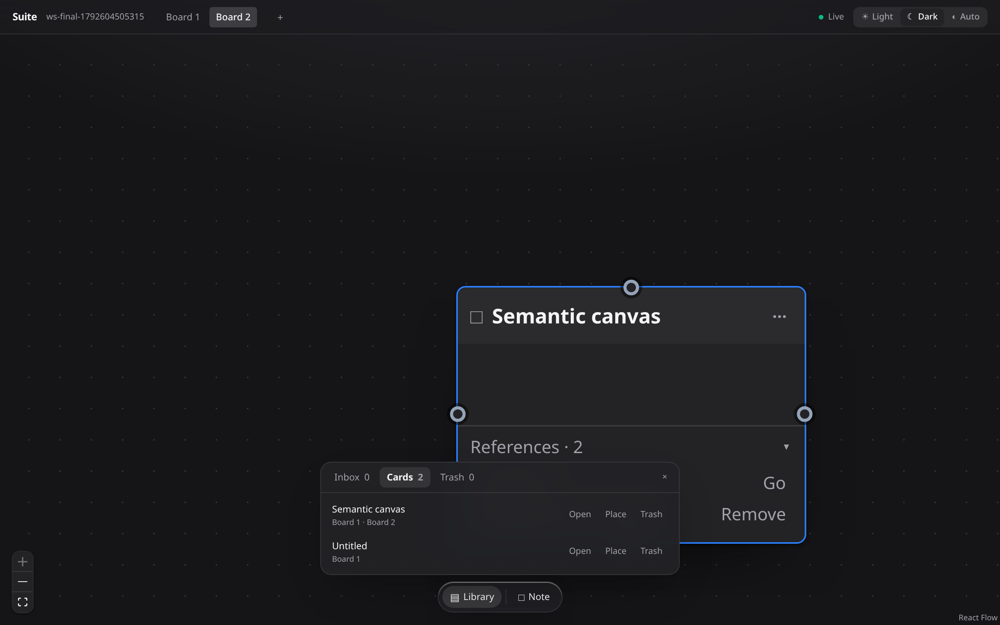

# Suite

A local-first, collaborative canvas for connected thinking. A **workspace** owns its **cards** and
the **boards** they appear on: cards are objects first (they can sit in the Inbox, or on several
boards at once), and boards are views. Edits sync live and the canvas keeps working offline.



## Quick start

```sh
pnpm install
pnpm dev          # canvas app (http://localhost:5173) + collab server (:1234)
```

The app opens on the **workspace launcher**: start a blank workspace, open a `.suite` backup, open a
`.suitekey` recovery key, or pick a recent workspace. Recent workspaces are local metadata only.

Open two browser windows at the same URL — including `?workspace=<any-id>` to work in a separate
workspace (`?doc=` still works as an alias) — and edits, carets, titles, and presence appear in
both. Board tabs in the app bar switch boards inside the same workspace.

The dock at the bottom of the canvas opens the **library**: cards taken off a board land in the
**Inbox**, the **Cards** tab lists everything in the workspace, and the **Trash** tab restores or
purges what you deleted. Clicking a card type creates a card on the current board.

## Commands

| Command | What it does |
| --- | --- |
| `pnpm dev` | Canvas app + Loro collab server |
| `pnpm storybook` | Component workshop on :6006 |
| `pnpm verify` | lint → typecheck → unit tests → build (what CI runs) |
| `pnpm lint` / `pnpm lint:fix` | Biome |
| `pnpm typecheck` | TypeScript across all packages |
| `pnpm test` | Vitest (graph + server + canvas) |
| `pnpm e2e` | Playwright (boots app + collab server) |
| `pnpm build` | Builds `@suite/graph` then the canvas app |
| `pnpm clean` | Removes build output and caches |

## Layout

```
apps/canvas          React 19 + Vite + Tailwind v4 app (React Flow canvas, Tiptap editors)
apps/collab-server   Loro WebSocket sync server
packages/graph       @suite/graph — Zod schema + typed Loro document layer
e2e                  Playwright tests
docs/                Architecture, conventions, ADRs
Dockerfile           Collab-server runtime and Caddy static-host targets
compose.yaml         Hosted and self-hosted deployment (app + caddy + volume)
deploy/              Caddyfile with TLS, proxying and security headers
```

## How it works

A single `LoroDoc` per workspace is the source of truth:

- `boards` — named boards in this workspace
- `cards` — workspace-level objects with one primary type, tags, typed properties, connectors and
  `deletedAt`; content lives independently of any board
- `types` / `tags` — type definitions with fields, and freeform workspace labels
- `placements` — where a card sits on a board (`x`, `y`, `z`, `createdAt`); one per card and board
- `sections` — board-scoped rectangles; a card's section is derived from geometry, never stored
- `edges` — described links drawn on a board, dormant while an endpoint is off it
- `references` — a derived index of mention targets, rebuilt from card content
- `content` / `titles` — per-card body and title rich text (Loro maps shaped by
  `loro-prosemirror`), edited with Tiptap

A card keeps its identity when it moves between boards; a mention, a `card` property or an arrow
is a reference, while only an explicit place action puts a card on a board.

`LoroIndexeddbPersistence` persists locally; the `loro-websocket` sync server flushes each room to
SQLite (`SUITE_DB`, default `apps/collab-server/suite.documents.sqlite`) so a workspace survives a
server restart. Share links are capability tokens kept in `SUITE_SHARES_DB` (default
`apps/collab-server/suite.shares.sqlite`) as SHA-256 hashes only; a join is authorized per room as
`read` or `write`. The projection worker presents `SUITE_PROJECTION_TOKEN` for projection rooms and
`SUITE_SOURCE_TOKEN` only for workspaces with an active editor share; both are generated at startup
when unset. Presence (`user`, `pointer`, `board`, `focus`, `dragging`, plus editor
carets) and the canvas gesture channel ride Loro `EphemeralStore`s; they are not persisted in the
document. All writes go through `WorkspaceDocument`, which validates with Zod. See
[docs/architecture.md](docs/architecture.md).

## Workspace files

`Share` opens one dialog for the workspace, the active board or the selected card. A workspace
editor token and every viewer or board/card link are capability tokens opened through `?share=`;
the owner link is the ordinary `?workspace=` URL plus the owner-key fragment, kept behind
`File → Recovery key…`. Board and card links read a live projection of that scope, never the
workspace index; a workspace viewer reads the real workspace room and can switch boards. Board and card editor links write a draft: owner saves pause while the
draft is dirty, `POST /api/shares/:token/publish` applies one conflict-checked commit to the
workspace, and `POST /api/shares/:token/reload` discards the draft. A publish may carry the
share document's version vector, so it waits for the editor's own edits to reach the share room
before it plans. A conflicting publish is resolved in one dialog: `overwrite` lists the fields
whose draft value wins, unlisted conflicts keep the workspace value, and `Publish` stays manual.
`GET /api/shares/:token/status` tells the editor whether the draft is still unpublished, which is
the single `Draft`/`Published` word beside Publish. Links are capabilities, not accounts or an ACL. Room writes require the credential
that matches the room: an owner key for a workspace, a share token for its share. Creating, listing
and revoking links additionally needs the workspace owner key, so a share token can never mint or
revoke another link.

`File → Export backup…` writes a versioned `.suite` file containing the exact Loro snapshot. Import
it from the launcher; it always opens as a **new** workspace and never merges into the open
document. `File → Export JSON…` and `Export Markdown…` are readable projections for other tools;
they are export-only, not import formats.

## Publishing

`pnpm build` produces a static site in `apps/canvas/dist` and the typed library in
`packages/graph/dist`. The build resolves `@suite/graph` from source in development
(`development` export condition) and from `dist` in production, so a clean checkout always
builds via `pnpm build` (Turbo builds the dependency first).

Deploy `apps/canvas/dist` to any static host. A production build derives its endpoints from the
page, so it needs no collab variables at all: HTTP calls go to `/api` on the page's origin and the
socket to `ws(s)://<page host>/ws`. Set `VITE_COLLAB_HTTP_URL` / `VITE_COLLAB_URL` only when the
API and socket live on another origin:

```sh
VITE_COLLAB_HTTP_URL=https://api.example.com VITE_COLLAB_URL=wss://collab.example.com pnpm build
```

## Deployment

The hosted instance and a self-hosted instance are the same artifact: one `Dockerfile`, one
`compose.yaml`, one domain. `docker compose up` runs the collab server in `app` and Caddy in
`caddy`; Caddy terminates TLS, serves the canvas, and proxies `/api/*` and `/ws` to the server, so
the browser only ever talks to one origin.

```sh
cp .env.example .env        # set SUITE_DOMAIN, optionally tokens
docker compose up -d --build
```

- **TLS is required.** Caddy obtains and renews a certificate for `SUITE_DOMAIN` and redirects
  HTTP to HTTPS. Collaboration needs `wss://`; a plain-HTTP deployment cannot sync.
- **Development vs production endpoints.** `pnpm dev` keeps the fixed ports
  (`http://localhost:1235` for the API, `ws://localhost:1234` for sync). A production build
  uses `/api` and `ws(s)://<host>/ws` on the page's origin unless `VITE_COLLAB_*` overrides it.
- **One instance only.** Documents live in SQLite (`SUITE_DB`, `SUITE_SHARES_DB`,
  `SUITE_WORKSPACES_DB`, all under `/data` in the container) and live rooms are in server
  memory. Do not scale `app` to multiple replicas; there is no shared room state.
- **Backups.** Stop `app` (or pause writes) and copy all three SQLite files **together** — share
  rows, owner hashes and documents reference each other, and restoring one without the others
  leaves links or owner keys orphaned. The files sit in the `suite-data` volume:

  ```sh
  docker compose stop app
  docker run --rm -v suite_suite-data:/data -v "$PWD/backups:/backup" alpine \
    tar czf /backup/suite-$(date +%F).tar.gz -C /data .
  docker compose start app
  ```

  Restore is the reverse: stop `app`, extract the archive into the volume, start `app`.
- **Health.** `GET /health` (proxied by Caddy, served by the API port) returns `{"ok":true}` and
  nothing else — counts, room state and database sizes live behind the admin API, not here. The
  compose healthcheck uses the same endpoint.
- **Backups.** `deploy/backup.sh` snapshots the three SQLite files with `.backup` (which drains an
  uncheckpointed WAL) and records integrity checks and counts. WAL is enabled, so never copy a live
  `*.sqlite` without its `-wal`/`-shm`; use the script or stop the app first. See
  [docs/operations.md](./docs/operations.md) for the restore procedure.

**AWS path.** One EC2 or Lightsail instance with Docker installed, an EBS volume for `/data`,
ports 80/443 open, and a DNS record pointing at the instance. Attach the EBS volume and point a
bind mount or a Docker volume at it so documents survive instance replacement. A load-balanced or
multi-AZ setup needs external state; it is deliberately out of scope.

**Self-host path.** The same compose file on any Docker host: copy the repository, set
`SUITE_DOMAIN`, and run `docker compose up -d --build`. Nothing else changes.


## Security

Suite has no accounts: access travels as bearer links. The relay stores documents in plaintext and
stores owner and share credentials only as SHA-256 hashes; there is no end-to-end encryption, no
attribution and no per-user ACL. TLS, disk encryption and coordinated backups are deployment
requirements, and the relay is a single SQLite-backed instance.

- [docs/security-model.md](docs/security-model.md) — capabilities, what the server can see,
  rotation/revocation, recovery and device hygiene, and deployment limits.
- Owner reset and workspace deletion are operator commands. Stop the server first, then use
  `pnpm --filter @suite/collab-server admin reset-owner <workspaceId> [--revoke-shares] --force`
  or `pnpm --filter @suite/collab-server admin delete <workspaceId> --force`.

## Docs

- [AGENTS.md](AGENTS.md) — repo map, rules, and workflow for AI agents
- [docs/architecture.md](docs/architecture.md) — data flow and layers
- [docs/conventions.md](docs/conventions.md) — coding standards
- [docs/decisions/](docs/decisions/) — architecture decision records
