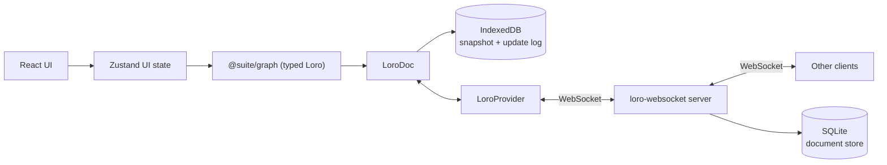

# Architecture

Suite is a **local-first, collaborative canvas**. The canvas is the primary surface; the data
is a **typed object graph** with semantic links, so it can later grow into a knowledge base
(Capacities-style).

Objects are workspace-level and views are boards: a **card** owns its content and exists whether or
not it is displayed, a **board** shows cards at a position, and the **library** is how you find
cards that are not on the board in front of you.

## Principles

1. **Local-first:** the app is fully usable offline; the network only accelerates sync.
2. **CRDT truth:** Loro owns the document state. The UI observes and mutates it, never the
   other way around.
3. **Typed boundary:** all graph writes are validated by Zod at the `@suite/graph` layer.

## Data flow

- **Zustand** holds ephemeral UI state: active board, selection, library drawer state,
  connection status. It never duplicates document data.
- **`@suite/graph`** exposes `WorkspaceDocument`, a typed wrapper over a `LoroDoc`. Boards, cards,
  placements and edges are nested `LoroMap`s; card text lives in `content`/`titles` maps shaped by
  `loro-prosemirror` in the same doc. Loro's typed containers (map, list, text, tree, counter,
  movable list) are available when the semantic model needs them.
- **`LoroIndexeddbPersistence`** stores a Loro snapshot plus an append-only update log locally, so
  the app rehydrates instantly and works offline.
- **`loro-websocket`** (provider + server) syncs the doc across peers over WebSocket, and the server
  flushes each room to SQLite (`apps/collab-server/src/persistence.ts`) so a workspace outlives the
  last connected client.

## Document model

One `LoroDoc` per workspace (room + IndexedDB key = workspace id). Boards are views inside that one
document, so moving a card between boards stays atomic. Card bodies are also in that document for
now; the target index/card-doc split is described in
[design-inspirations.md](./design-inspirations.md#7-collaboration-and-local-first-model).

| Map | Value |
| --- | --- |
| `boards` | `{ id, name, createdAt, updatedAt }` |
| `cards` | `LoroMap`, one key per field: `kind`, `createdAt`, `updatedAt`, `deletedAt`, `data`, `connectors` |
| `placements` | key `${boardId}/${cardId}` → `LoroMap`: `boardId`, `cardId`, `x`, `y`, `z`, `createdAt`, `width?`, `height?` |
| `edges` | `LoroMap`, one key per field: `boardId`, `source`, `target`, `sourceConnector?`, `targetConnector?`, `kind`, `path`, `bidirectional`, `label?` |
| `content` | card body rich text (`LoroMap` shaped by `loro-prosemirror`, keyed by card id) |
| `titles` | card title rich text (`LoroMap` shaped by `loro-prosemirror`, keyed by card id) |
| `meta` | `{ schemaVersion, seeded }` |

**Records are field maps, not values.** `WorkspaceDocument` materialises typed `Card`/`Placement`/
`GraphEdge` objects for reads, but stores each field as its own `LoroMap` key. A whole-record `set`
would make two clients editing different parts of one record resolve last-write-wins for everything
— one client moving a connector while another adds one silently dropped one of the two edits.
Field maps merge per key, so concurrent writers keep both. Mutations therefore route through
`mutateCard`/`mutateEdge` (single field writes), `updatePlacementPosition`/`updatePlacementSize`
(x/y and width/height only) and the connector sub-map (`connectors` is itself a `LoroMap` of maps).
`setCard`/`setEdge` remain as whole-record escape hatches for seeding and migration only.

Derived views keep the filtering in one place: `listBoardCards(boardId)` (placed, alive, back to
front), `listBoardEdges(boardId)` (both endpoints placed, alive, and still owning the connectors the
link names — a link whose connector was deleted cannot be drawn), `listInboxCards()` (alive with
no placement), `listTrashedCards()`, `listCardPlacements(cardId)`, `homeBoardId(cardId)` and
`displayTitle(cardId)` (title → body's first line → "Untitled").

**Home is derived**, not stored: the oldest placement is home. Placement `createdAt` is strictly
increasing per client, so creating two placements in the same millisecond cannot flip the home
board. Unplacing the home card promotes the next placement; with none left the card is in the Inbox.

**Trash is a tombstone.** `trashCard` sets `deletedAt` and keeps the placements, so a restore puts
the card back on every board it was on; `purgeCard` (and `emptyTrash`) destroy the card, its
placements, its text and every edge that referenced it.

**Links are board-scoped and dormant, not deleted.** An edge whose endpoint leaves the board (or is
trashed) stays in the CRDT and stops rendering, and revives when the card returns. Deleting a
connector does delete the links anchored to it, since nothing can re-attach them.

**Layer order is per board and fractional.** `moveLayer(boardId, cardId, action)` moves one card by
writing **one** rank: the midpoint between its new neighbours (or `last + 1` / `first - 1` at the
ends). Peers reordering other cards at the same moment keep their moves, because nothing renumbers
the stack. When neighbours converge below `MIN_RANK_GAP` (float precision), that board's placements
are renumbered once, in a single transaction. Sorting breaks ties by `createdAt` then `cardId`, so
concurrent moves that land on the same rank still order deterministically. Ranks are fractional, so
the canvas paints with the sorted index rather than the raw rank. Inbox cards never hold a rank.

**Reads never create shared containers.** `peekContent`/`peekTitle` return the existing Loro map or
`null`; only `createCard` and explicit writers create containers. A client that mounts before the
document has loaded must not initialize a competing container, or the real text is orphaned. The
card re-resolves its container ids on every document change, so it adopts the shared containers the
moment they arrive. Startup work (seeding, board resolution) waits for `ready`, which flips when
local storage hydrates.

**Card size belongs to the placement.** `width`/`height` are optional per placement, so a shared
card can be small on one board and large on another. A resize broadcasts `resizing { nodeId, width,
height }` at ~25 Hz; peers ease toward it (the same smoothing as card drags) and show the resizer's
colour ring, while the CRDT records only the final size on release.

**Title text is a Loro map shaped by `loro-prosemirror`.** A plain string would resolve concurrent
renames last-write-wins for the whole value; the ProseMirror tree stores text in `LoroText`, merges
character-wise, and lets the Loro cursor plugin draw carets in the title exactly as it does in the
body.

### Migration

The Loro document starts at the current schema; there is no production Yjs data to migrate.
`?doc=<id>` remains a URL alias for `?workspace=<id>`. Future schema changes follow the
additive-first rule: new fields are optional, and a migration is explicit and guarded by
`meta.schemaVersion`.

## Undo

Two histories, each scoped to what it owns:

- **Text** belongs to the editor. `LoroCollaboration` installs a `LoroUndoPlugin` with an
  `UndoManager` scoped to the editor's own commit origin (`text:title` or `text:body`), so `Cmd-Z`
  inside a card only walks that field's text (which is why `StarterKit`'s own history is disabled).
- **Structure** belongs to the document. `WorkspaceDocument` owns an `UndoManager` that excludes
  `text:`, `sys:init` and the Lite/import origins, covering moves, connectors, links, layers,
  place and trash/changes. The canvas handles `Cmd-Z` / `Cmd-Shift-Z` / `Ctrl-Y` when focus is not
  in an editor. `canUndo`/`canRedo` are exposed for affordances, and `stopCapturing()` starts a new
  entry.

Remote updates and local hydration carry non-local origins, so **undo can never revert a
collaborator's work**. Structural edits commit with a `struct:` origin; editor commits carry a
`text:` origin so the two stacks never capture each other.

## Session start

A client holds two copies of a workspace: the local IndexedDB one and the server's. Startup order
matters because acting on an empty document is indistinguishable from acting on a deleted workspace.

1. The document, presence stores and provider are created eagerly, so the Tiptap cursor plugins can
   bind to a stable `CursorEphemeralStore` on the first render.
2. `ready` flips when the IndexedDB snapshot and update log have been imported. Migration runs here,
   and again when `synced` flips.
3. `synced` flips when the workspace room join completes — or after `SYNC_WAIT_MS` (5 s) if the
   network is down, so an offline first run still works. `LoroAdaptor.waitForReachingServerVersion`
   is deliberately not used: it never resolves for a brand-new empty room.
4. Seeding and board resolution wait for **both**. Seeding an empty local doc before the server's
   snapshot arrives would resurrect starter cards in a workspace someone deliberately emptied.

`data-ready` on the app root reports the combined state, which is what the startup work keys off.

## Rendering

A CRDT change should repaint the card it touched, not the board.

- **Record identity is a cache.** `WorkspaceDocument` materialises a `Card`/`Placement`/`GraphEdge`
  once and hands out the same object until an observer sees one of that record's keys change
  (`invalidateOn`). A peer editing card A leaves card B's object identical.
- **The snapshot reuses collections.** `useWorkspaceSnapshot` keeps the previous `cards`,
  `placements`, `edges` and `boards` array whenever every element is still the same object, so the
  memoised board views re-run only for the collection that changed.
- **`?perf=1` shows render rates** from `dev/perf.ts` (dev builds only): counts for the shell,
  canvas, and each card, so a costly repaint is visible instead of guessed at.

## Connectors

Every note carries its own connectors, stored on the node (`connectors: { id, x, y }[]`, where
`x`/`y` are 0..1 fractions of the card's width/height). New notes start with four: the midpoints
of each side.

Interaction model:

- **Click a connector** to select it; a dashed circular grab handle appears, and the selection is
  published so peers see a dashed outline in their colour around the same connector.
- **Drag the grab handle** to reposition. Positions are free along the card perimeter, but the
  connector magnetizes to the nearest corner or side midpoint when released within ~20 px.
- Dragging the connector dot itself is reserved for creating connections.
- Right-click a connector for **Reposition Connector** and **Delete connector**.
- The node menu has **Add connector** (uses a free anchor) and a **Position** submenu
  (Bring Forward / Bring to Front / Send Back / Send to Back).

A drag publishes the connector's live perimeter fraction through presence (throttled to ~25 Hz,
with a trailing sample so the last position always lands). Peers ease their copy of the connector
toward it with the same per-frame smoothing used for cards and re-measure the node's handle, so
their links follow the dot while the drag is still in flight. The CRDT still records only the
final position on release.

Layering is a `z` integer per node; `moveNodeLayer` reindexes nodes in order (0 = furthest back),
and React Flow renders `zIndex: node.z`. React Flow elevates a *selected* node (z + 1000) in
`basic` mode, so a layer action clears the selection — otherwise the elevation would hide the new
order.

## Links

Edges connect **connectors**, not just nodes: `source`/`target` name the nodes and
`sourceConnector`/`targetConnector` name the handles. Connector dots are React Flow handles rendered
in `ConnectionMode.Loose`, so dragging from any connector to any other creates a link on drop.

Links are drawn in a layer above the cards (`.react-flow__edges` z-index 4 vs `.react-flow__nodes` 3),
so card stacking order cannot hide them.

`bidirectional` controls the arrowheads (`markerEnd` always, `markerStart` when bidirectional).
Right-clicking a link offers **Reverse direction** (swaps endpoints *and* their connectors),
**Make bidirectional** / **Make one-way**, a **Path** submenu (Curved / Straight / Step / Smooth
step, stored as `path` on the edge), and **Delete link**.

Links follow their connectors live: while a connector is being repositioned, `Connector` writes the
new position to local state and calls React Flow's `updateNodeInternals` once per animation frame,
so the edge re-routes before the drop instead of snapping afterwards.

Peers also see link drags as they happen. `onReconnectStart` publishes `reconnect`
(`edgeId`, moving `end`, pointer in flow coordinates), and `PeerReconnectLayer` draws the dragged
link as a dashed path in the peer's colour from the anchored connector to their pointer, using the
same path helper as the real edge. The shared edge is hidden for the duration, so only the preview
is visible until the drop rewrites it. React Flow reports the *anchored* handle from
`onReconnectStart`, so the moving end is the opposite one.

Arrowheads follow the finished link, not the gesture: dragging the target end puts the arrow on the
free end, dragging the source end keeps it on the anchored target, and a bidirectional link shows
both — so the preview never suggests a direction the drop will not produce.

Snapping is forwarded rather than reimplemented: while the drag is in flight the mover reads React
Flow's own `connection.toNode` / `toHandle` from the store (the same value that highlights the handle
under the pointer) and publishes it as `reconnect.target`. Peers then end their preview on that
connector instead of the raw pointer, meeting it perpendicular to its side, so both clients show the
drop the link would land on.

Dragging a **new** link out of a connector is the same story with no edge yet: `onConnectStart`
publishes `connect` (`nodeId`, `connectorId`, the `anchorEnd` the link will attach there, the pointer
in flow coordinates and React Flow's snapped `target`), the pointer is followed with the same
throttled + trailing sampler, and `onConnectEnd` clears the field. `PeerReconnectLayer` draws both
gestures with one dashed preview path, so peers see the new link grow from A's connector toward their
pointer and snap onto the connector the drop will use. The preview's arrowhead sits on the end the
dropped link will mark: the pointer end for a normal new link (the anchor is its source), or the
anchor when the gesture started from a `target` handle.

Either end of a link can be dragged onto another connector: hovering a link reveals React Flow's
reconnect handles (`edgesReconnectable` + `onReconnect`). React Flow keeps the anchored end intact,
so an unchanged `source`/`sourceHandle` means the *target* moved; `reconnectEdge` then rewrites only
that end and refuses to point a link at its own node.

While a connector is selected, the board adds `.connector-active`, which disables pointer events on
edges, their interaction strokes, and the reconnect handles. Without it the reconnect handle (a
10 px circle centred on the dot) swallows the drag that is meant to move the connector.

## Editing and presence

- **Editor:** each card mounts two Tiptap editors (`StarterKit` + `LoroCollaboration`) for its title
  and body. StarterKit's undo history is disabled because `LoroCollaboration` owns a scoped Loro
  undo stack.
- **Formatting toolbar:** Tiptap's built-in `BubbleMenu` (`@tiptap/react/menus`) handles
  positioning (Floating UI), show/hide on selection, and portalling. The buttons are plain
  markup inside it — Tiptap's documented pattern; there is no prebuilt button set in the library.
- **Presence:** one board `EphemeralStore` carries `user`, `board` (the board being viewed),
  `pointer` (canvas cursor), `focus` (card *and* editor field), `selection` (selected nodes,
  selected links *and* the clicked connector),
  `dragging` (node + live position), `connector` (`nodeId`, `connectorId` and the live fraction),
  `reconnect` (dragged link end + snap target) and `connect` (new-link drag: anchor card, anchor
  connector, anchor end, live pointer + snap target). A moving connector shows a peer ring and moves
  for everyone, a selected connector shows a dashed peer outline, and selected links render in the
  peer's colour. `selection` has a single publisher (`CanvasBoard`), so a connector click cannot be
  clobbered by a node or link selection clearing the same field.
  Pointer and drag positions are
  **flow coordinates**, so they stay aligned under pan/zoom; the overlay renders through React
  Flow's `ViewportPortal`. Remote carets come from `LoroEphemeralCursorPlugin`, filtered so a
  peer's caret only renders in the editor that owns its Loro container (all editors share one
  cursor store, and a card has both a title and a body editor). Focused-editor publishing keeps
  only one field's caret active at a time.
- **Gestures expire on their own.** A drag, resize, connector move or link drag (reconnecting an end
  or drawing a new one) that stops arriving
  without an end event (tab killed, network dropped) would leave a ghost on every peer until the
  ephemeral store timed the client out. `peerProjection.ts` stamps each peer's gesture signature with the
  time it last *changed* (on the receiving side, so clock skew does not matter) and drops the
  gesture after `GESTURE_TTL_MS` (3 s) of silence; a 1 s sweep re-projects presence so the ghost
  disappears even when no further update arrives. Selections and carets are state, not gestures, and
  are left alone.
- **Board scoping:** presence is workspace-wide because there is one document, so every board-scoped
  surface filters by `peer.board`. Carets stay card-scoped on purpose: two people editing the same
  card from different boards should see each other.
- **Workspaces:** the workspace id comes from `?workspace=<id>` (`?doc=` is a legacy alias,
  default `default-workspace`), used for both the IndexedDB key and the Loro sync room, so separate
  workspaces never share CRDT state. The active board rides in `?board=<id>`.

## Card chrome

Each card renders in-card chrome rather than React Flow's `NodeToolbar`, which counter-scales with
zoom (constant screen size) and only shows for the sole selected node.

- **Header:** card-type glyph (the future type picker), the collaborative title, presence avatars,
  and a `⋯` menu (Edit title/body, Remove from board, Go to board, Delete card). The title editor is
  a paragraph-only Tiptap editor on the card's `titles` fragment: Enter commits instead of adding a
  line, an empty title shows a muted "Untitled" placeholder, and remote carets render inside it.
  Clicking a non-editing title starts title editing; the body is edited on double-click.
- **Footer:** collapsed as `References · N`, expanding into a keyed section list. The first section
  is **References**: every placement of the card, home marked with `⌂`, the current board labelled,
  plus "Go" and "Remove" actions. The section list is generic so Backlinks or Tags can be added
  without touching the card again.

Both regions are `nodrag nopan` while interacting and are part of the measured node, so connectors
and links follow when the footer expands.

## Library (dock and drawer)

- **Dock** — a floating pill at the bottom centre: `Library` with the Inbox count, a separator, and
  the card-type registry. A type click creates that card at the viewport centre and focuses its
  title.
- **Drawer** — anchored above the dock, tabs `Inbox | Cards | Trash` with counts and empty states.
  Rows show `displayTitle` and board chips.
- **Place** centres the card in the viewport, staggered so repeated placements don't stack.
- **Hold to place** is a pointer gesture (not HTML5 drag and drop): a row lifts into a card ghost
  that follows the cursor; dropping over the canvas places the card centred on the drop point, and
  dropping anywhere else cancels. The pointer-down is prevented from selecting text across the board.
- **Trash** offers Restore and Delete forever, plus Empty trash; deleting a *board* asks first and
  offers keeping the cards (they fall into the Inbox) or trashing them.

## Layers

| Layer | Package | Responsibility |
| --- | --- | --- |
| UI | `apps/canvas` | React Flow board, Tiptap editor, panels |
| UI state | `apps/canvas` (Zustand) | Selection, tools, panels, connection status |
| Domain | `packages/graph` | Schema, types, typed CRDT access |
| Persistence | `LoroIndexeddbPersistence` | Offline-first local snapshot + update log |
| Sync | `loro-websocket` provider + server | Real-time collaboration |

## Drag tracking

Dragging a card broadcasts its live position at ~40 ms intervals (connectors and link ends use the
same throttle, plus a trailing sample so a pointer that stops moving still delivers its last
position). On the collaborator's side the
card eases toward that target each animation frame (`SMOOTHING = 0.22`), so motion reads as
continuous rather than stepping, and the card is visible the whole time. Position is persisted to
the CRDT only on drag stop.

## Theming

`light` / `dark` / `system` (auto) is stored in `localStorage` and applied as `.dark` on
`<html>` before first paint. Colors live in CSS variables (`--surface`, `--ink`, `--hairline`,
`--canvas-bg`, `--rf-dot`), and React Flow chrome is themed through those variables.

## Connection lifecycle

1. `useCanvasStore` constructs the `LoroDoc`, `WorkspaceDocument`, presence stores and provider
   once, and starts `LoroIndexeddbPersistence` immediately (offline-first).
2. `App` calls `connect()`, joining the workspace room through `LoroProvider` over WebSocket.
3. `status` reflects `connecting | connected | disconnected`; the UI stays functional in every
   state.
