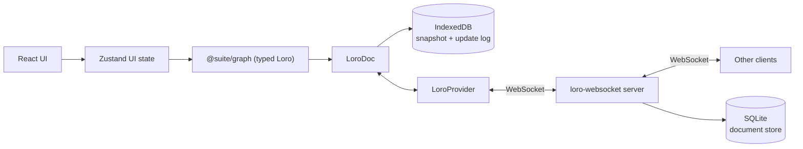

# Architecture

Suite is a **local-first, collaborative canvas**. The canvas is the primary surface; the data
is a **typed object graph** with semantic links, so it can later grow into a knowledge base
(Capacities-style).

Objects are workspace-level and views are boards: a **card** owns its content and exists whether or
not it is displayed, a **board** shows cards at a position, and the **library** is how you find
cards that are not on the board in front of you.

## Principles

1. **Local-first:** the app is fully usable offline; the network only accelerates sync.
2. **CRDT truth:** Loro owns the document state. The UI observes and mutates it, never the
   other way around.
3. **Typed boundary:** all graph writes are validated by Zod at the `@suite/graph` layer.

## Data flow



- **Zustand** holds ephemeral UI state: active board, selection, library drawer state,
  connection status. It never duplicates document data.
- **`@suite/graph`** exposes `WorkspaceDocument`, a typed wrapper over a `LoroDoc`. Boards, cards,
  placements, edges, types and tags are nested `LoroMap`s; card text lives in `content`/`titles`
  maps shaped by `loro-prosemirror` in the same doc. Loro's typed containers (map, list, text, tree,
  counter, movable list) are available when the semantic model needs them.
- **The workspace snapshot store** (`store/workspaceSnapshotStore.ts`) owns the single
  `WorkspaceDocument.observe` subscription. Hooks select an identity-stable slice
  (`useCard(id)`, `useCards()`, `useWorkspaceSnapshot()`), so a card re-renders only when its own
  record, or the node data the board derives from it, changed. Text containers are observed
  separately (`useCardContainers`, `useCardTitle`) so a keystroke never invalidates the graph.
- **`LoroIndexeddbPersistence`** stores a Loro snapshot plus an append-only update log locally, so
  the app rehydrates instantly and works offline.
- **`loro-websocket`** (provider + server) syncs the doc across peers over WebSocket, and the server
  flushes each room to SQLite (`apps/collab-server/src/persistence.ts`) so a workspace outlives the
  last connected client.

## Document model

One `LoroDoc` per workspace (room + IndexedDB key = workspace id). Boards are views inside that one
document, so moving a card between boards stays atomic. Card bodies are also in that document for
now; the target index/card-doc split is described in
[design-inspirations.md](./design-inspirations.md#7-collaboration-and-local-first-model).

| Map | Value |
| --- | --- |
| `boards` | `{ id, name, createdAt, updatedAt }` |
| `cards` | `LoroMap`, one key per field: `createdAt`, `updatedAt`, `deletedAt`, `connectors`, `primaryTypeId`, plus the nested `types`, `tags` and `properties` maps |
| `types` | `LoroMap`, one key per type: `id`, `name`, `pluralName?`, `glyph`, `color?`, `createdAt`, `updatedAt`, `fields` (a map of field definitions) |
| `tags` | `LoroMap`, one key per tag: `id`, `name`, `color?`, `createdAt` |
| `sections` | `LoroMap`, one key per field: `id`, `boardId`, `title`, `x`, `y`, `width`, `height`, `z`, `color?`, `createdAt`, `updatedAt` |
| `placements` | key `${boardId}/${cardId}` → `LoroMap`: `boardId`, `cardId`, `x`, `y`, `z`, `createdAt`, `width?`, `height?` |
| `edges` | `LoroMap`, one key per field: `boardId`, `source`, `target`, `sourceConnector?`, `targetConnector?`, `kind`, `path`, `bidirectional`, `label?` (the free-text description), `labelOffset?` (where along the path it sits, 0..1) |
| `references` | derived `LoroMap` per card: `targetCardId -> true`, rebuilt from mention nodes in the title and body |
| `content` | card body rich text (`LoroMap` shaped by `loro-prosemirror`, keyed by card id) |
| `titles` | card title rich text (`LoroMap` shaped by `loro-prosemirror`, keyed by card id) |
| `drawings` | whiteboard scenes ([ADR-0031](./decisions/0031-whiteboard-cards-and-loro-binding.md)), one key per whiteboard card: `elements` (a map of element id → element field map with per-element `deletedAt` tombstones), `order` (a movable list of element ids for z-order), `version`, `updatedAt` |
| `meta` | `{ schemaVersion, seeded }` (schema version 4 introduces spatial sections) |
| `views` | `LoroMap`, one key per saved view: `id`, `name`, `position`, plus a `query` sub-map: `text?`, `scope`, `groupBySection`, `order` and the `types`/`tags`/`sections` facet maps (`id -> true`). No card id is ever stored |
| `pins` | `LoroMap`, one key per field: `id`, `boardId`, `x`, `y`, `label`, `color`, `createdBy`, `createdAt`, plus an optional `target` sub-map (`kind`: `card`/`section`/`view`, `id`) |

**Records are field maps, not values.** `WorkspaceDocument` materialises typed `Card`/`Placement`/
`GraphEdge`/`CardType`/`Tag` objects for reads, but stores each field as its own `LoroMap` key. A
whole-record `set` would make two clients editing different parts of one record resolve
last-write-wins for everything — one client moving a connector while another adds one silently
dropped one of the two edits. Field maps merge per key, so concurrent writers keep both. Mutations
therefore route through `mutateCard`/`mutateEdge` (single field writes),
`updatePlacementPosition`/`updatePlacementSize` (x/y and width/height only), `movePlacements` for a
multi-card gesture (one commit for the whole set) and the connector
sub-map (`connectors` is itself a `LoroMap` of maps). `setCard`/`setEdge` remain as whole-record
escape hatches for seeding and migration only.

**Types, tags and properties follow the same rule.** A card's type membership is
`LoroMap<typeId, true>` plus a `primaryTypeId`; tags are `LoroMap<tagId, true>`; properties are one
key per field id. Adding two different types or tags concurrently merges, and two people editing
different properties of one card both keep their values. A `multiSelect` value is itself a
`LoroMap<optionId, true>`, so toggling different options does not clobber. Select values store the
option id, which makes renaming an option a single write. Writers validate the value against the
field definition owned by one of the card's types.

**Sections are geometry, not ownership.** `sections` stores a board-scoped rectangle, title and
colour; no card or placement stores a section id. A card belongs to the smallest section containing
its **header anchor** (`placement.x + 8`, `placement.y + 8`), with `z` and id as deterministic
tie-breaks. Nesting is derived by full containment. Dragging a section writes one
`moveSectionsBatch` commit containing the section, its contained sections and the x/y of every
member placement; nothing is written while the gesture runs. Dropping a card whose anchor is inside
a section but whose measured rectangle hangs outside expands that section and its ancestors, again
as geometry writes. Membership is recomputed on read, so no drag ever rewrites card state.

**Pins are bookmarks, not content.** `pins` stores a board-scoped point with a label (trimmed,
80 characters at most), a marker colour and the creator's actor id; an optional `target` names a
card, section or saved view and is a navigation action, not an anchor, so moving or deleting the
target leaves the marker where it was dropped. A pin creates no card, placement, section, reference
or board membership — `listPins` is the only surface that reads them. Writes are field-granular
(`createPin`, `updatePin`, `movePin`, `deletePin`, with `target` as its own mergeable sub-map), so a
rename and a drag of one pin converge; `observePins`/`pinsRevision` publish the change outside the
board snapshot stream, exactly as saved views do. The map is additive: a document written before
pins existed opens unchanged and gains the map on the first pin, with no schema bump, and a
hand-edited pin that fails `pinSchema` (or names a missing board) is skipped on read rather than
thrown on.

**Whiteboard scenes are element maps.** A `whiteboard` card keeps its Excalidraw scene under
`drawings.<cardId>`: one field map per element, a movable `order` list for z-order, and a
per-element `deletedAt` tombstone so a concurrent delete and an undo converge. `applyDrawing`
writes only changed fields, tombstones elements missing from a snapshot and lands the diff in one
commit; `setDrawing` remains the seed/import escape hatch. One Loro transaction covers a gesture,
Loro's undo is canonical, and Excalidraw's own history is scoped to the open whiteboard. The card
face is a cached SVG preview — a derived projection, not a second copy of the scene
([ADR-0031](./decisions/0031-whiteboard-cards-and-loro-binding.md)).

**Dormant values are intentional.** Removing a field from a type, switching a card's type or
removing a tag hides the stored value without deleting it; restoring the definition revives it.
Queries (`listCardsOfType`, `listCardsWithTag`) filter by existing records, so a deleted type or tag
simply stops matching. Type deletion is the one explicit bulk command: it reassigns affected cards
in a single commit and reports the count, and the built-in `note` type cannot be deleted.

**Saved views are queries, not results.** A view stores a name, a position and a query; a view's
results are recomputed on every read, exactly as section membership and references are. `runView`
in `views.ts` builds `{ cardIds, hits }` from the live cards, section geometry and search index, so
a body edit, a trashed card or a newly created card changes what a view shows without the view ever
being edited, and no card, trash or publish write touches `views`. Facets use the library's own
semantics (OR within a group, AND across groups, a section includes its subtree, board scope limits
to the active board); a facet id whose type, tag or section was deleted is dropped rather than
matched, so a view cannot strand itself on a filter the library no longer offers.

Derived views keep the filtering in one place: `listBoardCards(boardId)` (placed, alive, back to
front), `listBoardEdges(boardId)` (both endpoints placed, alive, and still owning the connectors the
link names — a link whose connector was deleted cannot be drawn), `listInboxCards()` (alive with
no placement), `listTrashedCards()`, `listCardPlacements(cardId)`, `homeBoardId(cardId)`,
`displayTitle(cardId)` (title → body's first line → "Untitled"), `viewCardFields(card)` (fields of
the card's types, primary first) and `listCardsOfType`/`listCardsWithTag` for retrieval.

**Home is derived**, not stored: the oldest placement is home. Placement `createdAt` is strictly
increasing per client, so creating two placements in the same millisecond cannot flip the home
board. Unplacing the home card promotes the next placement; with none left the card is in the Inbox.

**Sections always paint behind cards.** Each section is painted from a `SectionInstance`: a
background layer for the fill and border, and a header layer above the cards for the title chip,
member count and resize handles. Headers and handles counter-scale with zoom so titles stay usable.
In the current React Flow surface those layers are `ViewportPortal`s
([ADR-0017](./decisions/0017-spatial-sections.md)); a scene surface supplies them as instances, so a
section never becomes a selectable node with card selection, layer elevation or delete/trash
semantics. Deleting a section removes only the region; deleting its board removes its sections with
it.

**Trash is a tombstone.** `trashCard` sets `deletedAt` and keeps the placements, so a restore puts
the card back on every board it was on; `purgeCard` (and `emptyTrash`) destroy the card, its
placements, its text and every edge that referenced it.

**Links are board-scoped and dormant, not deleted.** An edge whose endpoint leaves the board (or is
trashed) stays in the CRDT and stops rendering, and revives when the card returns. Deleting a
connector does delete the links anchored to it, since nothing can re-attach them.

**Layer order is per board and fractional.** `moveLayer(boardId, cardId, action)` moves one card by
writing **one** rank: the midpoint between its new neighbours (or `last + 1` / `first - 1` at the
ends). Peers reordering other cards at the same moment keep their moves, because nothing renumbers
the stack. When neighbours converge below `MIN_RANK_GAP` (float precision), that board's placements
are renumbered once, in a single transaction. Sorting breaks ties by `createdAt` then `cardId`, so
concurrent moves that land on the same rank still order deterministically. Ranks are fractional, so
the canvas paints with the sorted index rather than the raw rank. Inbox cards never hold a rank.

**Reads never create shared containers.** `peekContent`/`peekTitle` return the existing Loro map or
`null`; only `createCard` and explicit writers create containers. A client that mounts before the
document has loaded must not initialize a competing container, or the real text is orphaned. The
card re-resolves its container ids on every document change, so it adopts the shared containers the
moment they arrive. Startup work (seeding, board resolution) waits for `ready`, which flips when
local storage hydrates.

**Card size belongs to the placement.** `width`/`height` are optional per placement, so a shared
card can be small on one board and large on another. A resize broadcasts `resizing { nodeId,
position, width, height }` at ~25 Hz; peers ease toward it (the same smoothing as card drags) and show
the resizer's colour ring. The corner is part of the gesture because React Flow moves the node when
the top or left edge is dragged: projecting only the size would anchor that edge on peers and mirror
the transformation. The CRDT records the final geometry on release, so the corner the resizer saw is
also what a reload reproduces.

**Title text is a Loro map shaped by `loro-prosemirror`.** A plain string would resolve concurrent
renames last-write-wins for the whole value; the ProseMirror tree stores text in `LoroText`, merges
character-wise, and lets the Loro cursor plugin draw carets in the title exactly as it does in the
body.

### Migration

The Loro document starts at the current schema; there is no production Yjs data to migrate.
`?doc=<id>` remains a URL alias for `?workspace=<id>`. Future schema changes follow the
additive-first rule: new fields are optional, and a migration is explicit and guarded by
`meta.schemaVersion`.

## Undo

Two histories, each scoped to what it owns:

- **Text** belongs to the editor. `LoroCollaboration` installs a `LoroUndoPlugin` with an
  `UndoManager` scoped to the editor's own commit origin (`text:title` or `text:body`), so `Cmd-Z`
  inside a card only walks that field's text (which is why `StarterKit`'s own history is disabled).
- **Structure** belongs to the document. `WorkspaceDocument` owns an `UndoManager` that excludes
  `text:`, `sys:init` and the Lite/import origins, covering moves, connectors, links, layers,
  place, trash/changes and section geometry. The canvas handles `Cmd-Z` / `Cmd-Shift-Z` / `Ctrl-Y`
  when focus is not in an editor. `canUndo`/`canRedo` are exposed for affordances, and `stopCapturing()` starts a new
  entry.

Remote updates and local hydration carry non-local origins, so **undo can never revert a
collaborator's work**. Structural edits commit with a `struct:` origin; editor commits carry a
`text:` origin so the two stacks never capture each other.

## Workspace launcher and files

The app starts at `/` on a **workspace launcher**. It lists recent workspaces from local metadata
(`localStorage`, never document truth), starts a new workspace (`?fresh=1`), and imports a
`.suite` backup. Opening a workspace navigates to the ordinary `?workspace=<id>` canvas.

Seeding happens once per document (`meta.seeded`). A workspace the launcher just created carries
`?fresh=1` and is seeded with the **example workspace**
(`apps/canvas/src/demo/seedExample.ts`): Atlas, Research and Sources, linked by portals (one at
depth two, one closing a cycle), with sections, tags, typed properties, an edge and an Excalidraw
scene, arranged by the shared fractal planner. Older workspaces and direct URLs keep the two
starter cards. `?blank=1` seeds no cards at all and is what count-sensitive tests use.

A workspace has a name of its own, stored in the document's `meta` map (`meta.name`) so it syncs
with the workspace and travels in a `.suite` export. That makes it document truth, not a launcher
preference. `WorkspaceDocument.workspaceName()` returns it, falling back to the first board's name
and then `"Untitled workspace"`, so a document from before workspace names existed never renders
blank; `renameWorkspace` trims and refuses empty, overlong (> 80 characters) or control-character
names with a readable reason. The launcher shows that name as a recents row's primary label, with
the board name and id as muted detail, and renames inline from the row's Rename action (no dialog).
A rename writes through to the cached document when this browser has one and to a local
`suite.workspaceNames.v1` mirror when the workspace is only a recent entry; that mirror also lets
the row read correctly before the document is opened, and such a local-only name is adopted into the
document the first time a cached copy exists. Each launcher mount re-reads the name from every
cached replica, so a rename made elsewhere shows up on the next visit rather than through a live
subscription from a screen that no longer has the workspace open.

A `.suite` backup is a versioned JSON envelope around `doc.export({ mode: "snapshot" })` with a
small manifest. Import validates the envelope, refuses a newer file/schema by name, creates a new
workspace id, writes the snapshot to that workspace's IndexedDB, and navigates. It never merges into
the open document. Portable JSON and Markdown exports are read-only projections of the same
document; only the exact backup is an import format. Sharing is link-based: a workspace editor
token opens the workspace through `?share=<token>`, the owner link is the ordinary workspace URL
plus its owner-key fragment, and `?share=<token>` also opens the real workspace for a workspace
viewer or a board/card projection — read-only for a viewer, and a publishable draft for an editor
([ADR-0022](./decisions/0022-share-projection-links.md)).
The capability boundaries, what the relay can read, and the operator reset/delete commands are
summarized in [security-model.md](./security-model.md).

A board or card editor starts from a projection of its share scope and publishes the diff back.
A board draft can also create content: cards, sections and edges on its shared board. A card draft
still edits only its one card. Creation stays within content — boards, card types, tags, trash and
links are not creatable from a draft. The publish preserves the
client UUID, rejects an id that already exists in the workspace, and requires a new card to be
placed on the shared board only. Publishing is all-or-nothing: an invalid or conflicting creation
keeps the draft and lists every rejected object in the “Can’t publish yet” dialog. Editing a
published object still resolves conflicts field by field.

A card body is published **block by block**, not as one field. Each top-level block of the body
(a direct child of the ProseMirror `doc`) gets its own conflict key,
`card:<cardId>:body:<blockKey>`, so two editors who touch different paragraphs of one card both
publish. A block's identity prefers its Loro container id; between two projections, which copy the
body into fresh containers and so share no ids, the fallback is the structural key — node name, a
hash of the block's subtree and the occurrence of that same content. The fallback never guesses: an
insert above shifts positions but not keys, an edit changes the hash, and a changed block is paired
with its baseline counterpart by position only when the leftover counts and node names agree on
both sides. A block the draft changed keeps the *baseline* block's
key, so the same paragraph changed on both sides lands on one key and conflicts, labelled with the
card name and the start of the block's text (“Launch plan · paragraph: …the deadline slipped…”).
Apply rewrites only the blocks that changed, in the same single `share:publish` commit, so a peer's
caret in an untouched block is not disturbed. When the blocks cannot be lined up — a reorder, or a
structure where no key means the same block — the card **degrades to one whole-body conflict**
instead of guessing which block moved where; that dialog entry still accepts the legacy
`card:<cardId>:body` key. A body of a single block keeps that legacy key and the whole-body write
exactly as before. See [ADR-0022](./decisions/0022-share-projection-links.md).

### Owner key

A workspace has a 32-byte base64url owner key, generated in the browser, kept in local storage and
the URL fragment (`#owner=<key>`), and stored on the server only as a SHA-256 hash
(`SUITE_WORKSPACES_DB`, default `suite.workspaces.sqlite`). `POST /api/workspaces/:id/claim`
registers the first key and reports a conflict for a different one. An online open claims the key
before the app boots; an offline open keeps working locally, and the next online open (not a
socket reconnect) claims it. Empty auth never writes a workspace room.

Recovery is a separate `.suitekey` JSON file — `{ kind: "suite.owner", version: 1, workspaceId,
ownerKey, exportedAt }` — saved from `File → Recovery key…`. It is never embedded in a `.suite`
backup, because that file is routinely copied, attached or shared. The protected screen accepts the
file (or its pasted contents), refuses a key from another workspace, and reloads with `#owner=` so
the app boots with it. The owner link stays the second recovery path: it carries the fragment, so
copying it is also copying the owner capability. `POST /api/workspaces/:id/rotate` takes
`{ newOwnerKey }` with the current key in `Authorization` and atomically replaces the stored hash;
old owner links and old `.suitekey` files then stop working. Rotation also offers to revoke every
share link, checked by default; share tokens work only if the owner unchecks it. Exporting a backup
offers the recovery file once, in a small prompt: the two files are deliberately
never bundled. Both backup paths — `File → Export backup…` and the launcher row's **Export**
— use the same offer, and only when this browser has an owner key it has never saved. The saved
flag records a download time, so the dialog says “Saved on this device” rather than implying the
file still exists. The launcher also accepts a `.suitekey` (**Open recovery key…**): it validates
the file, writes the key for the workspace it names and opens that workspace, never creating one. Share management requires
`Authorization: Bearer <ownerKey>`; a share token cannot list, create or revoke links.

## Session start

A client holds two copies of a workspace: the local IndexedDB one and the server's. Startup order
matters because acting on an empty document is indistinguishable from acting on a deleted workspace.

1. The document, presence stores and provider are created eagerly, so the Tiptap cursor plugins can
   bind to a stable `CursorEphemeralStore` on the first render.
2. `ready` flips when the IndexedDB snapshot and update log have been imported. Migration runs here,
   and again when `synced` flips.
3. `synced` flips when the workspace room join completes — or after `SYNC_WAIT_MS` (5 s) if the
   network is down, so an offline first run still works. `LoroAdaptor.waitForReachingServerVersion`
   is deliberately not used: it never resolves for a brand-new empty room.
4. Seeding and board resolution wait for **both**. Seeding an empty local doc before the server's
   snapshot arrives would resurrect starter cards in a workspace someone deliberately emptied.

`data-ready` on the app root reports the combined state, which is what the startup work keys off.

### Startup and hydration

The first editable frame waits for **local** hydration (`ready`), never for the first server sync
(`synced`). Until then the shell renders a small themed loading page — the logo, a progress bar and
the active theme — and does not mount the canvas, React Flow, ICE, Excalidraw or any Tiptap editor.
The loader is held for a short minimum and faded out, so a warm IndexedDB read does not flash. Remote
sync continues underneath and may flip `synced` after the canvas is already interactive.

Boot marks (`apps/canvas/src/dev/bootTiming.ts`, shown with `?perf=1`) separate the fixed floor from
document-size cost:

| Mark | Meaning |
| --- | --- |
| `hydrate` | IndexedDB open + snapshot/update import |
| `to-ready` | module load → first editable shell |
| `to-synced` | module load → first server sync |
| `to-canvas` | module load → first canvas mount |

Compare a cold hard reload, a warm in-session reload and a 5-card vs 500-card document separately.
Card count is a rendering/CRDT-application cost, not part of the startup floor.

The same principle applies inside the infinite canvas: a collapsed portal renders its impostor until
its effective zoom crosses the expansion gate; only visible subtrees are expanded; a whiteboard card
shows its cached SVG preview until the focus surface mounts Excalidraw. These are view concerns — the
Loro graph remains the truth, and an aborted expansion leaves the portal usable as a card.

## Rendering

The canvas target is a **derived scene over the graph**, rendered by a true infinite-canvas engine,
not a canvas whose document is the renderer's own node list
([ADR-0030](./decisions/0030-scene-projection-lod-and-real-portals.md),
[ADR-0034](./decisions/0034-ice-primary-rendering-engine.md)):

```text
Loro graph (@suite/graph)
  boards · cards · placements · sections · edges · drawings · views · pins
        │
        ▼
Scene projection (pure, engine-agnostic)
  board instances · transforms · effective zoom · LOD · portal gates · edges
        │
        ▼
ICE surface (WebGPU world, the target default)
  nested containers · spatial index · camera · input · GPU object faces
        │
        ├── suite.card: GPU paper + screen-space NodeCard overlay
        ├── suite.section / suite.edge / suite.pin: GPU face + DOM chrome
        ▼
Live `NodeCard` at full LOD + proxy layers (miniatures, icons, edges, sections, whiteboard previews)
```

[ADR-0034](./decisions/0034-ice-primary-rendering-engine.md) makes ICE the primary engine, and it is
now the **only** one: `@xyflow/react` and the React Flow surfaces are gone, `?canvas=` no longer
selects an engine (`?canvas=ice` is accepted and harmless), and the pure layer that survives is
`packages/scene` (`@suite/scene`) — the pure layout and geometry the canvas reads (fractal presets;
the parked type-graph module was removed under
[ADR-0040](./decisions/0040-the-type-graph-is-withdrawn.md)).
Interaction is described in
[ADR-0033](./decisions/0033-interactive-scene-surface.md); the ICE port is tracked in
[`docs/roadmap/ice-parity.md`](./roadmap/ice-parity.md) and the sections below record what is
implemented and where the parity gaps still are.

### Graph truth, derived scene

`@suite/graph` remains the only document truth. The scene is recomputed from a graph snapshot plus
the camera; it is never edited, persisted or synced. That keeps one document and one undo stack, and
it lets any engine host the same scene. The scene layer consumes graph types and plain values only —
no React, DOM, engine or Loro imports — so projection, camera math and layout are testable without a
renderer.

### The ICE host

ICE owns the world, spatial index, camera and pointer input. It does not own document truth.

- A board becomes a container; a portal becomes a nested board view of its target; a card becomes a
  placement inside that container. Multiple portals to one board are multiple instances of one
  canonical board ([ADR-0035](./decisions/0035-views-pins-and-portals.md)).
- A custom `suite.card` kind draws its paper body on the GPU and mounts the real `NodeCard` in a
  full-screen DOM overlay at `geometryOf(entity)`. The overlay is `pointer-events:none` until an
  explicit editor mode gives the card text focus; ICE keeps pan, zoom, selection and drag.
- Selection, drag, resize, create, delete, section and edge gestures report intent through one
  bridge. Live motion is ephemeral; pointer-up calls one `WorkspaceDocument` method per gesture.
  ICE's native history is disabled for document objects; Loro undo is the only user-visible history.
  The port mirrors ICE's `Selected` set into the shell selection, commits the final snapped box on
  pointer-up, and re-derives entities from canonical placements after undo.
- ICE's snap guides, equal-spacing bars, auto-alignment, `arrange`, `frameContent`, container
  entry/exit, lock and reorder stay. The bridge commits the final snapped ICE rect inverse-
  transformed into canonical board coordinates; it does not derive a position from the raw pointer
  delta or add a second alignment system.
- The Suite shell is unchanged: launcher, title bar, library, drawers, inspector, card menus,
  share dialogs, settings and theme remain Suite components. ICE is the canvas layer, not the shell;
  its tray/drawer/board chrome and HUD are development affordances.
- The DOM overlay is budgeted. It mounts full cards only at readable width (24 by default), hides
  and unmounts below the band, and no card has two mounted editors even when several portal
  instances show it.
- WebGPU is required. A browser without `navigator.gpu`, an adapter or a usable device gets a
  dedicated unsupported screen with diagnostics, not the React Flow canvas. Device loss stops
  drawing and offers recovery; it never writes partial state.


### Board instances

- The active board is the **root instance**. A portal adds a child `BoardInstance` rendered at
  `{ x, y, scale }` inside its frame, and the same board may appear in several instances at once.
- Canonical records project to instance types: `CardInstance`, `SectionInstance`, `EdgeInstance`,
  `PortalInstance`. `path: BoardId[]` identifies an instance and detects cycles.
- `effectiveScale = camera.zoom × product(ancestor scales)` drives LOD and expansion.
  `screenToBoard(instance, point)` and `boardToScreen(instance, point)` are the only coordinate
  conversions; a write inside an instance is inverse-transformed to canonical board coordinates.
- Instances are disposable identity. Two instances of one card are two renderings of one canonical
  card and placement: selection resolves by canonical id, and moving an instance moves the canonical
  placement, so every other instance updates.

### Real portals

- A portal card is a `PortalInstance` whose child board is fitted into the frame
  (`scale = min(frameW / boardBounds.w, frameH / boardBounds.h) × padding`).
- Below the expansion gate the portal renders its **impostor** — the existing `BoardMiniature` SVG —
  and instantiates nothing. Above the gate the target's cards, sections and edges are instantiated at
  the projected scale and are interactive: the same pointer handlers select, drag and resize inside
  a portal, and a drag is divided by the instance's board scale before it is committed.
- A card inside a portal moved by the scene writes the canonical placement at the
  inverse-transformed position. One gesture is one commit per board it touched; live positions stay
  ephemeral (see below).
- Starting a gesture inside a collapsed portal frame, or on an expanded portal's header, still means
  *enter*: the click focuses the child board through the camera path.

### Pointer interaction and commits

`SceneBoard` mounts an empty React Flow instance for the camera (`panOnDrag={[1, 2]}`,
`nodesDraggable`/`nodesConnectable`/`elementsSelectable`/`selectionOnDrag` off, no delete key) and
renders `SceneLayer` through `ViewportPortal`. Every card, section, edge and portal is DOM inside that
layer, positioned in page space from the projection; none of them is a React Flow node.

- `useSceneInteraction` converts the pointer with `screenToPage`, hit-tests the pure scene and runs
  one gesture at a time: card drag, section drag, resize, connector drag, marquee and edge press.
  Cards win the pick over the section that contains them.
- A press that moves less than 3 screen pixels is a click: click selects, shift-click toggles, an
  empty click clears and starts a marquee, a portal click enters its target and an edge click selects
  the link.
- Live geometry is an `overrides` map keyed by instance key. Nothing writes while the pointer moves.
- On release the hook commits once: `movePlacements` per board touched, `moveSectionsBatch` for a
  section with its contained cards and nested sections, `updatePlacementGeometry` or
  `updateSectionGeometry` for a resize, or one `addEdge` from a connector drop. A click, a
  sub-epsilon move, a cancelled pointer and a viewer's drag write nothing.
- The gesture is published while it runs, at the flow surface's cadence: pointer samples, the
  dragged canonical set with its board id, card and section resizes, section drags and the marquee
  box go through the same presence store, and the closed selection is written once. A viewer
  publishes selection and marquee but never a drag, and unmounting mid-gesture clears the samples.
- Resize handles, section chrome, connector handles and the marquee are painted by `SceneLayer`'s
  selection overlay, not by the cards; handles reach past the box edge so they win the pick over the
  body. An edge is redrawn thicker on top when selected, and its label stays readable.
- Connector handles come from the overlay and appear only for the single selected card, because
  `CardSurface` turns `NodeCard`'s own dots off. Dragging one onto another card on the same board
  commits one edge with the canonical anchors; the connector menu (reposition, delete) is therefore
  reachable only on the flow surface, and connectors stay invisible until a card is selected.
- Every write path is gated by the same capability flags the flow surface uses (`canEditLayout`,
  `canCreateContent`, `canManageStructure` and `readOnly`), so a share viewer selects, shift-selects
  and marquees but cannot drag, resize, create or connect.
- Escape clears selection, section and edge state. The focus path claims Escape first when there is a
  path to pop, so back-navigation never also clears the selection.

### Effective zoom, LOD bands and hysteresis

The target bands are discrete and screen-aware, because a card inside a scaled portal can have a
high effective scale but an unreadable footprint
([ADR-0036](./decisions/0036-fractal-lod-and-icon-graph.md)):

| Band | Condition | Card | Portal | Section | Edge |
| --- | --- | --- | --- | --- | --- |
| `full` | scale ≥ 0.75 **and** screen width ≥ 180 px | live `NodeCard` (Tiptap title/body) + whiteboard preview | live child board | fill + header (+ handles when selected) | full path + label |
| `compact` | scale 0.35–0.75, or full scale with a narrow footprint | static title + glyph + chips | live miniature | title chip | simplified path |
| `icon` | scale 0.12–0.35 | type glyph + layout badge | layout-encoded icon | colour band | hidden |
| `hidden` | culled by the viewport, at any zoom | none | aggregate proxy | none | none |

Downgrade immediately; upgrade only after the higher threshold is crossed and the state has held for
a dwell time (100 ms target). A card cannot change band again for 250 ms unless it leaves the
viewport. The resolved band is stored per instance and is never a continuous function recomputed per
frame. The selected/focused card and the card with the active editor are pinned one band higher until
the gesture ends.

- **Scene surface (reference):** DOM editors mount only at `full`; culling to the page-space viewport
  plus hysteresis bound mounted editors, live portal faces and visible nodes.
- **ICE surface (target):** the GPU face and the DOM card crossfade in place over 140 ms on upgrade
  and 120 ms on downgrade; only band-crossing cards animate. Camera motion paints GPU proxies only;
  after 80–120 ms of idle, one incremental mount pass resolves editors centre-out under a ~6 ms
  deadline and ~6-per-frame cap. The overlays are capped at 24 by default, prioritising the focused
  card, selection, viewport centre and z-order. A card with no budget keeps its static GPU face,
  never disappears.
- **Far zoom:** a spatial icon field — type glyphs at exact positions and footprints, container
  glyphs encoding layout mode — with no invented reference edges. Pins and selection chrome remain
  counter-scaled.
- **No graph projection.** The type-graph overlay was built, shipped and then withdrawn: it answered a
  question the inspector and the library already answered, at the cost of a second rendering of the
  same content ([ADR-0040](./decisions/0040-the-type-graph-is-withdrawn.md), which supersedes
  [ADR-0037](./decisions/0037-graph-projection-and-ambient-layer.md)). The zoom cluster's fourth control
  is **Types**, which opens the manage-types dialog. There is no zoom band and no ceiling. Every
  navigation is a flight whose duration grows with distance.
- **Evidence:** `?perf=1` render counters and a `buildScene` perf smoke exist. ICE frame time, GPU
  memory and mounted-editor count are not measured yet and are P0 gate evidence.


### The live card layer

`CardSurface` is the real `NodeCard` inside the box the layer positions: Tiptap title and body,
card menu, move targets, duplicate, trash, inspector and focus actions, and peer chips. It takes no
pointer or drag handlers on its wrapper and runs no effect that writes on mount, so mounting an
instance that just reached `full` is a pure render. A card whose text containers have
not arrived shows a neutral placeholder and adopts them when the observer reports one — mounting a
card never creates a container.

- **One editable surface per card, still.** `CardSurface` reads `editingSurface`; while the panel
  owns editing, the scene twin is read-only and does not publish carets. Starting editing from the
  scene sets `editingSurface: "canvas"` through the same store, so the existing rule holds.
- **Whiteboards** mount the cached preview and a double click opens the existing card focus surface;
  the drawing itself is written by `applyDrawing` there, never on the board.
- **Connectors live in the overlay.** The live card sets `showConnectors={false}`; `SceneLayer` draws
  the four side handles for the single selected card at scene scale, so they stay the same size at
  any zoom, and `useSceneInteraction` turns a handle drag into one `addEdge` on drop. Because those
  handles are the only dots, connectors are not visible or repositionable until the card is selected,
  and the connector menu is still a flow-surface action.

### Peer presence over the projection

`SceneBoard` reads `useBoardPeers(rootBoardId)` — presence is workspace-wide, so every board-scoped
surface filters by `peer.board` — and hands the result to `SceneLayer`; `scenePresence.ts` projects
each peer sample into page space, so presence pans and zooms with the camera and needs no second
layout. Page space is the root board's own coordinates — the root instance transform is the
identity — so the same samples mean the same thing on the flow surface.

- **Selection** is canonical: every visible instance the projection holds for the card gets the
  peer's ring, and a selected section gets the same treatment. A portal card is ringed by its frame.
- **Gestures in flight** become a dashed ghost at the peer's published geometry on every instance of
  the moved cards or section, reconstructed through the instance transform. One ghost per gesture
  carries the name tag, and a multi-card drag adds its count. When the card is mounted at `full`,
  `NodeCard` already labels the gesture from its own peer props, so the ghost stays a plain outline.
- **Pointers** are a dot per peer at the published page point. A dot over expanded portal content is
  clipped to that portal's frame; a dot over a collapsed target is dropped, so a share cannot reveal
  content the projection does not contain.
- Chips are counter-scaled with `--scene-chrome-scale`, the same variable the local selection chrome
  uses. Peer presence is not duplicated into the outline rail; the rail lists the scene, the surface
  shows who is where.

### Lazy expansion, cycles and depth

- Expansion is lazy: only subtrees the spatial index can show are considered, and only visible
  instances above the gate instantiate children. Expansion state is per instance and ephemeral.
- A cycle (`A → B → A`) stops at the repeated board path and renders a stub with a focus link; a hard
  depth cap (default 6) protects pathological graphs. Both are scene guards, not document
  constraints — the graph may contain the cycle ([ADR-0029](./decisions/0029-portal-board-field.md)).
- Icon collapse preserves position and footprint, and a portal icon encodes its child's layout mode,
  so the recursive arrangement stays legible at distance.

### Focus path and navigation

- The root View stays active; switching a View clears the focus path. “Board” is an internal data
  term, not product copy ([ADR-0035](./decisions/0035-views-pins-and-portals.md)).
- Entering a portal pushes a camera checkpoint and the instance path onto `focusPath`, then animates
  the camera to the child instance's bounds. There is no overlay, no board swap and no white flash.
- Escape or back pops the focus path and restores the exact camera checkpoint.
- The outline's arrow/Enter navigation focuses portal and board rows; the scene badge shows the
  focused path. A *reveal* request from the inspector or the board outline (`focusTarget`) is still
  consumed only by `CanvasBoard`, so "show on board" does not yet move the scene camera.
- `prefers-reduced-motion` skips camera flights and LOD transitions.

### Views, Pins and retrieval

- A **View** is a framing of a board: its content plus a camera and optional filter. Boards remain
  the internal containers; the top-bar switcher and library use “View”. Existing saved queries are
  surfaced as saved filters under the View they scope.
- A **Pin** is a spatial bookmark in the document: a board point, a label, an optional target and a
  creator. It is visible at every LOD, clips to its board instance, and never creates a card,
  reference or container. Pins are workspace-shared in v1.
- A **Portal** is a shared board view: one canonical board, many placements. Selection is canonical
  across every instance; a drag through one instance writes the canonical placement once.
- A **Section** is spatial grouping, not navigation. It may be a Pin target.
- Unplacing a card sends it to the Inbox and is non-destructive; deleting it is a Trash action. The
  old immediate unplace/delete prompt is retired once the library exposes both paths.


### Scene outline

The **scene outline** is a first-class derived tree: workspace → root board → portal instances →
target boards → nested portals, carrying the focus path, the per-instance LOD band, card counts and
expanded/collapsed state, plus actions to focus a board or enter a portal, expand/collapse a row and
go back. Rows are a `role="tree"` with arrow/Home/End/Enter navigation. It is a projection of the
same graph and scene, never a second document, and it is the accessibility path when the spatial
canvas is not legible.
Peer activity is painted on the surface itself (above), not in the rail.

### Context menus, shared

`useCanvasMenuItems` (`buildCanvasMenuItems`) is the single builder for the canvas, card, section,
edge and connector menus. It receives the menu context, the capability flags and every action as a
callback, and both `CanvasBoard` and `SceneBoard` call it, so creation, portal targets, fractal
arrangement, layer actions, share and trash cannot drift between surfaces. A viewer gets no menu, and
a capability that cannot complete an action removes it. The scene converts the right-click into a
board-space point for the hit instance before opening the menu; creation itself still targets the
root board.

### Surface routing, demo seed and cache reset

`canvasSurfaceFromSearch` (`apps/canvas/src/scene/surfaceFlag.ts`) returns `scene` unless the URL
asks for `flow` or `ice`, so a normal workspace and a share still open on the React Flow scene while
the ICE port is under the P0 gate. The scene badge shows board/card/portal counts, the focused path
and a link back to the ICE surface.

`?canvas=ice` mounts the ICE port tracked by
[`docs/roadmap/ice-parity.md`](./roadmap/ice-parity.md). The intended end state is ICE for every
normal workspace and share, with no user-facing React Flow fallback; a browser without WebGPU gets a
dedicated unsupported screen ([ADR-0034](./decisions/0034-ice-primary-rendering-engine.md)). The
headed launch, adapter HUD and gated check are in [docs/ice-spike.md](./ice-spike.md).


A workspace created from the launcher carries `?fresh=1` and is seeded once with
`seedExampleWorkspace`: three boards (Atlas, Research, Sources), fourteen cards, four portals
(depth two plus a cycle), four sections, tags, two typed properties, one labelled edge, one
whiteboard scene, arranged by the shared fractal planner. `?blank=1` seeds no cards for
count-sensitive tests, and an existing workspace keeps the two starter cards. The local IndexedDB
cache is `suite-loro-scene`; the previous `suite-loro` database is never opened again, and nothing
deletes it. Server rooms are untouched and re-sync on open.

### SceneSurface adapter

The seam is the pure `Scene` value plus the gesture contract: `SceneBoard` owns the camera,
LOD/gate state, focus path and pointer gestures; `SceneLayer` paints the frame from the scene,
`CardSurface` mounts the real card at `full`. This is the reference implementation while ICE
reaches parity. The target adapter is an ICE host that consumes the same projection, owns the
camera/spatial index/input, and mounts the same `NodeCard` through the `suite.card` overlay
([ADR-0034](./decisions/0034-ice-primary-rendering-engine.md)). LOD proxies, card faces and
interaction math are shared, so the engine change remains an adapter rather than a document
([ADR-0033](./decisions/0033-interactive-scene-surface.md)).


### The card layer

A CRDT change should repaint the card it touched, not the board.

- **Record identity is a cache.** `WorkspaceDocument` materialises a `Card`/`Placement`/`GraphEdge`
  once and hands out the same object until an observer sees one of that record's keys change
  (`invalidateOn`). A peer editing card A leaves card B's object identical.
- **The snapshot reuses collections.** `useWorkspaceSnapshot` keeps the previous `cards`,
  `placements`, `edges`, `boards`, `types`, `tags` and `sections` array whenever every element is
  still the same object, so the
  memoised board views re-run only for the collection that changed.
- **`?perf=1` shows render rates** from `dev/perf.ts` (dev builds only): counts for the shell,
  canvas, and each card, so a costly repaint is visible instead of guessed at.

## Connectors

Every note carries its own connectors, stored on the node (`connectors: { id, x, y }[]`, where
`x`/`y` are 0..1 fractions of the card's width/height). New notes start with four: the midpoints
of each side.

Interaction model:

- **Click a connector** to select it; a dashed circular grab handle appears, and the selection is
  published so peers see a dashed outline in their colour around the same connector.
- **Drag the grab handle** to reposition. Positions are free along the card perimeter, but the
  connector magnetizes to the nearest corner or side midpoint when released within ~20 px.
- Dragging the connector dot itself is reserved for creating connections.
- Right-click a connector for **Reposition Connector** and **Delete connector**.
- The node menu has **Add connector** (uses a free anchor) and a **Position** submenu
  (Bring Forward / Bring to Front / Send Back / Send to Back).

A drag publishes the connector's live perimeter fraction through presence (throttled to ~25 Hz,
with a trailing sample so the last position always lands). Peers ease their copy of the connector
toward it with the same per-frame smoothing used for cards and re-measure the node's handle, so
their links follow the dot while the drag is still in flight. The CRDT still records only the
final position on release.

Layering is a `z` integer per node; `moveNodeLayer` reindexes nodes in order (0 = furthest back),
and React Flow renders `zIndex: node.z`. React Flow elevates a *selected* node (z + 1000) in
`basic` mode, so a layer action clears the selection — otherwise the elevation would hide the new
order.

## Links

Edges connect **connectors**, not just nodes: `source`/`target` name the nodes and
`sourceConnector`/`targetConnector` name the handles. Connector dots are React Flow handles rendered
in `ConnectionMode.Loose`, so dragging from any connector to any other creates a link on drop.

Links are drawn in a layer above the cards (`.react-flow__edges` z-index 4 vs `.react-flow__nodes` 3),
so card stacking order cannot hide them.

`bidirectional` controls the arrowheads (`markerEnd` always, `markerStart` when bidirectional).
Right-clicking a link offers **Reverse direction** (swaps endpoints *and* their connectors),
**Make bidirectional** / **Make one-way**, a **Path** submenu (Curved / Straight / Step / Smooth
step, stored as `path` on the edge), and **Delete link**.

Links follow their connectors live: while a connector is being repositioned, `Connector` writes the
new position to local state and calls React Flow's `updateNodeInternals` once per animation frame,
so the edge re-routes before the drop instead of snapping afterwards.

Peers also see link drags as they happen. `onReconnectStart` publishes `reconnect`
(`edgeId`, moving `end`, pointer in flow coordinates), and `PeerReconnectLayer` draws the dragged
link as a dashed path in the peer's colour from the anchored connector to their pointer, using the
same path helper as the real edge. The shared edge is hidden for the duration, so only the preview
is visible until the drop rewrites it. React Flow reports the *anchored* handle from
`onReconnectStart`, so the moving end is the opposite one.

**The description sits on the line.** `labelOffset` places it as a fraction of the path (absent =
the midpoint), and the chip's canvas-coloured halo opens the gap in the stroke, so the link reads
as running into the label rather than behind a floating pill. Dragging the chip slides it along the
link: the pointer is projected onto the path (`nearestFractionOnPath`, sampled then refined in
`EdgeDescription.tsx`), and the position is published as `labelDrag` presence and written once on
release (`setEdgeLabelOffset`), so a slide never streams commits. Peers see the chip move in the
dragger's colour with their name on it, like every other gesture. The edge-label layer is raised to
`z-index: 5` because the app draws links above cards (4) and the chip has to be hit-testable.

Arrowheads follow the finished link, not the gesture: dragging the target end puts the arrow on the
free end, dragging the source end keeps it on the anchored target, and a bidirectional link shows
both — so the preview never suggests a direction the drop will not produce.

Snapping is forwarded rather than reimplemented: while the drag is in flight the mover reads React
Flow's own `connection.toNode` / `toHandle` from the store (the same value that highlights the handle
under the pointer) and publishes it as `reconnect.target`. Peers then end their preview on that
connector instead of the raw pointer, meeting it perpendicular to its side, so both clients show the
drop the link would land on.

Dragging a **new** link out of a connector is the same story with no edge yet: `onConnectStart`
publishes `connect` (`nodeId`, `connectorId`, the `anchorEnd` the link will attach there, the pointer
in flow coordinates and React Flow's snapped `target`), the pointer is followed with the same
throttled + trailing sampler, and `onConnectEnd` clears the field. `PeerReconnectLayer` draws both
gestures with one dashed preview path, so peers see the new link grow from A's connector toward their
pointer and snap onto the connector the drop will use. The preview's arrowhead sits on the end the
dropped link will mark: the pointer end for a normal new link (the anchor is its source), or the
anchor when the gesture started from a `target` handle.

Either end of a link can be dragged onto another connector: hovering a link reveals React Flow's
reconnect handles (`edgesReconnectable` + `onReconnect`). React Flow keeps the anchored end intact,
so an unchanged `source`/`sourceHandle` means the *target* moved; `reconnectEdge` then rewrites only
that end and refuses to point a link at its own node.

While a connector is selected, the board adds `.connector-active`, which disables pointer events on
edges, their interaction strokes, and the reconnect handles. Without it the reconnect handle (a
10 px circle centred on the dot) swallows the drag that is meant to move the connector.

## Editing and presence

- **Editor:** each card mounts two Tiptap editors (`StarterKit` + `LoroCollaboration`) for its title
  and body. StarterKit's undo history is disabled because `LoroCollaboration` owns a scoped Loro
  undo stack.
- **One editable surface per card per client.** The same card can be mounted on the canvas and in
  the inspector. `editingSurface` (`canvas | panel`) decides which one accepts keystrokes; the
  other stays read-only.
  `loro-prosemirror` ignores a local commit in every editor except its author, so a read-only twin
  re-reads the container through the sync plugin's own mapping when the owning surface writes
  (`useLocalMirrorSync`, coalesced per animation frame, dispatched as a non-local update so the
  cursor store is untouched). Only the owning surface receives the shared `cursorStore`; the twin
  gets `null`, so it cannot clear the caret the owning editor publishes. Peer carets are
  content-anchored, so a caret published from the panel still renders in the collaborator's canvas
  card. Undo remains per editor, exactly as it already is between title and body.
- **Inspector tabs:** the inspector splits the shared card surface into `Details` (type, tags,
  properties, links, Where) and `Content` (the body). A card whose body is still empty opens on
  Content, everything else opens on Details; Edit, a click on the body and a `@card.field` reveal
  move the inspector to the tab that request belongs to. The body gets its own surface — background,
  border and padding — so it reads as a destination instead of a section buried under the metadata.
- **Empty body:** the `Placeholder` extension from `@tiptap/extensions` decorates the empty
  paragraph with `Begin writing, or type / for commands.` in the canvas card and the inspector. It
  is a decoration only: it never writes to the CRDT and leaves collaborative carets untouched. A
  read-only share viewer keeps the empty body blank instead of inviting a write.
- **Formatting toolbar:** Tiptap's built-in `BubbleMenu` (`@tiptap/react/menus`) handles
  positioning (Floating UI), show/hide on selection, and portalling. The buttons are plain
  markup inside it — Tiptap's documented pattern; there is no prebuilt button set in the library.
- **Presence:** one board `EphemeralStore` carries `user`, `board` (the board being viewed),
  `pointer` (canvas cursor), `focus` (card *and* editor field), `selection` (selected nodes,
  selected links *and* the clicked connector),
  `dragging` (node + live position + the full dragged set), `connector` (`nodeId`, `connectorId`
  and the live fraction),
  `reconnect` (dragged link end + snap target) and `connect` (new-link drag: anchor card, anchor
  connector, anchor end, live pointer + snap target). A moving connector shows a peer ring and moves
  for everyone, a selected connector shows a dashed peer outline, and selected links render in the
  peer's colour. `selection` has a single publisher (`CanvasBoard`), so a connector click cannot be
  clobbered by a node or link selection clearing the same field.
  Pointer and drag positions are
  **flow coordinates**, so they stay aligned under pan/zoom; the overlay renders through React
  Flow's `ViewportPortal`. Remote carets come from `LoroEphemeralCursorPlugin`, filtered so a
  peer's caret only renders in the editor that owns its Loro container (all editors share one
  cursor store, and a card has both a title and a body editor). Focused-editor publishing keeps
  only one field's caret active at a time.
  While a peer edits text or has an in-flight card, connector or link gesture, their pointer arrow
  is hidden and their name moves onto the affected element; the arrow returns on their next pointer
  move. Selections alone keep the normal pointer.
- **Gestures expire on their own.** A drag, resize, connector move or link drag (reconnecting an end
  or drawing a new one) that stops arriving
  without an end event (tab killed, network dropped) would leave a ghost on every peer until the
  ephemeral store timed the client out. `peerProjection.ts` stamps each peer's gesture signature with the
  time it last *changed* (on the receiving side, so clock skew does not matter) and drops the
  gesture after `GESTURE_TTL_MS` (3 s) of silence; a 1 s sweep re-projects presence so the ghost
  disappears even when no further update arrives. Selections and carets are state, not gestures, and
  are left alone.
- **Reload identity:** presence and cursor stores are keyed by a `sessionStorage` tab id rather than the
  Loro document peer id. A refreshed tab overwrites its own presence instead of appearing as a
  second frozen collaborator. The presence room is ephemeral and is not replayed to late joiners.
- **Board scoping:** presence is workspace-wide because there is one document, so every board-scoped
  surface filters by `peer.board`. Carets stay card-scoped on purpose: two people editing the same
  card from different boards should see each other.
- **Workspaces:** the workspace id comes from `?workspace=<id>` (`?doc=` is a legacy alias,
  default `default-workspace`), used for both the IndexedDB key and the Loro sync room, so separate
  workspaces never share CRDT state. The active board rides in `?board=<id>`.
- **Multi-object gestures stay one payload.** A multi-card drag publishes its anchor position plus
  `nodeIds`; peers derive the other members from their stored placements plus the anchor delta,
  the same way a section drag is derived. Peer selection rings need no extra work because
  `selection.nodeIds` is already a list.
- **The selection gesture is visible.** A live marquee publishes `selectionBox` (flow coordinates,
  throttled like a drag); peers draw it in the dragger's colour with their name chip. Once the box
  closes and the group is dragged, the chip moves onto a dashed **group outline** derived from
  `dragging.nodeIds`, so it never sits on one card of a set that is moving together. Both expire
  with the gesture TTL.

## Orientation

Three read-only surfaces answer "where is this?", all derived and all free of document writes:

- **Focus primitive.** A surface asks the UI store (`focusCard`, `focusSection`) and the canvas
  consumes `focusTarget` (a nonce makes repeat requests re-run). A card target polls React Flow's
  node lookup while a board switch rebuilds the nodes, then moves the viewport with a capped zoom;
  a section target fits the stored rectangle. Nothing is persisted.
- **Board outline.** A collapsible left rail lists the active board's sections in reading order
  (`y`, then `x`, then id), nested by containment, with member counts from `sectionMembership` and
  peer dots from `selection.sectionId` / `sectionDrag`. Clicking a row selects the section and
  focuses it. The rail renders nothing on a board without sections.
- **Where block.** The shared card panel shows `Board › Section › Subsection` for the active board
  (via `sectionForCard` + `sectionLineage`) plus the other boards the card is placed on.

## References and backlinks

Links have two independent halves, and the app never conflates them
([ADR-0019](./decisions/0019-references-not-typed-links.md)):

- **A reference is workspace truth.** An `@` mention (an inline atom named `mention` with a
  `cardId` attribute) or a `card`-valued property. It exists with no board involved and never
  places anything.
- **An arrow is a drawing.** Board-scoped, untyped, with a free-text description (`edges.label`).
  Drawing one does not create a reference, and referencing does not draw.

**The reference index is derived.** `references.<fromCardId>` is maintained by `WorkspaceDocument`
from document changes: when a card's title or body container changes, the card is queued, and a
microtask re-parses its Loro tree for `mention` nodes and writes the target set in one commit with
origin `struct:index-refs`. The subscriber skips that origin (no recursion), writes only when the
set actually changed, and the workspace `UndoManager` excludes it, so the index never forms an undo
step. Every client maintains it, so it converges without coordination; `ensureReferences()` repairs
drift after the first sync and `rebuildReferences()` reconstructs everything from content. The index
is never authoritative and never mirrored onto a card.

**Links are read at render time** from three sources, so nothing is stored twice:
`incomingReferences` / `outgoingReferences` (mentions), `propertySources` and
`outgoingPropertyLinks` (cards whose `card` property points here or there, naming the field), and
`arrowSources` (edges touching the card, with their description, board and which end the card sits
on). `cardLinks` folds all of it into **Incoming** and **Outgoing** rows keyed by the *other card*:
one row per pair, provenance as markers (`✎` mention, `▤` property, `↗` arrow, `↔` both ways), and
an expander when a pair is joined more than once. Placement stays in `Where`, and the header count
(`referenceCount`) counts distinct partner cards, so both ends of a link report the same number.
`PropertyField` renders a `CardPicker` for the `card` kind; a value may dangle and shows "Unavailable
card" rather than being rewritten.

Mention chips subscribe to their target's title, so renames propagate and a trashed target degrades
to an unavailable chip. Snippets for backlink rows come from `mentionContext`, which walks the
source card's tree on demand — snippets are never indexed.

**Values render through a display template.** `fieldDefinition.display` is a template string
(`{{value}}`, `{{label}}`, `{{card}}`, `{{type}}` plus literal text, see
`packages/graph/src/template.ts`). It describes the *whole* rendering, `@` included, so nothing is
added behind the reader's back: a `{{value}}`-only style renders just the value. Absent means the
surface's default — a block says `{{label}} · {{value}}` (it already sits on the card), a chip says
`@{{card}} · {{value}}` (it is a reference from elsewhere, and a bare "Ada" would not say from
where). An explicit style wins on every surface. `ValueTemplate` is the one
place a template becomes pixels, so a chip, a body block and a future rollup cannot disagree about
what the same style means. Presentation only: it never changes the stored value, and label segments
stay muted so the value is still the part that carries ink. An empty value renders an em dash inside
the template rather than collapsing it, so `"Status: {{value}}"` never reads as a stray prefix. A
mention or a block can carry its own `display` attribute, which is how one instance differs from its
field without forking the schema.

**The body can carry views of index data.** `/` opens an insert menu over the existing nodes plus
`Mention` and `Property`, both of which hand over to the one `@` picker; the picker lists this
card's fields first (they insert a block), then cards (they insert a mention), and then a
`@card.field` reference once the query names one (or when ArrowRight/`.` steps into it). A `propertyBlock` is an inline atom holding only a
`fieldId`: it renders `card.properties[fieldId]` from the snapshot and writes through
`setProperty`/`clearProperty`, so deleting the block deletes a view and never the value. Scalar
kinds edit in place through a node view with `contenteditable={false}` and `stopEvent`, which keeps
ProseMirror from stealing keystrokes; `card` and `multiSelect` values are read-only chips that open
the panel, and the block's hover `×` deletes the node through the editor so peers see the same
removal as any other body edit. A `@card.field` chip is the same idea pointed the other way: it
stores `cardId` + `fieldId`, renders the live value, and opens that card's panel with the field
revealed and focused (`inspectorFieldId`), which is what makes a read-only chip as useful as an
inline editor. `WorkspaceDocument.appendPropertyBlock`/`removePropertyBlock` remain for callers
that are not the editor. Field definitions are never created from the editor — that keeps the two
undo scopes honest.

## Card chrome

Each card renders in-card chrome rather than React Flow's `NodeToolbar`, which counter-scales with
zoom (constant screen size) and only shows for the sole selected node.

- **Header:** card-type glyph (the future type picker), the collaborative title, presence avatars,
  and a `⋯` menu (Edit title/body, Remove from board, Go to board, Delete card). The title editor is
  a paragraph-only Tiptap editor on the card's `titles` fragment: Enter commits instead of adding a
  line, an empty title shows a muted "Untitled" placeholder, and remote carets render inside it.
  A click without movement opens card info. A double click on the title or body enters that field's editor; moving past the drag threshold still drags the card. While a field is focused, dragging from card chrome outside the editor still moves the card. The card's frontmatter starts collapsed behind a header disclosure; expanding it is local UI state.
- **Footer:** collapsed as `References · N`, expanding into a keyed section list. The first section
  is **References**: every placement of the card, home marked with `⌂`, the current board labelled,
  plus "Go" and "Remove" actions. The section list is generic so Backlinks or Tags can be added
  without touching the card again.

Both regions are `nodrag nopan` while interacting and are part of the measured node, so connectors
and links follow when the footer expands.

## Library (dock and drawer)

- **Dock** — a floating pill at the bottom centre: `Library` with the Inbox count, a separator, and
  the card-type registry. A type click creates that card at the viewport centre and focuses its
  title.
- **Drawer** — anchored above the dock, tabs `Inbox | Cards | Trash` with counts and empty states.
  Rows show `displayTitle` and board chips.
- **Scope** — the Cards tab offers `All | <board>`. Board scope filters rows to that board's
  placements, adds a **Sections** facet (a section includes its descendants, plus `Unsorted`), and
  offers **group by section**. Sections are never a global facet: a section title only means
  something inside one board's namespace. Scope, facet and grouping are UI state; membership stays
  derived from geometry.
- **Rows open the inspector** — a click on a row (a press that never becomes a hold-to-place drag)
  opens that card in the same inspector drawer the canvas uses; a row never expands into an editor
  of its own. The drawer widens only for board scope, where the section facet and grouping need the
  room.
- **Place** centres the card in the viewport, staggered so repeated placements don't stack. A row's
  `Open` action switches board and focuses the card through the focus primitive.
- **Hold to place** is a pointer gesture (not HTML5 drag and drop): a row lifts into a card ghost
  that follows the cursor; dropping over the canvas places the card centred on the drop point, and
  dropping anywhere else cancels. The pointer-down is prevented from selecting text across the board.
- **Trash** offers Restore and Delete forever, plus Empty trash; deleting a *board* asks first and
  offers keeping the cards (they fall into the Inbox) or trashing them.
- **Views** — `Views ▸` sits beside the board tabs and lists saved queries. A view is exactly what
  the drawer's own controls express, so opening one fills its search, facets, scope and grouping;
  the drawer shows the view's name (with an exit) so a filtered list is never mistaken for a
  hand-filtered one. Saving is `Save current search as view…` with an inline name; rename and delete
  live in the same menu, delete confirmed inline. `canManageSchema` gates saving, renaming and
  deleting: a view is workspace configuration, not content, so a board or card share editor — who
  holds `canEditContent` but must not publish configuration into the owner's workspace — never sees
  those actions, while still being able to open a view.

  **Target (ADR-0035):** the top-bar board switcher becomes the **Views** switcher; these saved
  queries are surfaced as **saved filters** under the View they scope. The data records do not
  change in the rename. Pins join Views in the library as spatial bookmarks.


## Layers

| Layer | Package | Responsibility |
| --- | --- | --- |
| UI | `apps/canvas` | Canvas shell and scene surfaces, Tiptap editors, panels |
| UI state | `apps/canvas` (Zustand) | Selection, tools, panels, connection status |
| Domain | `packages/graph` | Schema, types, typed CRDT access |
| Persistence | `LoroIndexeddbPersistence` | Offline-first local snapshot + update log in the `suite-loro-scene` database |
| Sync | `loro-websocket` provider + server | Real-time collaboration |

## Drag tracking

Dragging a card broadcasts its live position at ~40 ms intervals (connectors and link ends use the
same throttle, plus a trailing sample so a pointer that stops moving still delivers its last
position). On the collaborator's side the
card eases toward that target each animation frame (`SMOOTHING = 0.22`), so motion reads as
continuous rather than stepping, and the card is visible the whole time. Position is persisted to
the CRDT only on drag stop.

**Selection and multi-drag.** Shift, Ctrl and Cmd toggle membership; Shift-drag draws a partial
marquee; `Cmd/Ctrl+A` selects the board. Dragging a selected card moves the whole set: React Flow
reports every dragged node, the canvas keeps them in a local set so the snapshot projection does not
snap members back, and on release one `movePlacements` call writes all the geometry, followed by
`sectionsExpandPlan` → `moveSectionsBatch` for any section that has to grow. Undo is one step.

## Theming

`light` / `dark` / `system` (auto) is stored in `localStorage` and applied as `.dark` on
`<html>` before first paint. Colors live in CSS variables (`--surface`, `--ink`, `--hairline`,
`--canvas-bg`, `--rf-dot`), and React Flow chrome is themed through those variables.

## Connection lifecycle

1. `useCanvasStore` constructs the `LoroDoc`, `WorkspaceDocument`, presence stores and provider
   once, and starts `LoroIndexeddbPersistence` immediately (offline-first).
2. `App` calls `connect()`, joining the workspace room through `LoroProvider` over WebSocket.
3. `status` reflects `connecting | connected | disconnected`; the UI stays functional in every
   state.

## Share projections

A board or card share opens `share-<token>`, a room that holds a self-contained projection instead
of the workspace. `ProjectionWorker` keeps those rooms live: it joins every active board and card
share over the sync server with the internal token, holds one `LoroDoc` per room, and rebuilds a
workspace's shares after each save (debounced, one rebuild at a time per workspace). A rebuild calls
`projectWorkspace` on the saved workspace and `applyProjection` into the room document, which clears
and rewrites every projection root in a single commit; the room keeps one peer for its lifetime, so
each rebuild wins the LWW race against the previous one. A share whose card is missing or trashed
keeps its previous projection. Sharing a workspace creates its share row with a `room_id`: only the
token hash is stored, so the worker can name a projection room without ever seeing the token.
Creating a share rebuilds immediately and revoking one closes its room. Resolving a board or card
token reports the projection room as its `workspaceId`; the owner workspace id never reaches that
holder, so a board or card link cannot be exchanged for a workspace link.

A projection must carry whiteboard `drawings` for the cards in scope, and a portal must render a
live target only when that target board is part of the projection; anything else reads as
*Unavailable board* ([ADR-0022](./decisions/0022-share-projection-links.md),
[ADR-0030](./decisions/0030-scene-projection-lod-and-real-portals.md)). Redaction runs before the
scene is built, so a share never fetches owner-workspace content through a portal.

A reference row is emitted for every link that crosses the projection boundary, so the same card is
reported once even when several kinds point the same way. Building those rows walks the workspace
once — mention targets, `card`-valued properties and edge endpoints are indexed in a single pass —
because asking the per-card reference helpers for every copied card re-scanned every other card and
made a large board's rebuild quadratic. Rebuild cost is recorded in `docs/operations.md`.

### Selection shares

A **selection** share is the board projection filtered to an explicit set of card ids chosen when
the link is created. The set is fixed, so changing it means creating a new link. `projectWorkspace`
takes this scope beside `board` and `card`, and the projection keeps the real board id, name and
geometry: the viewer sees the same arrangement with the unshared cards missing. Section membership
is derived from card positions (`cardAnchor` and the smallest containing rectangle), so the filter
copies every section whose rectangle contains a selected card's anchor, plus that section's
ancestors; nothing is resized or moved, which keeps membership inside the share exactly the
selected subset. An edge is copied only when both endpoints are selected. `ShareDialog` caps a
selection at 200 card ids; the active-shares-per-workspace cap is unchanged.

### Room authorization

Every sync join carries an `auth` payload that `authorize(roomId, auth, deps)` maps to a
permission, in this order:

1. the projection worker token writes only `share-` projection rooms;
2. the source worker token writes only a workspace room that currently has an active editor share;
3. a share token opens exactly its share room, `read` for a viewer and `write` for an editor, and
   writes the derived `<room>:presence` / `<room>:cursors` rooms, which are ephemeral and scoped to
   the same share;
4. an owner key verifies its workspace and that workspace's derived presence/cursor rooms. A join
   never claims an unclaimed workspace; the explicit HTTP claim does that before the app boots, and
   a different key is refused;
5. an empty or mismatched credential is rejected. The workspace id alone is not a secret, and an
   owner key can never claim a `share-` projection room.

Share management (`GET/POST/DELETE /api/shares`) requires `Authorization: Bearer <ownerKey>` and
verifies it against the workspace registry; resolving a token stays public. The client sends the
same credential to the document, presence and cursor joins.

### Live revocation

Revoking a link closes the sessions that already hold it. `loro-websocket@0.6.2` keeps its socket
and room maps private, so `patches/loro-websocket@0.6.2.patch` records the auth credential used for
each joined room and adds `disconnectRoomWhere(roomId, predicate)` and `disconnectAuth(auth)`, both
covering the room's derived `:presence` / `:cursors` keys. The patch leaves client behavior alone;
an upstream API of the same shape can replace it. `apps/collab-server/src/roomSockets.ts` wraps it:
revoking a board or card link closes every session in `share-<token>` except the projection worker,
revoking a workspace link closes only share credentials that no longer resolve (the owner key, the
source worker and other active links stay), and rotating the owner key closes the sessions that
hold the previous key.

### Build profile: standalone and relay

`session/mode.ts` owns the deployment profile. `suiteMode()` reads
`VITE_SUITE_MODE` (default `relay`), and `bootPlan(mode, url)` is a pure function
of the profile and the page URL returning `{ resolveShare, claimOwner,
connectProvider, showSharing }`:

- **relay** — a `?share=` link resolves, an ordinary `?workspace=` link claims
  its owner key, the provider connects, and sharing renders.
- **standalone** — all four are false whatever the URL says. `?share=abc` in a
  local-only build resolves nothing and claims nothing: `main.tsx` renders a
  short "this build is local-only" notice instead of a fetch that could only
  fail as a network error.

The profile outranks the session, so it cannot be negotiated at runtime.
`sessionCapabilities` returns `STANDALONE_CAPABILITIES` before it looks at a
share: local editing, layout, creation, boards, schema and trash, but
`canManageLinks` and `canPublish` false. `main.tsx` boots a standalone session
with no `ownerKey` and no `share`, never calls `prepareOwnerSession`, and imports
the share client and the owner-key claim on demand only inside the relay branch
— the build-time check lets a standalone bundle drop that branch, so no `/api`
path or socket URL is compiled in.

`useCanvasStore` builds its provider at module load, and `LoroProvider` opens its
socket in the constructor, so a standalone build must not take that path at all:
`vite.config.ts` flips the store's existing no-transport switch
(`import.meta.env.MODE`, the one unit tests already use) for the standalone
profile. The cleaner follow-up is `isStandalone()` in the store's provider
condition, after which that define can go.

`App` skips `connect()` and presence binding in a standalone build, marks `synced`
itself (there is no first sync to wait 5 s for), and shows a small "Local only"
note in the status slot. `WorkspaceActions` splits link management from export:
`Share` and the recovery-key item are relay-only, while the `File` menu — export
backup/JSON/Markdown and back to the launcher — stays, and import remains on the
launcher. `session/mode.test.ts` guards this: a direct `fetch(`/`WebSocket`/
`collabHttpBase()` call may only live in a listed relay module, that module must
still be gated by the profile, and `main.tsx` may not statically import the share
client or the owner key.

### Opening a share link

`main.tsx` resolves `?share=<token>` through the share API before it imports `App`, then
`configureSession` records the room, role and read-only flag that `useCanvasStore` reads at module
load. `?workspace=` stays the synchronous default, so stories and unit tests boot the editor
unchanged.

- **Board and card viewer:** the session targets `share-<token>` only. `workspaceId`, the IndexedDB
  key and the provider room are that projection room, so a viewer never learns or loads the owner's
  workspace id. The token is the provider's `auth`.
- **Workspace viewer:** the session targets the real workspace room, so the viewer learns the
  workspace id but not the owner key. Empty auth no longer writes a workspace room, and share
  management requires the owner key, so the id alone neither writes nor mints links. Presence and
  cursor rooms are joined with the share token.
- **Read-only path:** `useUiStore.readOnly` closes every write surface — canvas drag/connect/delete
  and context menus, section gestures, the card menu and inline editors, panel type/tag/property
  edits, and the dock, library and share actions. Board tabs remain (workspace viewers may switch),
  without create/rename/delete. Presence and cursor rooms are joined with the same credential: the
  server scopes them to the share, so a viewer writes the ephemeral rooms while staying read-only
  on the document. A card share opens the inspector on its card once the projection has it.
- **Failure:** a revoked or unknown token renders `ShareUnavailable` ("This link is no longer
  available.") instead of the shell.

## Attachments

Images are **nodes that name bytes stored beside the document**, never bytes inside it.

- **Node.** A card body can hold an `attachment` inline atom with
  `{ id, mime, width, height, name, bytes }`: a 128-bit id, the image's type, its intrinsic size, its
  name (used as alt text) and its byte count. Nothing else. The same node name and attributes are
  allowlisted in `publishValidation.ts`, so a publish accepts it and `editorSchemaContract.test.ts`
  keeps the editor schema and the allowlist from drifting apart.
- **Why no bytes in the document.** A share projection copies the *document*. Bytes in a node would
  therefore put a private copy of every image in every share link and in every peer's CRDT state.
  With metadata only, a projection carries ids and a viewer fetches each image once from the relay.
  The export file is the deliberate exception, and it embeds the bytes *beside* the document rather
  than inside it — see **Export** below.
- **Storage.** `attachments.ts` owns the bytes: `put`/`get`/`delete`/`usage` over one SQLite table
  (`attachments`: id, workspace_id, mime, bytes, size, created_at) in the file named by
  `SUITE_ATTACHMENTS_DB`. The interface is the seam for object storage; a signed-read S3 backend is
  described there and not implemented — the disk store is the only one that ships.
- **HTTP.** `attachmentHttp.ts` serves `/api/attachments`: `POST /api/attachments/<workspaceId>`
  (owner key in `Authorization`, the same rule the claim path uses — a share token is never accepted),
  `GET /api/attachments/<id>` (the id *is* the read capability, so a projected node resolves for a
  viewer without exposing the workspace) and `DELETE /api/attachments/<id>` (owner key of the owning
  workspace, for GC).
- **What a GET may serve.** Only the allowlisted image types (PNG, JPEG, GIF, WebP, AVIF), always with
  `x-content-type-options: nosniff`, `content-disposition: inline`, immutable cache headers and
  `content-security-policy: default-src 'none'; sandbox`. An SVG is refused at upload *and* at read
  time: it is markup that can carry script, and the relay will not host markup. HTML is refused for
  the same reason.
- **Cap.** `attachmentBytesPerWorkspace` from `limits.ts` is enforced inside `put`, in the same write
  transaction that inserts the row, so two racing uploads cannot both slip under it. The refusal is
  readable and names the way out: what the workspace uses, what the cap is, and
  `SUITE_ATTACHMENT_BYTES_PER_WORKSPACE`. A hosted licence's `attachmentBytes` caps one image on top
  of that. A refused upload writes nothing and leaves the editor's paste as a local-only node rather
  than losing it.
- **Paste.** Images pasted from the clipboard become attachment nodes. With a relay configured the
  bytes are uploaded under the node's id; offline, in a standalone build, or from a share session
  (which holds no owner key) they are written to this browser's IndexedDB under that same id, and the
  card renders them from there. Such a node is **local-only**: a share viewer has no way to fetch
  those bytes until the image is uploaded under the same id, and sees the node's placeholder.
- **Stored is not the same as uploaded.** Bytes are local-first: a paste writes them to this browser
  first, and a failed relay upload leaves them in IndexedDB, so "I can see my image" never implies
  "my collaborator can". The record beside those bytes therefore carries the upload fact as well
  (`local`, `synced`, or `unknown` for records written before the flag existed, which must never be
  read as `local`). `attachmentUploadState(id)` is the one accessor over that fact; where it says
  `local`, the node view draws one quiet muted line under the image — not uploaded yet, and a
  collaborator sees a placeholder until it reaches the relay. The line is hidden in a standalone
  build (no relay by design, so nothing to fix) and never applies to a URL `image` node, which holds
  no bytes at all. Nothing retries an upload in the background today: a node stays `local` until a
  later upload under the same id succeeds and flips the record to `synced`.
- **Placeholder.** A node whose bytes are unreachable — offline viewer, GC'd row, a local-only node on
  another device — renders a placeholder with its name. Rendering never throws: it runs inside a
  replicated editor.
- **GC.** Nothing expires attachments on a timer; a timer would delete bytes while an editor still
  holds a paste in flight. `gcAttachments(workspaceId, referencedIds)` deletes every row of that
  workspace whose id the document no longer references. It is exported from `attachments.ts` for the
  operator (the admin HTTP surface has no route for it yet, so adding one would be a new admin
  module): call it after a document edit that removed images, passing the ids still present in card
  bodies. `DELETE /api/attachments/<id>` removes one row by hand.

- **Export.** A `.suite` backup is the only portability and backup mechanism this product has, so
  the file must be complete: `workspaceFile.ts` version 2 adds an `attachments` section holding
  `{ mime, name, width, height, data }` per id, where `data` is base64 of the exact bytes. The
  document still carries only the node's metadata; the bytes sit beside it in the envelope. Import
  restores each image into this browser's local store under the same id, so the card renders
  immediately, and deliberately does not upload it: like an offline paste, that copy is
  **local-only / not-yet-uploaded**, and a share viewer resolves the node only after the owning
  relay holds the bytes under that id. `attachmentBytes.ts` gathers the bytes with an injectable
  `AttachmentSource`: IndexedDB first (where a paste writes), then `GET /api/attachments/<id>`
  (where an upload writes). An image found nowhere is listed, named by its card's title, and the
  export still completes — silently dropping it is the data loss this format exists to prevent.
  Because the bytes travel with the file, a workspace full of screenshots produces a large
  `.suite`: above 25 MB (`BACKUP_SIZE_WARNING_BYTES`) the app states the real size before writing
  the file, then writes it anyway. Refusing to back up would be worse than a big backup.
