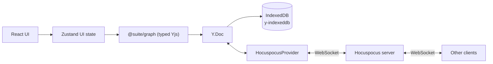

# Architecture

Suite is a **local-first, collaborative canvas**. The canvas is the primary surface; the data
is a **typed object graph** with semantic links, so it can later grow into a knowledge base
(Capacities-style).

Objects are workspace-level and views are boards: a **card** owns its content and exists whether or
not it is displayed, a **board** shows cards at a position, and the **library** is how you find
cards that are not on the board in front of you.

## Principles

1. **Local-first:** the app is fully usable offline; the network only accelerates sync.
2. **CRDT truth:** Yjs owns the document state. The UI observes and mutates it, never the
   other way around.
3. **Typed boundary:** all graph writes are validated by Zod at the `@suite/graph` layer.

## Data flow

- **Zustand** holds ephemeral UI state: active board, selection, library drawer state,
  connection status. It never duplicates document data.
- **`@suite/graph`** exposes `WorkspaceDocument`, a typed wrapper over a `Y.Doc`. Boards, cards,
  placements and edges are `Y.Map`s; card text lives in `content`/`titles` fragments in the same
  doc.
- **`y-indexeddb`** persists the whole doc locally so the app rehydrates instantly and works
  offline.
- **Hocuspocus** (provider + server) syncs the doc across peers over WebSocket.

## Document model

One `Y.Doc` per workspace (room + IndexedDB key = workspace id). Boards are views inside that one
document, so moving a card between boards stays atomic.

| Map | Shape |
| --- | --- |
| `boards` | `{ id, name, createdAt, updatedAt }` |
| `cards` | `{ id, kind, connectors, data, createdAt, updatedAt, deletedAt? }` |
| `placements` | key `${boardId}/${cardId}` → `{ boardId, cardId, x, y, z, createdAt }` |
| `edges` | `{ id, boardId, source, target, sourceConnector?, targetConnector?, kind, path, bidirectional, label? }` |
| `content` | card body rich text (`Y.XmlFragment`, keyed by card id) |
| `titles` | card title rich text (`Y.XmlFragment`, keyed by card id) |
| `meta` | `{ schemaVersion, seeded }` |

Derived views keep the filtering in one place: `listBoardCards(boardId)` (placed, alive, back to
front), `listBoardEdges(boardId)` (both endpoints placed and alive), `listInboxCards()` (alive with
no placement), `listTrashedCards()`, `listCardPlacements(cardId)`, `homeBoardId(cardId)` and
`displayTitle(cardId)` (title → body's first line → "Untitled").

**Home is derived**, not stored: the oldest placement is home. Placement `createdAt` is strictly
increasing per client, so creating two placements in the same millisecond cannot flip the home
board. Unplacing the home card promotes the next placement; with none left the card is in the Inbox.

**Trash is a tombstone.** `trashCard` sets `deletedAt` and keeps the placements, so a restore puts
the card back on every board it was on; `purgeCard` (and `emptyTrash`) destroy the card, its
placements, its text and every edge that referenced it.

**Links are board-scoped and dormant, not deleted.** An edge whose endpoint leaves the board (or is
trashed) stays in the CRDT and stops rendering, and revives when the card returns.

**Layer order is per board**: `moveLayer(boardId, cardId, action)` reindexes that board's placements
only, so Inbox cards never consume z slots.

**Title text is a fragment.** A `Y.Map` string would resolve concurrent renames last-write-wins for
the whole value; an `XmlFragment` merges character-wise and lets y-prosemirror draw carets in the
title exactly as it does in the body.

### Migration

Documents created before workspaces hold flat `nodes`/`edges` maps. `migrateLegacyDocument` (run
from the constructor, guarded by `meta.schemaVersion`) creates one default board, converts nodes to
cards plus placements (preserving `createdAt` so home is stable), backfills empty titles and stamps
`boardId` on edges. Deterministic ids make concurrent migrations converge; it is safe to run twice.

## Connectors

Every note carries its own connectors, stored on the node (`connectors: { id, x, y }[]`, where
`x`/`y` are 0..1 fractions of the card's width/height). New notes start with four: the midpoints
of each side.

Interaction model:

- **Click a connector** to select it; a dashed circular grab handle appears, and the selection is
  published so peers see a dashed outline in their colour around the same connector.
- **Drag the grab handle** to reposition. Positions are free along the card perimeter, but the
  connector magnetizes to the nearest corner or side midpoint when released within ~20 px.
- Dragging the connector dot itself is reserved for creating connections.
- Right-click a connector for **Reposition Connector** and **Delete connector**.
- The node menu has **Add connector** (uses a free anchor) and a **Position** submenu
  (Bring Forward / Bring to Front / Send Back / Send to Back).

A drag publishes the connector's live perimeter fraction through presence (throttled to ~25 Hz,
with a trailing sample so the last position always lands). Peers ease their copy of the connector
toward it with the same per-frame smoothing used for cards and re-measure the node's handle, so
their links follow the dot while the drag is still in flight. The CRDT still records only the
final position on release.

Layering is a `z` integer per node; `moveNodeLayer` reindexes nodes in order (0 = furthest back),
and React Flow renders `zIndex: node.z`. React Flow elevates a *selected* node (z + 1000) in
`basic` mode, so a layer action clears the selection — otherwise the elevation would hide the new
order.

## Links

Edges connect **connectors**, not just nodes: `source`/`target` name the nodes and
`sourceConnector`/`targetConnector` name the handles. Connector dots are React Flow handles rendered
in `ConnectionMode.Loose`, so dragging from any connector to any other creates a link on drop.

Links are drawn in a layer above the cards (`.react-flow__edges` z-index 4 vs `.react-flow__nodes` 3),
so card stacking order cannot hide them.

`bidirectional` controls the arrowheads (`markerEnd` always, `markerStart` when bidirectional).
Right-clicking a link offers **Reverse direction** (swaps endpoints *and* their connectors),
**Make bidirectional** / **Make one-way**, a **Path** submenu (Curved / Straight / Step / Smooth
step, stored as `path` on the edge), and **Delete link**.

Links follow their connectors live: while a connector is being repositioned, `Connector` writes the
new position to local state and calls React Flow's `updateNodeInternals` once per animation frame,
so the edge re-routes before the drop instead of snapping afterwards.

Peers also see link drags as they happen. `onReconnectStart` publishes `reconnect`
(`edgeId`, moving `end`, pointer in flow coordinates), and `PeerReconnectLayer` draws the dragged
link as a dashed path in the peer's colour from the anchored connector to their pointer, using the
same path helper as the real edge. The shared edge is hidden for the duration, so only the preview
is visible until the drop rewrites it. React Flow reports the *anchored* handle from
`onReconnectStart`, so the moving end is the opposite one.

Arrowheads follow the finished link, not the gesture: dragging the target end puts the arrow on the
free end, dragging the source end keeps it on the anchored target, and a bidirectional link shows
both — so the preview never suggests a direction the drop will not produce.

Snapping is forwarded rather than reimplemented: while the drag is in flight the mover reads React
Flow's own `connection.toNode` / `toHandle` from the store (the same value that highlights the handle
under the pointer) and publishes it as `reconnect.target`. Peers then end their preview on that
connector instead of the raw pointer, meeting it perpendicular to its side, so both clients show the
drop the link would land on.

Either end of a link can be dragged onto another connector: hovering a link reveals React Flow's
reconnect handles (`edgesReconnectable` + `onReconnect`). React Flow keeps the anchored end intact,
so an unchanged `source`/`sourceHandle` means the *target* moved; `reconnectEdge` then rewrites only
that end and refuses to point a link at its own node.

While a connector is selected, the board adds `.connector-active`, which disables pointer events on
edges, their interaction strokes, and the reconnect handles. Without it the reconnect handle (a
10 px circle centred on the dot) swallows the drag that is meant to move the connector.

## Editing and presence

- **Editor:** each card mounts a Tiptap editor (`StarterKit` + `Collaboration` +
  `CollaborationCursor`). StarterKit's undo history is disabled because Collaboration ships its
  own.
- **Formatting toolbar:** Tiptap's built-in `BubbleMenu` (`@tiptap/react/menus`) handles
  positioning (Floating UI), show/hide on selection, and portalling. The buttons are plain
  markup inside it — Tiptap's documented pattern; there is no prebuilt button set in the library.
- **Presence:** one awareness channel carries `user`, `board` (the board being viewed),
  `pointer` (canvas cursor), `focus` (card *and* editor field), `selection` (selected nodes,
  selected links *and* the clicked connector),
  `dragging` (node + live position), `connector` (`nodeId`, `connectorId` and the live fraction) and
  `reconnect` (dragged link end + snap target). A moving connector shows a peer ring and moves for
  everyone, a selected connector shows a dashed peer outline, and selected links render in the
  peer's colour. `selection` has a single publisher (`CanvasBoard`), so a connector click cannot be
  clobbered by a node or link selection clearing the same field.
  Pointer and drag positions are
  **flow coordinates**, so they stay aligned under pan/zoom; the overlay renders through React
  Flow's `ViewportPortal`. Remote carets come from `yCursorPlugin`, filtered so a peer's caret
  only renders in the card **and field** they have focused (all editors share one awareness, and a
  card has both a title and a body editor).
- **Board scoping:** presence is workspace-wide because there is one document, so every board-scoped
  surface filters by `peer.board`. Carets stay card-scoped on purpose: two people editing the same
  card from different boards should see each other.
- **Workspaces:** the workspace id comes from `?workspace=<id>` (`?doc=` is a legacy alias,
  default `default-workspace`), used for both the IndexedDB key and the Hocuspocus room, so separate
  workspaces never share CRDT state. The active board rides in `?board=<id>`.

## Card chrome

Each card renders in-card chrome rather than React Flow's `NodeToolbar`, which counter-scales with
zoom (constant screen size) and only shows for the sole selected node.

- **Header:** card-type glyph (the future type picker), the collaborative title, presence avatars,
  and a `⋯` menu (Edit title/body, Remove from board, Go to board, Delete card). The title editor is
  a paragraph-only Tiptap editor on the card's `titles` fragment: Enter commits instead of adding a
  line, an empty title shows a muted "Untitled" placeholder, and remote carets render inside it.
  Clicking a non-editing title starts title editing; the body is edited on double-click.
- **Footer:** collapsed as `References · N`, expanding into a keyed section list. The first section
  is **References**: every placement of the card, home marked with `⌂`, the current board labelled,
  plus "Go" and "Remove" actions. The section list is generic so Backlinks or Tags can be added
  without touching the card again.

Both regions are `nodrag nopan` while interacting and are part of the measured node, so connectors
and links follow when the footer expands.

## Library (dock and drawer)

- **Dock** — a floating pill at the bottom centre: `Library` with the Inbox count, a separator, and
  the card-type registry. A type click creates that card at the viewport centre and focuses its
  title.
- **Drawer** — anchored above the dock, tabs `Inbox | Cards | Trash` with counts and empty states.
  Rows show `displayTitle` and board chips.
- **Place** centres the card in the viewport, staggered so repeated placements don't stack.
- **Hold to place** is a pointer gesture (not HTML5 drag and drop): a row lifts into a card ghost
  that follows the cursor; dropping over the canvas places the card centred on the drop point, and
  dropping anywhere else cancels. The pointer-down is prevented from selecting text across the board.
- **Trash** offers Restore and Delete forever, plus Empty trash; deleting a *board* asks first and
  offers keeping the cards (they fall into the Inbox) or trashing them.

## Layers

| Layer | Package | Responsibility |
| --- | --- | --- |
| UI | `apps/canvas` | React Flow board, Tiptap editor, panels |
| UI state | `apps/canvas` (Zustand) | Selection, tools, panels, connection status |
| Domain | `packages/graph` | Schema, types, typed CRDT access |
| Persistence | `y-indexeddb` | Offline-first local storage |
| Sync | Hocuspocus provider + server | Real-time collaboration |

## Drag tracking

Dragging a card broadcasts its live position at ~40 ms intervals (connectors and link ends use the
same throttle, plus a trailing sample so a pointer that stops moving still delivers its last
position). On the collaborator's side the
card eases toward that target each animation frame (`SMOOTHING = 0.22`), so motion reads as
continuous rather than stepping, and the card is visible the whole time. Position is persisted to
the CRDT only on drag stop.

## Theming

`light` / `dark` / `system` (auto) is stored in `localStorage` and applied as `.dark` on
`<html>` before first paint. Colors live in CSS variables (`--surface`, `--ink`, `--hairline`,
`--canvas-bg`, `--rf-dot`), and React Flow chrome is themed through those variables.

## Connection lifecycle

1. `useCanvasStore` constructs the `Y.Doc` and `GraphDocument` once, and starts
   `IndexeddbPersistence` immediately (offline-first).
2. `App` calls `connect()`, creating a `HocuspocusProvider` that syncs over WebSocket.
3. `status` reflects `connecting | connected | disconnected`; the UI stays functional in every
   state.
