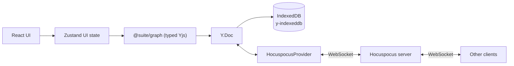

# Architecture

Suite is a **local-first, collaborative canvas**. The canvas is the primary surface; the data
is a **typed object graph** with semantic links, so it can later grow into a knowledge base
(Capacities-style).

## Principles

1. **Local-first:** the app is fully usable offline; the network only accelerates sync.
2. **CRDT truth:** Yjs owns the document state. The UI observes and mutates it, never the
   other way around.
3. **Typed boundary:** all graph writes are validated by Zod at the `@suite/graph` layer.

## Data flow

- **Zustand** holds ephemeral UI state: selection, active tool, panel visibility,
  connection status. It never duplicates document data.
- **`@suite/graph`** exposes `GraphDocument`, a typed wrapper over a `Y.Doc`. Nodes and edges
  are `Y.Map`s (`nodes`, `edges`); Tiptap content is a `Y.Text` (`prosemirror`) in the same doc.
- **`y-indexeddb`** persists the whole doc locally so the app rehydrates instantly and works
  offline.
- **Hocuspocus** (provider + server) syncs the doc across peers over WebSocket.

## Document model

| Yjs type | Key | Contents |
| --- | --- | --- |
| `Y.Map<GraphNode>` | `nodes` | Typed node entities (`note`) |
| `Y.Map<GraphEdge>` | `edges` | Typed semantic links (`references`, `relates-to`, `tagged`) |
| `Y.Map<Y.XmlFragment>` | `content` | Per-node rich-text, keyed by node id |

Every node is a Tiptap editor bound to its own `Y.XmlFragment` in `content`. Deleting a node
cascades to its edges and its content fragment.

## Object graph (semantic layer)

Nodes and edges form a graph, not a flat list. Node kinds are discriminated unions; edge kinds
carry semantic meaning (`references`, `relates-to`, `tagged`). The schema lives in
`packages/graph/src/schema.ts` and is the contract between the canvas, the editor, and future
search/semantic features.

## Connectors

Every note carries its own connectors, stored on the node (`connectors: { id, x, y }[]`, where
`x`/`y` are 0..1 fractions of the card's width/height). New notes start with four: the midpoints
of each side.

Interaction model:

- **Click a connector** to select it; a dashed circular grab handle appears.
- **Drag the grab handle** to reposition. Positions are free along the card perimeter, but the
  connector magnetizes to the nearest corner or side midpoint when released within ~20 px.
- Dragging the connector dot itself is reserved for creating connections (not implemented yet).
- Right-click a connector for **Reposition Connector** and **Delete connector**.
- The node menu has **Add connector** (uses a free anchor) and a **Position** submenu
  (Bring Forward / Bring to Front / Send Back / Send to Back).

Layering is a `z` integer per node; `moveNodeLayer` reindexes nodes in order (0 = furthest back),
and React Flow renders `zIndex: node.z`. React Flow elevates a *selected* node (z + 1000) in
`basic` mode, so a layer action clears the selection — otherwise the elevation would hide the new
order.

## Links

Edges connect **connectors**, not just nodes: `source`/`target` name the nodes and
`sourceConnector`/`targetConnector` name the handles. Connector dots are React Flow handles rendered
in `ConnectionMode.Loose`, so dragging from any connector to any other creates a link on drop.

Links are drawn in a layer above the cards (`.react-flow__edges` z-index 4 vs `.react-flow__nodes` 3),
so card stacking order cannot hide them.

`bidirectional` controls the arrowheads (`markerEnd` always, `markerStart` when bidirectional).
Right-clicking a link offers **Reverse direction** (swaps endpoints *and* their connectors),
**Make bidirectional** / **Make one-way**, and **Delete link**.

## Editing and presence

- **Editor:** each card mounts a Tiptap editor (`StarterKit` + `Collaboration` +
  `CollaborationCursor`). StarterKit's undo history is disabled because Collaboration ships its
  own.
- **Formatting toolbar:** Tiptap's built-in `BubbleMenu` (`@tiptap/react/menus`) handles
  positioning (Floating UI), show/hide on selection, and portalling. The buttons are plain
  markup inside it — Tiptap's documented pattern; there is no prebuilt button set in the library.
- **Presence:** one awareness channel carries `user`, `pointer` (canvas cursor), `focus`
  (editing node), `selection` (selected nodes) and `dragging` (node + live position).
  Pointer and drag positions are
  **flow coordinates**, so they stay aligned under pan/zoom; the overlay renders through React
  Flow's `ViewportPortal`. Remote carets come from `yCursorPlugin`, filtered so a peer's caret
  only renders in the card they have focused (all editors share one awareness).
- **Documents:** the document id comes from `?doc=<id>` (default `default-graph`), used for both
  the IndexedDB key and the Hocuspocus room, so separate documents never share CRDT state.

## Layers

| Layer | Package | Responsibility |
| --- | --- | --- |
| UI | `apps/canvas` | React Flow board, Tiptap editor, panels |
| UI state | `apps/canvas` (Zustand) | Selection, tools, panels, connection status |
| Domain | `packages/graph` | Schema, types, typed CRDT access |
| Persistence | `y-indexeddb` | Offline-first local storage |
| Sync | Hocuspocus provider + server | Real-time collaboration |

## Drag tracking

Dragging a card broadcasts its live position at ~40 ms intervals. On the collaborator's side the
card eases toward that target each animation frame (`SMOOTHING = 0.22`), so motion reads as
continuous rather than stepping, and the card is visible the whole time. Position is persisted to
the CRDT only on drag stop.

## Theming

`light` / `dark` / `system` (auto) is stored in `localStorage` and applied as `.dark` on
`<html>` before first paint. Colors live in CSS variables (`--surface`, `--ink`, `--hairline`,
`--canvas-bg`, `--rf-dot`), and React Flow chrome is themed through those variables.

## Connection lifecycle

1. `useCanvasStore` constructs the `Y.Doc` and `GraphDocument` once, and starts
   `IndexeddbPersistence` immediately (offline-first).
2. `App` calls `connect()`, creating a `HocuspocusProvider` that syncs over WebSocket.
3. `status` reflects `connecting | connected | disconnected`; the UI stays functional in every
   state.
