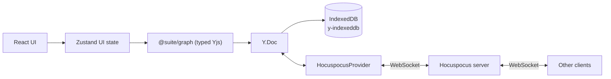

# Architecture

Suite is a **local-first, collaborative canvas**. The canvas is the primary surface; the data
is a **typed object graph** with semantic links, so it can later grow into a knowledge base
(Capacities-style).

## Principles

1. **Local-first:** the app is fully usable offline; the network only accelerates sync.
2. **CRDT truth:** Yjs owns the document state. The UI observes and mutates it, never the
   other way around.
3. **Typed boundary:** all graph writes are validated by Zod at the `@suite/graph` layer.

## Data flow

- **Zustand** holds ephemeral UI state: selection, active tool, panel visibility,
  connection status. It never duplicates document data.
- **`@suite/graph`** exposes `GraphDocument`, a typed wrapper over a `Y.Doc`. Nodes and edges
  are `Y.Map`s (`nodes`, `edges`); Tiptap content is a `Y.Text` (`prosemirror`) in the same doc.
- **`y-indexeddb`** persists the whole doc locally so the app rehydrates instantly and works
  offline.
- **Hocuspocus** (provider + server) syncs the doc across peers over WebSocket.

## Document model

| Yjs type | Key | Contents |
| --- | --- | --- |
| `Y.Map<GraphNode>` | `nodes` | Typed node entities (`note`) |
| `Y.Map<GraphEdge>` | `edges` | Typed semantic links (`references`, `relates-to`, `tagged`) |
| `Y.Map<Y.XmlFragment>` | `content` | Per-node rich-text, keyed by node id |

Every node is a Tiptap editor bound to its own `Y.XmlFragment` in `content`. Deleting a node
cascades to its edges and its content fragment.

## Object graph (semantic layer)

Nodes and edges form a graph, not a flat list. Node kinds are discriminated unions; edge kinds
carry semantic meaning (`references`, `relates-to`, `tagged`). The schema lives in
`packages/graph/src/schema.ts` and is the contract between the canvas, the editor, and future
search/semantic features.

## Editing and presence

- **Editor:** each card mounts a Tiptap editor (`StarterKit` + `Collaboration` +
  `CollaborationCursor`). StarterKit's undo history is disabled because Collaboration ships its
  own.
- **Formatting toolbar:** Tiptap's built-in `BubbleMenu` (`@tiptap/react/menus`) handles
  positioning (Floating UI), show/hide on selection, and portalling. The buttons are plain
  markup inside it — Tiptap's documented pattern; there is no prebuilt button set in the library.
- **Presence:** one awareness channel carries `user`, `pointer` (canvas cursor) and `focus`
  (focused node). Editor carets/selections ride the same awareness via `yCursorPlugin`, on a
  separate `editorSelection` field.
- **Documents:** the document id comes from `?doc=<id>` (default `default-graph`), used for both
  the IndexedDB key and the Hocuspocus room, so separate documents never share CRDT state.

## Layers

| Layer | Package | Responsibility |
| --- | --- | --- |
| UI | `apps/canvas` | React Flow board, Tiptap editor, panels |
| UI state | `apps/canvas` (Zustand) | Selection, tools, panels, connection status |
| Domain | `packages/graph` | Schema, types, typed CRDT access |
| Persistence | `y-indexeddb` | Offline-first local storage |
| Sync | Hocuspocus provider + server | Real-time collaboration |

## Connection lifecycle

1. `useCanvasStore` constructs the `Y.Doc` and `GraphDocument` once, and starts
   `IndexeddbPersistence` immediately (offline-first).
2. `App` calls `connect()`, creating a `HocuspocusProvider` that syncs over WebSocket.
3. `status` reflects `connecting | connected | disconnected`; the UI stays functional in every
   state.
