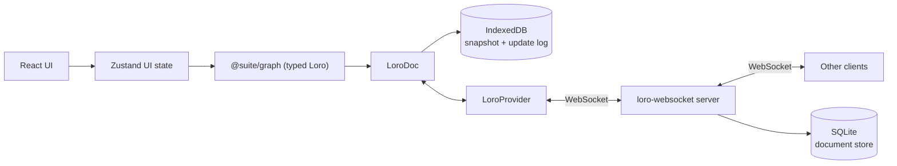

# Architecture

Suite is a **local-first, collaborative canvas**. The canvas is the primary surface; the data
is a **typed object graph** with semantic links, so it can later grow into a knowledge base
(Capacities-style).

Objects are workspace-level and views are boards: a **card** owns its content and exists whether or
not it is displayed, a **board** shows cards at a position, and the **library** is how you find
cards that are not on the board in front of you.

## Principles

1. **Local-first:** the app is fully usable offline; the network only accelerates sync.
2. **CRDT truth:** Loro owns the document state. The UI observes and mutates it, never the
   other way around.
3. **Typed boundary:** all graph writes are validated by Zod at the `@suite/graph` layer.

## Data flow

- **Zustand** holds ephemeral UI state: active board, selection, library drawer state,
  connection status. It never duplicates document data.
- **`@suite/graph`** exposes `WorkspaceDocument`, a typed wrapper over a `LoroDoc`. Boards, cards,
  placements, edges, types and tags are nested `LoroMap`s; card text lives in `content`/`titles`
  maps shaped by `loro-prosemirror` in the same doc. Loro's typed containers (map, list, text, tree,
  counter, movable list) are available when the semantic model needs them.
- **The workspace snapshot store** (`store/workspaceSnapshotStore.ts`) owns the single
  `WorkspaceDocument.observe` subscription. Hooks select an identity-stable slice
  (`useCard(id)`, `useCards()`, `useWorkspaceSnapshot()`), so a card re-renders only when its own
  record, or the node data the board derives from it, changed. Text containers are observed
  separately (`useCardContainers`, `useCardTitle`) so a keystroke never invalidates the graph.
- **`LoroIndexeddbPersistence`** stores a Loro snapshot plus an append-only update log locally, so
  the app rehydrates instantly and works offline.
- **`loro-websocket`** (provider + server) syncs the doc across peers over WebSocket, and the server
  flushes each room to SQLite (`apps/collab-server/src/persistence.ts`) so a workspace outlives the
  last connected client.

## Document model

One `LoroDoc` per workspace (room + IndexedDB key = workspace id). Boards are views inside that one
document, so moving a card between boards stays atomic. Card bodies are also in that document for
now; the target index/card-doc split is described in
[design-inspirations.md](./design-inspirations.md#7-collaboration-and-local-first-model).

| Map | Value |
| --- | --- |
| `boards` | `{ id, name, createdAt, updatedAt }` |
| `cards` | `LoroMap`, one key per field: `createdAt`, `updatedAt`, `deletedAt`, `connectors`, `primaryTypeId`, plus the nested `types`, `tags` and `properties` maps |
| `types` | `LoroMap`, one key per type: `id`, `name`, `pluralName?`, `glyph`, `color?`, `createdAt`, `updatedAt`, `fields` (a map of field definitions) |
| `tags` | `LoroMap`, one key per tag: `id`, `name`, `color?`, `createdAt` |
| `sections` | `LoroMap`, one key per field: `id`, `boardId`, `title`, `x`, `y`, `width`, `height`, `z`, `color?`, `createdAt`, `updatedAt` |
| `placements` | key `${boardId}/${cardId}` → `LoroMap`: `boardId`, `cardId`, `x`, `y`, `z`, `createdAt`, `width?`, `height?` |
| `edges` | `LoroMap`, one key per field: `boardId`, `source`, `target`, `sourceConnector?`, `targetConnector?`, `kind`, `path`, `bidirectional`, `label?` (the free-text description), `labelOffset?` (where along the path it sits, 0..1) |
| `references` | derived `LoroMap` per card: `targetCardId -> true`, rebuilt from mention nodes in the title and body |
| `content` | card body rich text (`LoroMap` shaped by `loro-prosemirror`, keyed by card id) |
| `titles` | card title rich text (`LoroMap` shaped by `loro-prosemirror`, keyed by card id) |
| `meta` | `{ schemaVersion, seeded }` (schema version 4 introduces spatial sections) |

**Records are field maps, not values.** `WorkspaceDocument` materialises typed `Card`/`Placement`/
`GraphEdge`/`CardType`/`Tag` objects for reads, but stores each field as its own `LoroMap` key. A
whole-record `set` would make two clients editing different parts of one record resolve
last-write-wins for everything — one client moving a connector while another adds one silently
dropped one of the two edits. Field maps merge per key, so concurrent writers keep both. Mutations
therefore route through `mutateCard`/`mutateEdge` (single field writes),
`updatePlacementPosition`/`updatePlacementSize` (x/y and width/height only), `movePlacements` for a
multi-card gesture (one commit for the whole set) and the connector
sub-map (`connectors` is itself a `LoroMap` of maps). `setCard`/`setEdge` remain as whole-record
escape hatches for seeding and migration only.

**Types, tags and properties follow the same rule.** A card's type membership is
`LoroMap<typeId, true>` plus a `primaryTypeId`; tags are `LoroMap<tagId, true>`; properties are one
key per field id. Adding two different types or tags concurrently merges, and two people editing
different properties of one card both keep their values. A `multiSelect` value is itself a
`LoroMap<optionId, true>`, so toggling different options does not clobber. Select values store the
option id, which makes renaming an option a single write. Writers validate the value against the
field definition owned by one of the card's types.

**Sections are geometry, not ownership.** `sections` stores a board-scoped rectangle, title and
colour; no card or placement stores a section id. A card belongs to the smallest section containing
its **header anchor** (`placement.x + 8`, `placement.y + 8`), with `z` and id as deterministic
tie-breaks. Nesting is derived by full containment. Dragging a section writes one
`moveSectionsBatch` commit containing the section, its contained sections and the x/y of every
member placement; nothing is written while the gesture runs. Dropping a card whose anchor is inside
a section but whose measured rectangle hangs outside expands that section and its ancestors, again
as geometry writes. Membership is recomputed on read, so no drag ever rewrites card state.

**Dormant values are intentional.** Removing a field from a type, switching a card's type or
removing a tag hides the stored value without deleting it; restoring the definition revives it.
Queries (`listCardsOfType`, `listCardsWithTag`) filter by existing records, so a deleted type or tag
simply stops matching. Type deletion is the one explicit bulk command: it reassigns affected cards
in a single commit and reports the count, and the built-in `note` type cannot be deleted.

Derived views keep the filtering in one place: `listBoardCards(boardId)` (placed, alive, back to
front), `listBoardEdges(boardId)` (both endpoints placed, alive, and still owning the connectors the
link names — a link whose connector was deleted cannot be drawn), `listInboxCards()` (alive with
no placement), `listTrashedCards()`, `listCardPlacements(cardId)`, `homeBoardId(cardId)`,
`displayTitle(cardId)` (title → body's first line → "Untitled"), `viewCardFields(card)` (fields of
the card's types, primary first) and `listCardsOfType`/`listCardsWithTag` for retrieval.

**Home is derived**, not stored: the oldest placement is home. Placement `createdAt` is strictly
increasing per client, so creating two placements in the same millisecond cannot flip the home
board. Unplacing the home card promotes the next placement; with none left the card is in the Inbox.

**Sections always paint behind cards.** The canvas renders sections through two React Flow
`ViewportPortal`s: a background portal with a negative z-index for the fill and border, and a header
portal above the nodes for the title chip, member count and resize handles. Headers and handles
counter-scale with zoom so titles stay usable. This keeps sections out of React Flow's node
selection, layer elevation and `onlyRenderVisibleElements` machinery, which is card-specific.
Deleting a section removes only the region; deleting its board removes its sections with it.

**Trash is a tombstone.** `trashCard` sets `deletedAt` and keeps the placements, so a restore puts
the card back on every board it was on; `purgeCard` (and `emptyTrash`) destroy the card, its
placements, its text and every edge that referenced it.

**Links are board-scoped and dormant, not deleted.** An edge whose endpoint leaves the board (or is
trashed) stays in the CRDT and stops rendering, and revives when the card returns. Deleting a
connector does delete the links anchored to it, since nothing can re-attach them.

**Layer order is per board and fractional.** `moveLayer(boardId, cardId, action)` moves one card by
writing **one** rank: the midpoint between its new neighbours (or `last + 1` / `first - 1` at the
ends). Peers reordering other cards at the same moment keep their moves, because nothing renumbers
the stack. When neighbours converge below `MIN_RANK_GAP` (float precision), that board's placements
are renumbered once, in a single transaction. Sorting breaks ties by `createdAt` then `cardId`, so
concurrent moves that land on the same rank still order deterministically. Ranks are fractional, so
the canvas paints with the sorted index rather than the raw rank. Inbox cards never hold a rank.

**Reads never create shared containers.** `peekContent`/`peekTitle` return the existing Loro map or
`null`; only `createCard` and explicit writers create containers. A client that mounts before the
document has loaded must not initialize a competing container, or the real text is orphaned. The
card re-resolves its container ids on every document change, so it adopts the shared containers the
moment they arrive. Startup work (seeding, board resolution) waits for `ready`, which flips when
local storage hydrates.

**Card size belongs to the placement.** `width`/`height` are optional per placement, so a shared
card can be small on one board and large on another. A resize broadcasts `resizing { nodeId,
position, width, height }` at ~25 Hz; peers ease toward it (the same smoothing as card drags) and show
the resizer's colour ring. The corner is part of the gesture because React Flow moves the node when
the top or left edge is dragged: projecting only the size would anchor that edge on peers and mirror
the transformation. The CRDT records the final geometry on release, so the corner the resizer saw is
also what a reload reproduces.

**Title text is a Loro map shaped by `loro-prosemirror`.** A plain string would resolve concurrent
renames last-write-wins for the whole value; the ProseMirror tree stores text in `LoroText`, merges
character-wise, and lets the Loro cursor plugin draw carets in the title exactly as it does in the
body.

### Migration

The Loro document starts at the current schema; there is no production Yjs data to migrate.
`?doc=<id>` remains a URL alias for `?workspace=<id>`. Future schema changes follow the
additive-first rule: new fields are optional, and a migration is explicit and guarded by
`meta.schemaVersion`.

## Undo

Two histories, each scoped to what it owns:

- **Text** belongs to the editor. `LoroCollaboration` installs a `LoroUndoPlugin` with an
  `UndoManager` scoped to the editor's own commit origin (`text:title` or `text:body`), so `Cmd-Z`
  inside a card only walks that field's text (which is why `StarterKit`'s own history is disabled).
- **Structure** belongs to the document. `WorkspaceDocument` owns an `UndoManager` that excludes
  `text:`, `sys:init` and the Lite/import origins, covering moves, connectors, links, layers,
  place, trash/changes and section geometry. The canvas handles `Cmd-Z` / `Cmd-Shift-Z` / `Ctrl-Y`
  when focus is not in an editor. `canUndo`/`canRedo` are exposed for affordances, and `stopCapturing()` starts a new
  entry.

Remote updates and local hydration carry non-local origins, so **undo can never revert a
collaborator's work**. Structural edits commit with a `struct:` origin; editor commits carry a
`text:` origin so the two stacks never capture each other.

## Workspace launcher and files

The app starts at `/` on a **workspace launcher**. It lists recent workspaces from local metadata
(`localStorage`, never document truth), starts a blank workspace (`?fresh=1`), and imports a
`.suite` backup. Opening a workspace navigates to the ordinary `?workspace=<id>` canvas.

A `.suite` backup is a versioned JSON envelope around `doc.export({ mode: "snapshot" })` with a
small manifest. Import validates the envelope, refuses a newer file/schema by name, creates a new
workspace id, writes the snapshot to that workspace's IndexedDB, and navigates. It never merges into
the open document. Portable JSON and Markdown exports are read-only projections of the same
document; only the exact backup is an import format. Sharing is link-based: a workspace editor link
is the ordinary workspace URL plus its owner-key fragment, while `?share=<token>` opens the real
workspace for a workspace viewer or a board/card projection — read-only for a viewer, and a
publishable draft for an editor ([ADR-0022](./decisions/0022-share-projection-links.md)).

### Owner key

A workspace has a 32-byte base64url owner key, generated in the browser, kept in local storage and
the URL fragment (`#owner=<key>`), and stored on the server only as a SHA-256 hash
(`SUITE_WORKSPACES_DB`, default `suite.workspaces.sqlite`). `POST /api/workspaces/:id/claim`
registers the first key and reports a conflict for a different one; an online open claims the key,
while an offline open keeps working locally and claims on the next sync. Empty auth never writes a
workspace room after a claim.

Recovery is a separate `.suitekey` JSON file — `{ kind: "suite.owner", version: 1, workspaceId,
ownerKey, exportedAt }` — saved from `File → Recovery key…`. It is never embedded in a `.suite`
backup, because that file is routinely copied, attached or shared. The protected screen accepts the
file (or its pasted contents), refuses a key from another workspace, and reloads with `#owner=` so
the app boots with it. The editor link stays the second recovery path: it carries the fragment, so
copying it is also copying the owner capability. `POST /api/workspaces/:id/rotate` takes
`{ newOwnerKey }` with the current key in `Authorization` and atomically replaces the stored hash;
old editor links and old `.suitekey` files then stop working while share tokens keep working.
Exporting a backup offers the recovery file once, in a small prompt: the two files are deliberately
never bundled. Share management requires
`Authorization: Bearer <ownerKey>`; a share token cannot list, create or revoke links.

## Session start

A client holds two copies of a workspace: the local IndexedDB one and the server's. Startup order
matters because acting on an empty document is indistinguishable from acting on a deleted workspace.

1. The document, presence stores and provider are created eagerly, so the Tiptap cursor plugins can
   bind to a stable `CursorEphemeralStore` on the first render.
2. `ready` flips when the IndexedDB snapshot and update log have been imported. Migration runs here,
   and again when `synced` flips.
3. `synced` flips when the workspace room join completes — or after `SYNC_WAIT_MS` (5 s) if the
   network is down, so an offline first run still works. `LoroAdaptor.waitForReachingServerVersion`
   is deliberately not used: it never resolves for a brand-new empty room.
4. Seeding and board resolution wait for **both**. Seeding an empty local doc before the server's
   snapshot arrives would resurrect starter cards in a workspace someone deliberately emptied.

`data-ready` on the app root reports the combined state, which is what the startup work keys off.

## Rendering

A CRDT change should repaint the card it touched, not the board.

- **Record identity is a cache.** `WorkspaceDocument` materialises a `Card`/`Placement`/`GraphEdge`
  once and hands out the same object until an observer sees one of that record's keys change
  (`invalidateOn`). A peer editing card A leaves card B's object identical.
- **The snapshot reuses collections.** `useWorkspaceSnapshot` keeps the previous `cards`,
  `placements`, `edges`, `boards`, `types`, `tags` and `sections` array whenever every element is
  still the same object, so the
  memoised board views re-run only for the collection that changed.
- **`?perf=1` shows render rates** from `dev/perf.ts` (dev builds only): counts for the shell,
  canvas, and each card, so a costly repaint is visible instead of guessed at.

## Connectors

Every note carries its own connectors, stored on the node (`connectors: { id, x, y }[]`, where
`x`/`y` are 0..1 fractions of the card's width/height). New notes start with four: the midpoints
of each side.

Interaction model:

- **Click a connector** to select it; a dashed circular grab handle appears, and the selection is
  published so peers see a dashed outline in their colour around the same connector.
- **Drag the grab handle** to reposition. Positions are free along the card perimeter, but the
  connector magnetizes to the nearest corner or side midpoint when released within ~20 px.
- Dragging the connector dot itself is reserved for creating connections.
- Right-click a connector for **Reposition Connector** and **Delete connector**.
- The node menu has **Add connector** (uses a free anchor) and a **Position** submenu
  (Bring Forward / Bring to Front / Send Back / Send to Back).

A drag publishes the connector's live perimeter fraction through presence (throttled to ~25 Hz,
with a trailing sample so the last position always lands). Peers ease their copy of the connector
toward it with the same per-frame smoothing used for cards and re-measure the node's handle, so
their links follow the dot while the drag is still in flight. The CRDT still records only the
final position on release.

Layering is a `z` integer per node; `moveNodeLayer` reindexes nodes in order (0 = furthest back),
and React Flow renders `zIndex: node.z`. React Flow elevates a *selected* node (z + 1000) in
`basic` mode, so a layer action clears the selection — otherwise the elevation would hide the new
order.

## Links

Edges connect **connectors**, not just nodes: `source`/`target` name the nodes and
`sourceConnector`/`targetConnector` name the handles. Connector dots are React Flow handles rendered
in `ConnectionMode.Loose`, so dragging from any connector to any other creates a link on drop.

Links are drawn in a layer above the cards (`.react-flow__edges` z-index 4 vs `.react-flow__nodes` 3),
so card stacking order cannot hide them.

`bidirectional` controls the arrowheads (`markerEnd` always, `markerStart` when bidirectional).
Right-clicking a link offers **Reverse direction** (swaps endpoints *and* their connectors),
**Make bidirectional** / **Make one-way**, a **Path** submenu (Curved / Straight / Step / Smooth
step, stored as `path` on the edge), and **Delete link**.

Links follow their connectors live: while a connector is being repositioned, `Connector` writes the
new position to local state and calls React Flow's `updateNodeInternals` once per animation frame,
so the edge re-routes before the drop instead of snapping afterwards.

Peers also see link drags as they happen. `onReconnectStart` publishes `reconnect`
(`edgeId`, moving `end`, pointer in flow coordinates), and `PeerReconnectLayer` draws the dragged
link as a dashed path in the peer's colour from the anchored connector to their pointer, using the
same path helper as the real edge. The shared edge is hidden for the duration, so only the preview
is visible until the drop rewrites it. React Flow reports the *anchored* handle from
`onReconnectStart`, so the moving end is the opposite one.

**The description sits on the line.** `labelOffset` places it as a fraction of the path (absent =
the midpoint), and the chip's canvas-coloured halo opens the gap in the stroke, so the link reads
as running into the label rather than behind a floating pill. Dragging the chip slides it along the
link: the pointer is projected onto the path (`nearestFractionOnPath`, sampled then refined in
`EdgeDescription.tsx`), and the position is published as `labelDrag` presence and written once on
release (`setEdgeLabelOffset`), so a slide never streams commits. Peers see the chip move in the
dragger's colour with their name on it, like every other gesture. The edge-label layer is raised to
`z-index: 5` because the app draws links above cards (4) and the chip has to be hit-testable.

Arrowheads follow the finished link, not the gesture: dragging the target end puts the arrow on the
free end, dragging the source end keeps it on the anchored target, and a bidirectional link shows
both — so the preview never suggests a direction the drop will not produce.

Snapping is forwarded rather than reimplemented: while the drag is in flight the mover reads React
Flow's own `connection.toNode` / `toHandle` from the store (the same value that highlights the handle
under the pointer) and publishes it as `reconnect.target`. Peers then end their preview on that
connector instead of the raw pointer, meeting it perpendicular to its side, so both clients show the
drop the link would land on.

Dragging a **new** link out of a connector is the same story with no edge yet: `onConnectStart`
publishes `connect` (`nodeId`, `connectorId`, the `anchorEnd` the link will attach there, the pointer
in flow coordinates and React Flow's snapped `target`), the pointer is followed with the same
throttled + trailing sampler, and `onConnectEnd` clears the field. `PeerReconnectLayer` draws both
gestures with one dashed preview path, so peers see the new link grow from A's connector toward their
pointer and snap onto the connector the drop will use. The preview's arrowhead sits on the end the
dropped link will mark: the pointer end for a normal new link (the anchor is its source), or the
anchor when the gesture started from a `target` handle.

Either end of a link can be dragged onto another connector: hovering a link reveals React Flow's
reconnect handles (`edgesReconnectable` + `onReconnect`). React Flow keeps the anchored end intact,
so an unchanged `source`/`sourceHandle` means the *target* moved; `reconnectEdge` then rewrites only
that end and refuses to point a link at its own node.

While a connector is selected, the board adds `.connector-active`, which disables pointer events on
edges, their interaction strokes, and the reconnect handles. Without it the reconnect handle (a
10 px circle centred on the dot) swallows the drag that is meant to move the connector.

## Editing and presence

- **Editor:** each card mounts two Tiptap editors (`StarterKit` + `LoroCollaboration`) for its title
  and body. StarterKit's undo history is disabled because `LoroCollaboration` owns a scoped Loro
  undo stack.
- **One editable surface per card per client.** The same card can be mounted on the canvas and in
  the inspector. `editingSurface` (`canvas | panel`) decides which one accepts keystrokes; the
  other stays read-only.
  `loro-prosemirror` ignores a local commit in every editor except its author, so a read-only twin
  re-reads the container through the sync plugin's own mapping when the owning surface writes
  (`useLocalMirrorSync`, coalesced per animation frame, dispatched as a non-local update so the
  cursor store is untouched). Only the owning surface receives the shared `cursorStore`; the twin
  gets `null`, so it cannot clear the caret the owning editor publishes. Peer carets are
  content-anchored, so a caret published from the panel still renders in the collaborator's canvas
  card. Undo remains per editor, exactly as it already is between title and body.
- **Inspector tabs:** the inspector splits the shared card surface into `Details` (type, tags,
  properties, links, Where) and `Content` (the body). A card whose body is still empty opens on
  Content, everything else opens on Details; Edit, a click on the body and a `@card.field` reveal
  move the inspector to the tab that request belongs to. The body gets its own surface — background,
  border and padding — so it reads as a destination instead of a section buried under the metadata.
- **Empty body:** the `Placeholder` extension from `@tiptap/extensions` decorates the empty
  paragraph with `Begin writing, or type / for commands.` in the canvas card and the inspector. It
  is a decoration only: it never writes to the CRDT and leaves collaborative carets untouched. A
  read-only share viewer keeps the empty body blank instead of inviting a write.
- **Formatting toolbar:** Tiptap's built-in `BubbleMenu` (`@tiptap/react/menus`) handles
  positioning (Floating UI), show/hide on selection, and portalling. The buttons are plain
  markup inside it — Tiptap's documented pattern; there is no prebuilt button set in the library.
- **Presence:** one board `EphemeralStore` carries `user`, `board` (the board being viewed),
  `pointer` (canvas cursor), `focus` (card *and* editor field), `selection` (selected nodes,
  selected links *and* the clicked connector),
  `dragging` (node + live position + the full dragged set), `connector` (`nodeId`, `connectorId`
  and the live fraction),
  `reconnect` (dragged link end + snap target) and `connect` (new-link drag: anchor card, anchor
  connector, anchor end, live pointer + snap target). A moving connector shows a peer ring and moves
  for everyone, a selected connector shows a dashed peer outline, and selected links render in the
  peer's colour. `selection` has a single publisher (`CanvasBoard`), so a connector click cannot be
  clobbered by a node or link selection clearing the same field.
  Pointer and drag positions are
  **flow coordinates**, so they stay aligned under pan/zoom; the overlay renders through React
  Flow's `ViewportPortal`. Remote carets come from `LoroEphemeralCursorPlugin`, filtered so a
  peer's caret only renders in the editor that owns its Loro container (all editors share one
  cursor store, and a card has both a title and a body editor). Focused-editor publishing keeps
  only one field's caret active at a time.
  While a peer edits text or has an in-flight card, connector or link gesture, their pointer arrow
  is hidden and their name moves onto the affected element; the arrow returns on their next pointer
  move. Selections alone keep the normal pointer.
- **Gestures expire on their own.** A drag, resize, connector move or link drag (reconnecting an end
  or drawing a new one) that stops arriving
  without an end event (tab killed, network dropped) would leave a ghost on every peer until the
  ephemeral store timed the client out. `peerProjection.ts` stamps each peer's gesture signature with the
  time it last *changed* (on the receiving side, so clock skew does not matter) and drops the
  gesture after `GESTURE_TTL_MS` (3 s) of silence; a 1 s sweep re-projects presence so the ghost
  disappears even when no further update arrives. Selections and carets are state, not gestures, and
  are left alone.
- **Reload identity:** presence and cursor stores are keyed by a `sessionStorage` tab id rather than the
  Loro document peer id. A refreshed tab overwrites its own presence instead of appearing as a
  second frozen collaborator. The presence room is ephemeral and is not replayed to late joiners.
- **Board scoping:** presence is workspace-wide because there is one document, so every board-scoped
  surface filters by `peer.board`. Carets stay card-scoped on purpose: two people editing the same
  card from different boards should see each other.
- **Workspaces:** the workspace id comes from `?workspace=<id>` (`?doc=` is a legacy alias,
  default `default-workspace`), used for both the IndexedDB key and the Loro sync room, so separate
  workspaces never share CRDT state. The active board rides in `?board=<id>`.
- **Multi-object gestures stay one payload.** A multi-card drag publishes its anchor position plus
  `nodeIds`; peers derive the other members from their stored placements plus the anchor delta,
  the same way a section drag is derived. Peer selection rings need no extra work because
  `selection.nodeIds` is already a list.
- **The selection gesture is visible.** A live marquee publishes `selectionBox` (flow coordinates,
  throttled like a drag); peers draw it in the dragger's colour with their name chip. Once the box
  closes and the group is dragged, the chip moves onto a dashed **group outline** derived from
  `dragging.nodeIds`, so it never sits on one card of a set that is moving together. Both expire
  with the gesture TTL.

## Orientation

Three read-only surfaces answer "where is this?", all derived and all free of document writes:

- **Focus primitive.** A surface asks the UI store (`focusCard`, `focusSection`) and the canvas
  consumes `focusTarget` (a nonce makes repeat requests re-run). A card target polls React Flow's
  node lookup while a board switch rebuilds the nodes, then moves the viewport with a capped zoom;
  a section target fits the stored rectangle. Nothing is persisted.
- **Board outline.** A collapsible left rail lists the active board's sections in reading order
  (`y`, then `x`, then id), nested by containment, with member counts from `sectionMembership` and
  peer dots from `selection.sectionId` / `sectionDrag`. Clicking a row selects the section and
  focuses it. The rail renders nothing on a board without sections.
- **Where block.** The shared card panel shows `Board › Section › Subsection` for the active board
  (via `sectionForCard` + `sectionLineage`) plus the other boards the card is placed on.

## References and backlinks

Links have two independent halves, and the app never conflates them
([ADR-0019](./decisions/0019-references-not-typed-links.md)):

- **A reference is workspace truth.** An `@` mention (an inline atom named `mention` with a
  `cardId` attribute) or a `card`-valued property. It exists with no board involved and never
  places anything.
- **An arrow is a drawing.** Board-scoped, untyped, with a free-text description (`edges.label`).
  Drawing one does not create a reference, and referencing does not draw.

**The reference index is derived.** `references.<fromCardId>` is maintained by `WorkspaceDocument`
from document changes: when a card's title or body container changes, the card is queued, and a
microtask re-parses its Loro tree for `mention` nodes and writes the target set in one commit with
origin `struct:index-refs`. The subscriber skips that origin (no recursion), writes only when the
set actually changed, and the workspace `UndoManager` excludes it, so the index never forms an undo
step. Every client maintains it, so it converges without coordination; `ensureReferences()` repairs
drift after the first sync and `rebuildReferences()` reconstructs everything from content. The index
is never authoritative and never mirrored onto a card.

**Links are read at render time** from three sources, so nothing is stored twice:
`incomingReferences` / `outgoingReferences` (mentions), `propertySources` and
`outgoingPropertyLinks` (cards whose `card` property points here or there, naming the field), and
`arrowSources` (edges touching the card, with their description, board and which end the card sits
on). `cardLinks` folds all of it into **Incoming** and **Outgoing** rows keyed by the *other card*:
one row per pair, provenance as markers (`✎` mention, `▤` property, `↗` arrow, `↔` both ways), and
an expander when a pair is joined more than once. Placement stays in `Where`, and the header count
(`referenceCount`) counts distinct partner cards, so both ends of a link report the same number.
`PropertyField` renders a `CardPicker` for the `card` kind; a value may dangle and shows "Unavailable
card" rather than being rewritten.

Mention chips subscribe to their target's title, so renames propagate and a trashed target degrades
to an unavailable chip. Snippets for backlink rows come from `mentionContext`, which walks the
source card's tree on demand — snippets are never indexed.

**Values render through a display template.** `fieldDefinition.display` is a template string
(`{{value}}`, `{{label}}`, `{{card}}`, `{{type}}` plus literal text, see
`packages/graph/src/template.ts`). It describes the *whole* rendering, `@` included, so nothing is
added behind the reader's back: a `{{value}}`-only style renders just the value. Absent means the
surface's default — a block says `{{label}} · {{value}}` (it already sits on the card), a chip says
`@{{card}} · {{value}}` (it is a reference from elsewhere, and a bare "Ada" would not say from
where). An explicit style wins on every surface. `ValueTemplate` is the one
place a template becomes pixels, so a chip, a body block and a future rollup cannot disagree about
what the same style means. Presentation only: it never changes the stored value, and label segments
stay muted so the value is still the part that carries ink. An empty value renders an em dash inside
the template rather than collapsing it, so `"Status: {{value}}"` never reads as a stray prefix. A
mention or a block can carry its own `display` attribute, which is how one instance differs from its
field without forking the schema.

**The body can carry views of index data.** `/` opens an insert menu over the existing nodes plus
`Mention` and `Property`, both of which hand over to the one `@` picker; the picker lists this
card's fields first (they insert a block), then cards (they insert a mention), and then a
`@card.field` reference once the query names one (or when ArrowRight/`.` steps into it). A `propertyBlock` is an inline atom holding only a
`fieldId`: it renders `card.properties[fieldId]` from the snapshot and writes through
`setProperty`/`clearProperty`, so deleting the block deletes a view and never the value. Scalar
kinds edit in place through a node view with `contenteditable={false}` and `stopEvent`, which keeps
ProseMirror from stealing keystrokes; `card` and `multiSelect` values are read-only chips that open
the panel, and the block's hover `×` deletes the node through the editor so peers see the same
removal as any other body edit. A `@card.field` chip is the same idea pointed the other way: it
stores `cardId` + `fieldId`, renders the live value, and opens that card's panel with the field
revealed and focused (`inspectorFieldId`), which is what makes a read-only chip as useful as an
inline editor. `WorkspaceDocument.appendPropertyBlock`/`removePropertyBlock` remain for callers
that are not the editor. Field definitions are never created from the editor — that keeps the two
undo scopes honest.

## Card chrome

Each card renders in-card chrome rather than React Flow's `NodeToolbar`, which counter-scales with
zoom (constant screen size) and only shows for the sole selected node.

- **Header:** card-type glyph (the future type picker), the collaborative title, presence avatars,
  and a `⋯` menu (Edit title/body, Remove from board, Go to board, Delete card). The title editor is
  a paragraph-only Tiptap editor on the card's `titles` fragment: Enter commits instead of adding a
  line, an empty title shows a muted "Untitled" placeholder, and remote carets render inside it.
  A click without movement opens card info. A double click on the title or body enters that field's editor; moving past the drag threshold still drags the card. While a field is focused, dragging from card chrome outside the editor still moves the card. The card's frontmatter starts collapsed behind a header disclosure; expanding it is local UI state.
- **Footer:** collapsed as `References · N`, expanding into a keyed section list. The first section
  is **References**: every placement of the card, home marked with `⌂`, the current board labelled,
  plus "Go" and "Remove" actions. The section list is generic so Backlinks or Tags can be added
  without touching the card again.

Both regions are `nodrag nopan` while interacting and are part of the measured node, so connectors
and links follow when the footer expands.

## Library (dock and drawer)

- **Dock** — a floating pill at the bottom centre: `Library` with the Inbox count, a separator, and
  the card-type registry. A type click creates that card at the viewport centre and focuses its
  title.
- **Drawer** — anchored above the dock, tabs `Inbox | Cards | Trash` with counts and empty states.
  Rows show `displayTitle` and board chips.
- **Scope** — the Cards tab offers `All | <board>`. Board scope filters rows to that board's
  placements, adds a **Sections** facet (a section includes its descendants, plus `Unsorted`), and
  offers **group by section**. Sections are never a global facet: a section title only means
  something inside one board's namespace. Scope, facet and grouping are UI state; membership stays
  derived from geometry.
- **Rows open the inspector** — a click on a row (a press that never becomes a hold-to-place drag)
  opens that card in the same inspector drawer the canvas uses; a row never expands into an editor
  of its own. The drawer widens only for board scope, where the section facet and grouping need the
  room.
- **Place** centres the card in the viewport, staggered so repeated placements don't stack. A row's
  `Open` action switches board and focuses the card through the focus primitive.
- **Hold to place** is a pointer gesture (not HTML5 drag and drop): a row lifts into a card ghost
  that follows the cursor; dropping over the canvas places the card centred on the drop point, and
  dropping anywhere else cancels. The pointer-down is prevented from selecting text across the board.
- **Trash** offers Restore and Delete forever, plus Empty trash; deleting a *board* asks first and
  offers keeping the cards (they fall into the Inbox) or trashing them.

## Layers

| Layer | Package | Responsibility |
| --- | --- | --- |
| UI | `apps/canvas` | React Flow board, Tiptap editor, panels |
| UI state | `apps/canvas` (Zustand) | Selection, tools, panels, connection status |
| Domain | `packages/graph` | Schema, types, typed CRDT access |
| Persistence | `LoroIndexeddbPersistence` | Offline-first local snapshot + update log |
| Sync | `loro-websocket` provider + server | Real-time collaboration |

## Drag tracking

Dragging a card broadcasts its live position at ~40 ms intervals (connectors and link ends use the
same throttle, plus a trailing sample so a pointer that stops moving still delivers its last
position). On the collaborator's side the
card eases toward that target each animation frame (`SMOOTHING = 0.22`), so motion reads as
continuous rather than stepping, and the card is visible the whole time. Position is persisted to
the CRDT only on drag stop.

**Selection and multi-drag.** Shift, Ctrl and Cmd toggle membership; Shift-drag draws a partial
marquee; `Cmd/Ctrl+A` selects the board. Dragging a selected card moves the whole set: React Flow
reports every dragged node, the canvas keeps them in a local set so the snapshot projection does not
snap members back, and on release one `movePlacements` call writes all the geometry, followed by
`sectionsExpandPlan` → `moveSectionsBatch` for any section that has to grow. Undo is one step.

## Theming

`light` / `dark` / `system` (auto) is stored in `localStorage` and applied as `.dark` on
`<html>` before first paint. Colors live in CSS variables (`--surface`, `--ink`, `--hairline`,
`--canvas-bg`, `--rf-dot`), and React Flow chrome is themed through those variables.

## Connection lifecycle

1. `useCanvasStore` constructs the `LoroDoc`, `WorkspaceDocument`, presence stores and provider
   once, and starts `LoroIndexeddbPersistence` immediately (offline-first).
2. `App` calls `connect()`, joining the workspace room through `LoroProvider` over WebSocket.
3. `status` reflects `connecting | connected | disconnected`; the UI stays functional in every
   state.

## Share projections

A board or card share opens `share-<token>`, a room that holds a self-contained projection instead
of the workspace. `ProjectionWorker` keeps those rooms live: it joins every active board and card
share over the sync server with the internal token, holds one `LoroDoc` per room, and rebuilds a
workspace's shares after each save (debounced, one rebuild at a time per workspace). A rebuild calls
`projectWorkspace` on the saved workspace and `applyProjection` into the room document, which clears
and rewrites every projection root in a single commit; the room keeps one peer for its lifetime, so
each rebuild wins the LWW race against the previous one. A share whose card is missing or trashed
keeps its previous projection. Sharing a workspace creates its share row with a `room_id`: only the
token hash is stored, so the worker can name a projection room without ever seeing the token.
Creating a share rebuilds immediately and revoking one closes its room. Resolving a board or card
token reports the projection room as its `workspaceId`; the owner workspace id never reaches that
holder, so a board or card link cannot be exchanged for a workspace link.

### Room authorization

Every sync join carries an `auth` payload that `authorize(roomId, auth, deps)` maps to a
permission, in this order:

1. the internal token writes any room (the projection worker);
2. a share token opens exactly its share room, `read` for a viewer and `write` for an editor, and
   writes the derived `<room>:presence` / `<room>:cursors` rooms, which are ephemeral and scoped to
   the same share;
3. an owner key writes its workspace and that workspace's derived presence/cursor rooms; the first
   use claims an unclaimed workspace, and a different key is refused;
4. an empty or mismatched credential is rejected. The workspace id alone is not a secret, and an
   owner key can never claim a `share-` projection room.

Share management (`GET/POST/DELETE /api/shares`) requires `Authorization: Bearer <ownerKey>` and
verifies it against the workspace registry; resolving a token stays public. The client sends the
same credential to the document, presence and cursor joins.

### Opening a share link

`main.tsx` resolves `?share=<token>` through the share API before it imports `App`, then
`configureSession` records the room, role and read-only flag that `useCanvasStore` reads at module
load. `?workspace=` stays the synchronous default, so stories and unit tests boot the editor
unchanged.

- **Board and card viewer:** the session targets `share-<token>` only. `workspaceId`, the IndexedDB
  key and the provider room are that projection room, so a viewer never learns or loads the owner's
  workspace id. The token is the provider's `auth`.
- **Workspace viewer:** the session targets the real workspace room, so the viewer learns the
  workspace id but not the owner key. Empty auth no longer writes a workspace room, and share
  management requires the owner key, so the id alone neither writes nor mints links. Presence and
  cursor rooms are joined with the share token.
- **Read-only path:** `useUiStore.readOnly` closes every write surface — canvas drag/connect/delete
  and context menus, section gestures, the card menu and inline editors, panel type/tag/property
  edits, and the dock, library and share actions. Board tabs remain (workspace viewers may switch),
  without create/rename/delete. Presence and cursor rooms are joined with the same credential: the
  server scopes them to the share, so a viewer writes the ephemeral rooms while staying read-only
  on the document. A card share opens the inspector on its card once the projection has it.
- **Failure:** a revoked or unknown token renders `ShareUnavailable` ("This link is no longer
  available.") instead of the shell.
