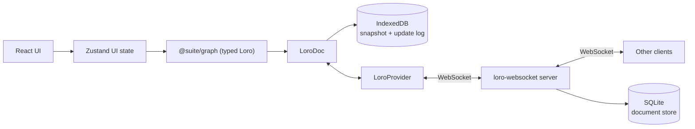

# Architecture

Suite is a local-first collaborative canvas whose data is a typed object graph with semantic links, so
the same content can later be read as a knowledge base.

Objects are workspace-level and views are boards. A card owns its content and exists whether or not it
is displayed, a board shows cards at positions, and the library finds cards that are not on the board in
front of you. Terms are in [glossary.md](glossary.md). The reasons behind the shape are in
the internal decision log, which links each record by number.

## Toolchain

Three rules hold the shape. The app works offline and the network only accelerates sync. Loro owns the
document and the UI observes and mutates it. Every graph write passes a Zod schema in `@suite/graph`.

The monorepo is pnpm workspaces plus Turborepo, one package per bounded surface, so the domain tests
without React and the relay tests without a browser.

| Layer | Package or app | Responsibility |
| --- | --- | --- |
| UI | `apps/canvas` | Canvas surfaces, Tiptap editors, panels, launcher |
| UI state | `apps/canvas` (Zustand) | Selection, tools, panels, connection status |
| Domain | `packages/graph` | Schema, records, typed CRDT access, pure planning and projection |
| Persistence | `LoroIndexeddbPersistence` | Offline snapshot plus update log |
| Sync | `loro-websocket` provider and server | Real-time collaboration, SQLite-backed rooms |
| Control plane | `services/auth` | Accounts, organizations, invitations, seats, licence checks |
| Money | `services/billing` | Stripe webhook that mints a hosted licence |

`apps/canvas` ships three surfaces. `?canvas=ice` runs the pure `@suite/scene` projection on
`@vibecook/ice` with the real `NodeCard` in a screen-space DOM overlay, `?canvas=scene` is the reference
implementation until the parity gate, and `?canvas=flow` is the older single-board surface kept for
development. There is no user-facing React Flow fallback.

`@suite/graph` holds pure modules (`schema.ts`, `links.ts`, `sections.ts`, `views.ts`, `layoutPlan.ts`,
`template.ts`, `projection.ts`, `workspaceFile.ts`), `src/records/` for readonly record shapes, and
`src/loro/`. That last folder is the typed CRDT layer behind one facade, `loro/WorkspaceDocument.ts`,
with a module per domain (`cards/`, `placements.ts`, `sections.ts`, `edges.ts`, `boards.ts`, `tags.ts`,
`cardTypes.ts`, `views.ts`, `drawings.ts`) over shared `keys.ts`, `context.ts`, `snapshot.ts`,
`model.ts`, `undo.ts` and `api.ts`.

The relay is `apps/collab-server/src` in five folders: `http/` for routes, auth, CORS and rate limits;
`store/` for the six SQLite stores; `projection/` for share rooms and the worker; `config/` for env and
limits; `sync/` for the room server, seat gate and socket revocation. `server.ts` is the entry. Code shape
is [conventions.md](conventions.md); commands are [../how-to/test-and-verify.md](../how-to/test-and-verify.md).

## Document model

### Data flow



Zustand holds ephemeral UI state only: active board, selection, drawer state, connection status.

`@suite/graph` exposes `WorkspaceDocument`, a typed wrapper over a `LoroDoc`. Boards, cards, placements,
edges, types and tags are nested `LoroMap`s; card text lives in `content` and `titles` maps shaped by
`loro-prosemirror` in the same doc.

`apps/canvas/src/store/workspaceSnapshotStore.ts` owns the single `WorkspaceDocument.observe`
subscription. Hooks select an identity-stable slice (`useCard(id)`, `useCards()`,
`useWorkspaceSnapshot()`), and text containers are observed separately so a keystroke never invalidates
the graph.

`LoroIndexeddbPersistence` keeps a snapshot plus an append-only update log locally, so the app rehydrates
instantly and works offline. The `loro-websocket` provider syncs peers, and the server flushes each room
through `apps/collab-server/src/store/persistence.ts` so a workspace outlives its last client.

### One document per workspace

One `LoroDoc` per workspace: room and IndexedDB key are the workspace id. Boards are views inside it, so
moving a card between boards is atomic. Card bodies live there for now, and the index plus per-card document
split stays a storage change behind one seam until benchmarks ask for it; the trade-off is in
[design.md](../explanation/design.md).

| Map | Value |
| --- | --- |
| `boards` | `id`, `name`, `createdAt`, `updatedAt` |
| `cards` | one key per field: `createdAt`, `updatedAt`, `deletedAt`, `connectors`, `primaryTypeId`, plus nested `types`, `tags`, `properties` maps |
| `types` | one key per type: `id`, `name`, `pluralName?`, `glyph`, `color?`, `createdAt`, `updatedAt`, `fields` |
| `tags` | one key per tag: `id`, `name`, `color?`, `createdAt` |
| `sections` | one key per field: `id`, `boardId`, `title`, `x`, `y`, `width`, `height`, `z`, `color?`, `createdAt`, `updatedAt` |
| `placements` | key `${boardId}/${cardId}`: `boardId`, `cardId`, `x`, `y`, `z`, `createdAt`, `width?`, `height?` |
| `edges` | one key per field: `boardId`, `source`, `target`, `sourceConnector?`, `targetConnector?`, `kind`, `path`, `bends`, `layer`, `bidirectional`, `label?`, `labelOffset?` |
| `references` | derived per card: `targetCardId -> true`, rebuilt from mention nodes |
| `content`, `titles` | per-card rich text shaped by `loro-prosemirror` |
| `drawings` | one key per whiteboard card: `elements`, `order` (movable list), `version`, `updatedAt` |
| `views` | one key per saved view: `id`, `name`, `position`, plus `query` (`text?`, `scope`, `groupBySection`, `order`, and `types`/`tags`/`sections` facets). No card id is stored |
| `meta` | `schemaVersion`, `name`, `seeded`; schema version 4 adds spatial sections |

### Field maps

`WorkspaceDocument` materialises typed `Card`, `Placement`, `GraphEdge`, `CardType` and `Tag` objects for
reads, and stores each field as its own key. A whole-record `set` would resolve concurrent edits to
different fields last-write-wins: one client moving a connector while another adds one would drop an
edit. Field maps merge per key.

Mutations route through `mutateCard` and `mutateEdge`, `updatePlacementPosition` and
`updatePlacementSize`, `movePlacements` for a gesture, and the connector sub-map (`connectors` is a
`LoroMap` of maps). `setCard` and `setEdge` remain escape hatches for seeding and migration.

Types, tags and properties follow the same rule. Membership is `LoroMap<typeId, true>` plus a
`primaryTypeId`, tags are `LoroMap<tagId, true>`, and properties are one key per field id, so two people
editing different properties both keep their values. A `multiSelect` value is itself
`LoroMap<optionId, true>`; a select stores the option id, so renaming an option is one write. Writers
validate against the field definition owned by one of the card's types.

### Sections and whiteboards

A section is a board-scoped rectangle, title and colour; no card or placement stores a section id. A card
belongs to the smallest section containing its header anchor (`placement.x + 8`, `placement.y + 8`), with
`z` and id as tie-breaks. Nesting comes from containment and membership is recomputed on read, so a drag
never rewrites card state. A section drag writes one `moveSectionsBatch` commit covering the section, its
contained sections and every member placement. A drop whose anchor is inside a section but whose
rectangle hangs outside expands that section and its ancestors.

A whiteboard card keeps its Excalidraw scene under `drawings.<cardId>`: one field map per element, a
movable `order` list, and a per-element `deletedAt` tombstone so a concurrent delete and an undo
converge. `applyDrawing` writes only changed fields in one commit and `setDrawing` is the seed and import
escape hatch. Loro's undo is canonical; the card face is a cached SVG preview.

Values go dormant rather than away. Removing a field from a type, switching a type or removing a tag
hides the stored value, and restoring the definition revives it. Queries filter by existing records, so a
deleted type stops matching. Type deletion is the one bulk command and reassigns affected cards in a
single batch.

### Reads, home and trash

List reads: `listBoardCards(boardId)`, `listBoardEdges(boardId)` (both endpoints placed, alive, still
owning the named connectors), `listInboxCards()`, `listTrashedCards()`, `listCardPlacements(cardId)`,
`homeBoardId(cardId)`, `displayTitle(cardId)` (title, then body's first line, then "Untitled"),
`viewCardFields(card)`, `listCardsOfType` and `listCardsWithTag`.

Home is derived: the oldest placement wins. Placement `createdAt` is strictly increasing per client.
Unplacing the home card promotes the next placement, and with none left the card is in the Inbox.

Trash is a tombstone. `trashCard` sets `deletedAt` and keeps placements, so a restore returns the card to
every board; `purgeCard` and `emptyTrash` destroy the card, its placements, its text and every edge that
referenced it. Edges whose endpoint leaves the board stay in the CRDT and revive when the card returns.
Deleting a connector does delete the links anchored to it.

Layer order is per board and fractional. `moveLayer(boardId, cardId, action)` writes one rank, the
midpoint between its new neighbours (or `last + 1` and `first - 1` at the ends), so peers reordering other
cards keep their moves. When neighbours converge below `MIN_RANK_GAP` that board is renumbered once, in
one transaction. Ties sort by `createdAt` then `cardId`, and Inbox cards never hold a rank.

Two invariants protect the text. Reads never create shared containers: `peekContent` and `peekTitle`
return the existing map or `null`, and a client mounting before load must not initialize a competing
container or the real text is orphaned. Titles are Loro maps as well, because a string would resolve
concurrent renames last-write-wins while `LoroText` merges character-wise and carries carets. Card size
belongs to the placement (`width` and `height` are optional), so one card can be small on one board and
large on another.

### Undo

Text belongs to the editor. `LoroCollaboration` installs a `LoroUndoPlugin` with an `UndoManager` scoped
to that field's commit origin (`text:title`, `text:body`), which is why `StarterKit`'s own history is
disabled.

Structure belongs to the document. `WorkspaceDocument` owns an `UndoManager` that excludes `text:`,
`sys:init` and the import origins, covering moves, connectors, links, layers, place, trash and section
geometry. The canvas handles `Cmd-Z`, `Cmd-Shift-Z` and `Ctrl-Y` outside editors; `canUndo` and
`canRedo` are exposed, and `stopCapturing()` starts a new entry.

Remote updates and hydration carry non-local origins, so undo cannot revert a collaborator's work.
Structural edits commit with a `struct:` origin.

### Migration

The document starts at the current schema, with no production Yjs data to migrate, and `?doc=<id>` stays
an alias for `?workspace=<id>`. Schema changes are additive-first: new fields are optional, and a
migration is explicit and guarded by `meta.schemaVersion`.

## Content and presence

Each card mounts two Tiptap editors (`StarterKit` plus `LoroCollaboration`), one for the title and one for
the body.

One surface per card per client is editable. `editingSurface` (`canvas` or `panel`) decides which mount
accepts keystrokes; the other is read-only and re-reads the container when the owner writes
(`useLocalMirrorSync`, coalesced per frame, dispatched as a non-local update). Only the owning surface
receives the shared `cursorStore`, so the twin cannot clear the owner's caret. Peer carets are
content-anchored, so a caret published from the panel renders inside the collaborator's canvas card.

An empty body gets a `Placeholder` decoration reading `Begin writing, or type / for commands.` The
decoration writes nothing, and a read-only viewer keeps the body blank. Formatting uses Tiptap's built-in
`BubbleMenu` with plain markup buttons, because the library ships no button set.

### Presence coverage

`apps/canvas/src/collab/presence.ts` rides the Loro `EphemeralStore`. Nothing in this table is document
data.

| Signal | Field | State | Notes |
| --- | --- | --- | --- |
| Which board | `board` | shipped | other boards' presence is ignored |
| Identity and colour | `user` | shipped | per session; an account adds a stable name |
| Pointer | `pointer` | shipped | flow coordinates |
| Editing focus | `focus` | shipped for card body and title, planned as a `Target` | property and type-editor rows become addressable |
| Card drag and resize | `dragging`, `resizing` | shipped | `dragging` carries `nodeIds`; `resizing` carries position and size |
| Section drag and resize | `sectionDrag`, `sectionResize` | shipped | |
| Marquee | `selectionBox` | shipped | the box, because the result would be stale |
| Selection | `selection` | shipped | nodes, edges, clicked connector, section |
| Connector move and click | `connector`, `selection.connector` | shipped | perimeter fraction; one publisher for the click |
| Link drag, re-attach, label slide | `connect`, `reconnect`, `labelDrag` | shipped | `connect` carries React Flow's snapped target |
| Library drag | `libraryDrag` | shipped | flow point plus landing board |
| Gesture liveness | `gestureBeat` | shipped | a counter, so a press-and-hold does not age out |
| Purpose and gesture | `purpose`, `gesture` | planned | what tool a peer is holding |
| Chat bubble | `bubble` | planned | text, timestamp, optional anchor `Target`; ephemeral and capped |
| Follow | none | planned | a subscription to a peer's `Target`; stores nothing |
| Keystrokes, clipboard, chat prose | none | refused | a privacy decision |

`peerProjection.ts` stamps each gesture signature with the time it last changed, on the receiving side so
clock skew does not matter, and drops it after `GESTURE_TTL_MS` (3 s) of silence. A one-second sweep
re-projects presence. Selections and carets are state, so they are left alone.

Presence and cursor stores are keyed by a `sessionStorage` tab id, so a refreshed tab overwrites its own
presence instead of appearing as a frozen second peer. Presence is workspace-wide, so board-scoped
surfaces filter by `peer.board`; carets stay card-scoped.

A drag broadcasts at roughly 40 ms intervals with a trailing sample, the peer eases toward it each frame
(`SMOOTHING = 0.22`), and the CRDT records position only on drag stop. Multi-card and section drags
publish an anchor plus ids, and peers derive the members.

## Boards, sections and placement

### From graph to board

The editing canvas is React Flow (`apps/canvas/src/canvas/CanvasBoard.tsx`). Boards are node lists derived
from the graph on every change:

```text
Loro graph (@suite/graph)
  cards · placements · sections · edges · drawings
        │
        ▼
Board view (apps/canvas/src/canvas)
  nodes from placements · edges from connectors · sections · portals · whiteboards
        │
        ▼
React Flow surface (CanvasBoard)
  NodeCard (Tiptap) · SectionLayer · PortalNode · WhiteboardNode · PresenceLayer
```

The board view is never edited, persisted or synced, which keeps one document and one undo stack. Layout
planning is pure: `packages/graph/src/layoutPlan.ts` turns placements into a plan and `applyLayoutPlan`
commits it as one field-granular batch, so an Arrange is one undo step. Record identity is a cache, so a
peer editing card A leaves card B identical, and `useWorkspaceSnapshot` reuses a collection array while
every element is the same object. `?perf=1` shows render rates from `dev/perf.ts` in dev builds.

A portal is a card with a `board` field, a live miniature and a camera transition that swaps
`activeBoardId`. A whiteboard card renders Excalidraw behind a cached SVG face, only in its focus surface.
A collapsed portal shows its impostor until zoom crosses the expansion gate. Presence and drag positions
draw in a `ViewportPortal`.

### Home and new-tab boards

| Setting | Question it answers | Used by |
| --- | --- | --- |
| home board | where do I land | the home control, and closing the last open board |
| new-tab board | where does a blank tab start | the new-tab action, when the workspace sets one |

With no new-tab board, a new tab opens a chooser. Both are board ids, so a portal resolves them like any
other board, and neither is a new record class.

### Boards and sections

Boards and sections get small fixed inspectors (name, colour, cover image, links). They never get types,
fields or templates; composition between them is expressed by links.

Sections paint behind cards. A section renders as a `SectionInstance`: a background layer for fill and
border, plus a header layer above the cards holding the title chip, member count and resize handles, all
counter-scaled with zoom. In the current surface those layers are `ViewportPortal`s, so a section never
becomes a selectable node with card layer or trash semantics. Deleting a section removes the region;
deleting its board removes its sections.

### Placement modes and runs

The mode slot (`place`, `thread`, `web`, `pattern`) acts as a link tool on connectors and as a placement
tool during a run. A run places an ordered queue one at a time, with positions from the pure planner in
`apps/canvas/src/canvas/placeRun.ts` and, in thread, web or pattern, a link to the predecessor. A step is
one `batch()`, section wrapping is opt-in, and a run ends on Escape, when the queue empties, or when the
active board changes.

### Library

The dock is a floating pill at the bottom centre: `Library` with the Inbox count, a separator, and the
card-type registry. A type click creates that card at the viewport centre and focuses its title.

The drawer sits above the dock with tabs `Inbox | Cards | Sketches | Boards | Types | Trash`, counts and
empty states, in that order; type facets appear on Inbox and Cards only. Rows show `displayTitle`, board
chips and one `⋯` menu. An expanded state takes the window with the same header, facets and rows.

The Cards tab offers `All | <board>`. Board scope filters rows to that board's placements, adds a
Sections facet and offers group by section. Sections are never a global facet, because a section title
only means something inside one board. Scope, facet and grouping are UI state.

A press that never becomes a hold-to-place drag opens the card in the canvas inspector; a row never
expands into its own editor. Place centres the card, staggered so repeats do not stack. Hold to place
lifts the row into a ghost that follows the cursor and places on drop. Rows select with click,
`⌘`/`Ctrl`-add and `Shift`-range, and a selection's actions are the row menu plus the run verbs.

Trash offers Restore, Delete forever and Empty trash. Deleting a board asks first and offers keeping the
cards, which fall into the Inbox, or trashing them.

## Links and routing

### Connectors

Every card carries its connectors on the record (`connectors: { id, x, y }[]`, 0..1 fractions of its
size), and new cards start with the four side midpoints. Edges connect connectors: `source` and `target`
name nodes, `sourceConnector` and `targetConnector` name handles. Dots are React Flow handles in
`ConnectionMode.Loose`, so any dot drags to any other.

A click selects a connector and shows a dashed grab handle, published so peers see it in their colour.
Dragging the grab handle repositions it; positions are free along the perimeter, and a release within
about 20 px magnetizes to the nearest corner or midpoint. Dragging the dot itself creates connections.
Right-click offers Reposition Connector and Delete connector; the card menu has Add connector and a
Position submenu (Bring Forward, Bring to Front, Send Back, Send to Back).

A drag publishes the live perimeter fraction at about 25 Hz with a trailing sample. Peers ease toward it
and re-measure the handle, so their links follow the dot mid-drag, and only the final position is written.

Layering is a `z` integer per placement rendered as `zIndex`. React Flow elevates a selected node by 1000
in `basic` mode, so a layer action clears the selection or the elevation would hide the new order.

### Routes and styles

A link is one `GraphEdge` whose ends carry an optional kind (`card`, `board`, `section`). An absent kind
means a card, so older documents stay valid. `packages/graph/src/links.ts` owns the rules
(`edgeEndpoints`, `linkKey`, `isSelfLink`), and `addEdge` refuses missing endpoints, same-kind self-links
and duplicate connections.

A board end has no position, so it is drawn through the first portal pointing at that board: no portal
means no line, while the link survives in the inspector. A section end resolves to its rect and attaches
to the connectors every section is seeded with.

`edges.<id>.bends` is a polyline in flow coordinates relative to the source anchor, and `edges.<id>.layer`
defaults to beneath the cards. `linkGeometry.ts` and `edgeRoute.ts` turn endpoints into rects and anchors
without React, so canvas, previews and tests share one answer. `edges.<id>.path` is Curved, Straight, Step
or Smooth step, and `bidirectional` drives the arrowheads. The menu offers Reverse direction (swapping
endpoints and their connectors), Make bidirectional, Make one-way, Path and Delete link.

Links paint above cards (`.react-flow__edges` at z-index 4, `.react-flow__nodes` at 3). While a connector
moves, `NodeConnectors` writes the position locally and calls `updateNodeInternals` once per frame, so an
edge re-routes before the drop.

The description sits on the line. `labelOffset` places it as a path fraction (absent means the midpoint),
and the chip's canvas-coloured halo opens the gap in the stroke. Dragging the chip projects the pointer
onto the path (`nearestFractionOnPath` in `EdgeDescription.tsx`), publishes `labelDrag` presence, and
writes on release. The label layer sits at z-index 5 so the chip stays hit-testable.

Peers see the gesture. `onReconnectStart` publishes `reconnect`, `onConnectStart` publishes `connect`
(node, connector, anchor end, pointer, and React Flow's snapped target), and `PeerReconnectLayer` draws
both with one dashed preview from the same path helper while the shared edge is hidden. Snapping is
forwarded: the mover reads React Flow's own `connection.toNode` and `toHandle`. Arrowheads follow the
finished link.

Connector dots appear on selection, on hover, in a chaining mode (`useChainingMode()` is
`linkMode !== "connect"`, and both chaining modes need every dot), and during a drag. Sections use the
same predicate through their own empty area, so hovering a card never wires the section behind it.
Handles stay mounted while hidden, because React Flow only starts a connection from a measured handle.
With a connector selected, `.connector-active` disables edge pointer events and reconnect handles so the
10 px handle cannot swallow the reposition drag.

## Types, fields and views

Types add schema and never behaviour. The primary type may change presentation (glyph, colour, template),
and no code branches on a combination of types. `viewCardFields` lists the fields of a card's types,
primary first.

Field kinds compose: `rating`, `group` and `list` nest one level, with one registry entry per kind
rendering in all four places.

A type may name a template card (`CardType.templateCardId`), and `createCard` copies it in one batch:
title, body, properties, tags and connectors. A plain title may carry `{{Field Name}}` tokens expanded
once at creation; rich titles copy verbatim so mentions stay live.

Values render through a display template. `fieldDefinition.display` (`packages/graph/src/template.ts`)
describes the whole rendering, with `{{value}}`, `{{label}}`, `{{card}}`, `{{type}}` and literal text, so
nothing is added behind the reader's back. Absent means the surface default: a block says
`{{label}} · {{value}}` and a chip says `@{{card}} · {{value}}`. `ValueTemplate` is the one place a
template becomes pixels, so a chip, a body block and a rollup cannot disagree. An empty value renders an
em dash inside the template rather than collapsing it, and a mention or block may carry its own `display`
attribute.

The body can carry views of index data. `/` opens an insert menu over existing nodes plus Mention and
Property, both handing over to the one `@` picker: this card's fields first (they insert a block), then
cards (they insert a mention), then a `@card.field` reference once the query names one. A `propertyBlock`
is an inline atom holding only a `fieldId`; it renders `card.properties[fieldId]` and writes through
`setProperty` and `clearProperty`, so deleting the block deletes a view. Scalar kinds edit in place
through a node view with `contenteditable={false}` and `stopEvent`; `card` and `multiSelect` values are
read-only chips that open the panel. A `@card.field` chip stores `cardId` and `fieldId`, renders the live
value, and opens that card's panel with the field focused. Field definitions are never created from the
editor, which keeps the two undo scopes honest.

### References and backlinks

Two halves of linking stay separate. A reference is workspace truth: an `@` mention (an inline atom named
`mention` with a `cardId` attribute) or a `card`-valued property, existing with no board involved and
placing nothing. An arrow is a drawing: board-scoped, untyped, with a free-text description, creating no
reference.

The reference index is derived. When a card's title or body changes it is queued, and a microtask re-parses
its Loro tree for `mention` nodes and writes `references.<fromCardId>` in one commit with origin
`struct:index-refs`. The subscriber skips that origin, writes only on a real change, and the workspace
`UndoManager` excludes it, so the index never forms an undo step. `ensureReferences()` repairs drift after
the first sync and `rebuildReferences()` reconstructs everything; the index is never authoritative.

Links are read at render time from mentions, from `card` properties, and from edges touching the card.
`cardLinks` folds them into Incoming and Outgoing rows keyed by the other card, one row per pair, with
provenance markers (`✎` mention, `▤` property, `↗` arrow, `↔` both) and an expander when a pair is joined
more than once. Placement stays in Where, and `referenceCount` counts distinct partners. A `card` value may
dangle and shows "Unavailable card" rather than being rewritten, and snippets come from `mentionContext`,
which walks the source tree on demand and is never indexed.

### The palette and the lens

The command palette (`⌘K`, `apps/canvas/src/command/CommandPalette.tsx`) is the navigation home: boards,
saved views, the active board's sections, cards and actions, ranked by one matcher (`paletteRank.ts` over
`fuzzysort`). Providers in `paletteProviders.ts` are pure functions of a small input, so adding a source
is a function. `⌘⇧K` keeps the library search.

The lens is what a saved view does to the canvas: `runViewQuery` selects the cards and the board dims
everything else. Sections dim when none of their cards is on the lens, and edges dim when either endpoint
is. A lens is UI state (`activeViewId`) and never a document write.

A view is a lens, a database or a render over the one `ViewQuery`; the kind changes presentation and not
the result set. `Views ▸` sits beside the board tabs, and a view is exactly what the drawer's controls
express, so opening one fills its search, facets, scope and grouping while the drawer shows its name with
an exit. `canManageSchema` gates saving, renaming and deleting, because a view is workspace configuration:
a share editor may open one and never sees those actions.

## Styling and theming

`light`, `dark` and `system` live in `localStorage` and are applied as `.dark` on `<html>` before first
paint. Colours are CSS variables (`--surface`, `--ink`, `--hairline`, `--canvas-bg`, `--rf-dot`), and
React Flow chrome is themed through the same variables.

Those variables are the role tokens of the paint system. The viewing theme is UI state; anything a style
rule assigns lives on the document, so collaborators see the same painting. A stored style names a role
and never a colour value, which lets one rule repaint every surface. Semantic hues are fixed by the build
and not user-editable: a reader who retuned `fan` would make a peer's cursor lie.

`SurfaceStyle` is an optional `style` on a card, section, board, edge or field definition: `surface`,
`ink`, `shape`, `radius`, `sides` (per edge, each an `EdgeStyle` of `paint`, `width`, `colour`, `flow`,
`speed`), `opacity` with a floor, `textScale` and `icon`. None of these is a new root map.

Style is a ladder you can write: the surface's own style, then a `type`, `kind` or `global` rule, then the
reader's preferences, then the tokens. The inspector's Style tab edits whichever rung the scope picker
names, and `Styles…` edits a rule with the same controls, so there is one editor. The shell derives its
paint from the same tokens, flowing one way: card override, type default, workspace default, interface
tokens.

## Inspector and interaction

One inspector serves cards, boards, sections, links and fields. The card surface splits into Details (type,
tags, properties, links, Where) and Content (the body). An empty body opens on Content and everything else
on Details; Edit, a body click and a `@card.field` reveal move to the tab the request belongs to. The body
gets its own background, border and padding, so it reads as a destination.

One target primitive underlies presence, Follow, Goto and the handbook. Read-only surfaces answer "where is
this", all derived and all free of document writes.

- Focus primitive: a surface asks the UI store (`focusCard`, `focusSection`) and the canvas consumes
  `focusTarget`, with a nonce so repeats re-run. A card target polls React Flow's node lookup while a board
  switch rebuilds nodes, then moves the viewport with a capped zoom; a section target fits the stored
  rectangle.
- Board outline: a collapsible left rail lists the active board's sections in reading order (`y`, then `x`,
  then id), nested by containment, with counts from `sectionMembership` and peer dots from presence.
- Where block: the card panel shows `Board › Section › Subsection` through `sectionForCard` and
  `sectionLineage`, plus the other boards the card is placed on.

One modifier vocabulary. Shift, Ctrl and Cmd toggle membership, Shift-drag draws a partial marquee, and
`Cmd/Ctrl+A` selects the board. Dragging a selected card moves the whole set: the canvas keeps the dragged
ids in a local set so the projection does not snap members back, and on release one `movePlacements` writes
all geometry, followed by `sectionsExpandPlan` and `moveSectionsBatch` for a section that must grow. Undo is
one step, and a purpose picker explains what each modifier does in the current mode.

Card chrome is drawn inside the card, because React Flow's `NodeToolbar` counter-scales with zoom and shows
only for the sole selected node. The header holds the type glyph, collaborative title, presence avatars and
a `⋯` menu (Edit title or body, Remove from board, Go to board, Delete card). The title editor is
paragraph-only on the `titles` fragment: Enter commits, an empty title shows a muted "Untitled", and remote
carets render inside. A click without movement opens card info, a double click enters that field's editor,
and past the drag threshold it still drags. The footer collapses to `References · N` and expands into a
keyed section list whose first section is References: every placement, home marked `⌂`, the current board
labelled, plus Go and Remove. Both regions are `nodrag nopan` and part of the measured node.

## Handbook, tutorials and tours

A handbook article is a card, so in-app documentation shares the content model of the user's notes:
searchable, linkable, shareable, and edited with the same editor.

A tutorial is a card and a tour is its timeline. The tutorial body holds step blocks whose attributes
name `targets` and a stored viewport; the card's inspector authors and presents them, and the overlay is
the reader's view. One tour document appears on three surfaces: the tutorial inspector
(Details, Steps, Style), the overlay with no inspector, and the handbook panel, which only starts a tour
whose steps include the article's subject.

| Thing | Where | Why |
| --- | --- | --- |
| steps, captions, `targets` | the tutorial card's body (CRDT) | content: merges, exports, shares, is linkable |
| current step, panel open, presenting | `useUiStore`, like `containerInspector` | per-viewer state |
| completion | a workspace record on the tutorial card | a collaborator can see it was read |
| the camera a step asks for | `viewportRequest` in `useUiStore` | the camera channel that already exists |

The overlay measures the DOM (`data-node-id`, `data-testid="section-region-<id>"`), so a tour needs no
change to `CanvasBoard.tsx`.

## Sync, sharing and durability

### Launcher and files

The app starts at `/` on a workspace launcher: recent workspaces from `localStorage` (never document
truth), a blank workspace (`?fresh=1`), and `.suite` import.

A workspace name lives in `meta.name`, so it syncs and travels in an export. `workspaceName()` falls back
to the first board's name and then "Untitled workspace", and `renameWorkspace` refuses empty, overlong or
control-character names. Inline rename writes to the cached document, or to a `suite.workspaceNames.v1`
mirror when the workspace is only a recent entry, and each mount re-reads every cached replica.

A `.suite` backup is a versioned JSON envelope around `doc.export({ mode: "snapshot" })`. Import validates
it, refuses a newer file by name, writes the snapshot under a new workspace id and navigates, and never
merges into the open document. JSON and Markdown exports are read-only projections, and only the backup
imports.

### Owner key and recovery

A workspace has a 32-byte base64url owner key, generated in the browser, kept in local storage and the URL
fragment (`#owner=<key>`), and stored on the server only as a SHA-256 hash (`SUITE_WORKSPACES_DB`).
`POST /api/workspaces/:id/claim` registers the first key and reports a conflict for a different one. An
offline open keeps working locally and the next online open claims; empty auth never writes a workspace
room.

Recovery is a separate `.suitekey` file (`kind: "suite.owner"`, `version: 1`, `workspaceId`, `ownerKey`,
`exportedAt`) saved from File then Recovery key, never embedded in a `.suite` backup because that file gets
copied and shared. The protected screen accepts the file or its pasted contents, refuses another
workspace's key, and reloads with `#owner=`. The owner link is the second recovery path, since copying it
copies the capability. `POST /api/workspaces/:id/rotate` replaces the hash atomically, retiring old owner
links and `.suitekey` files, and offers to revoke every share link. The launcher's Open recovery key
validates a `.suitekey`, writes the key for the workspace it names and opens it without creating one.

The account layer is built and not wired. `services/auth` holds identity, organizations, invitations,
seats and licence checks, with its HTTP entry, memory and Postgres repositories and capability mapping
tested. No process mounts that entry and no running relay opens a Postgres pool: a socket join carries an
owner key or a share token, so `apps/collab-server/src/sync/seatGate.ts` refuses an account principal with
`account-check-unavailable` instead of guessing a seat count. Anonymous workspaces are what ships, and
[security-model.md](security-model.md) covers what accounts add.

### Session start

A client holds two copies, local IndexedDB and the server's, and order matters because acting on an empty
document is indistinguishable from acting on a deleted workspace. Document, presence stores and provider
are created eagerly, because cursor plugins need a stable `CursorEphemeralStore` on first render.

`ready` flips when the local snapshot and update log are imported, and migration runs then and again on
`synced`. `synced` flips when the room join completes, or after `SYNC_WAIT_MS` (5 s) offline;
`waitForReachingServerVersion` is unused because it never resolves for a new empty room. Seeding and board
resolution wait for both, or seeding would resurrect starter cards in a workspace someone emptied.

The first editable frame waits for local hydration only, and the shell shows a themed loading page with no
canvas, ICE, Excalidraw or editor until then. Boot marks in `apps/canvas/src/dev/bootTiming.ts`, shown with
`?perf=1`, are `hydrate`, `to-ready`, `to-synced` and `to-canvas`.

### Connection lifecycle

`useCanvasStore` constructs the `LoroDoc`, `WorkspaceDocument`, presence stores and provider once and
starts `LoroIndexeddbPersistence` immediately. `App` calls `connect()` through `LoroProvider`, and `status`
is `connecting`, `connected` or `disconnected` while the UI stays usable. The workspace id comes from
`?workspace=<id>` (`?doc=` is a legacy alias, default `default-workspace`) and is both the IndexedDB key
and the sync room. The active board rides in `?board=<id>`.

### Share projections

A board or card share opens `share-<token>`, a room holding a self-contained projection.
`apps/collab-server/src/projection/worker.ts` joins every active share with the internal token, holds one
`LoroDoc` per room, and rebuilds a workspace's shares after each save. A rebuild calls `projectWorkspace`
then `applyProjection`, which clears and rewrites every projection root in one commit, and the room keeps
one peer for its lifetime so each rebuild wins the LWW race against the previous one. A share whose card is
missing or trashed keeps its previous projection. A share row stores a `room_id` and only the token hash, so
the worker names a room without seeing the token, and resolving a board or card token reports that room as
its `workspaceId`, which means the link cannot be exchanged for a workspace link.

A projection carries whiteboard `drawings` for the cards in scope, a portal to a board outside it reads as
Unavailable board, and redaction runs before the projection is built. A reference row is emitted once per
card crossing the boundary, from a single walk over mention targets, `card` properties and edge endpoints,
because per-card helpers made a large rebuild quadratic; figures are in
[../how-to/operate.md](../how-to/operate.md).

A selection share filters that projection to card ids fixed at creation, keeps the real board id, name and
geometry, copies every section containing a selected anchor plus its ancestors, and copies an edge only
when both endpoints are selected. `ShareDialog` caps it at `SUITE_MAX_SELECTION_CARDS`.

A card body publishes block by block, each top-level block carrying its own conflict key,
`card:<cardId>:body:<blockKey>`, so two editors touching different paragraphs both publish. Identity
prefers the block's Loro container id; between two projections, which share no ids, the fallback is a
structural key of node name, subtree hash and occurrence. Apply rewrites only changed blocks in one
`share:publish` commit, and when blocks cannot be lined up the card degrades to one whole-body conflict,
which still accepts the legacy `card:<cardId>:body` key.

A board or card editor starts from a projection of its scope and publishes the diff back. A board draft can
create cards, sections and edges on its board, while a card draft edits only its card; boards, types, tags,
trash and links are not creatable from a draft. Publish preserves the client UUID, rejects an id that
already exists, and requires a new card to be placed on the shared board, all or nothing: a rejected object
keeps the draft and is listed in the "Can't publish yet" dialog.

### Room authorization

Every sync join carries an `auth` payload that `authorize(roomId, auth, deps)` maps to a permission:

1. the projection worker token writes only `share-` projection rooms;
2. the source worker token writes only a workspace room that currently has an active editor share;
3. a share token opens exactly its share room, `read` for a viewer and `write` for an editor, plus the
   derived `<room>:presence` and `<room>:cursors` rooms, which are ephemeral and scoped to that share;
4. an owner key verifies its workspace and its derived presence and cursor rooms; a join never claims an
   unclaimed workspace, because the explicit HTTP claim does that, and a different key is refused;
5. an empty or mismatched credential is rejected. The workspace id is not a secret, and an owner key can
   never claim a `share-` room.

Live revocation closes sessions that already hold a link. `loro-websocket@0.6.2` keeps its socket and room
maps private, so `patches/loro-websocket@0.6.2.patch` records each room's credential and adds
`disconnectRoomWhere` and `disconnectAuth`, covering the derived presence and cursor keys.
`apps/collab-server/src/sync/roomSockets.ts` wraps it: revoking a board or card link closes every session
in `share-<token>` except the projection worker, revoking a workspace link closes only credentials that no
longer resolve, and rotating the owner key closes sessions holding the previous key.

### Standalone and relay

`apps/canvas/src/session/mode.ts` owns the profile. `suiteMode()` reads `VITE_SUITE_MODE` (default
`relay`), and `bootPlan(mode, url)` returns `resolveShare`, `claimOwner`, `connectProvider` and
`showSharing`, all true under relay and all false under standalone whatever the URL says.

`sessionCapabilities` returns `STANDALONE_CAPABILITIES` before it looks at a share: local editing, layout,
creation, boards, schema and trash, with `canManageLinks` and `canPublish` false. `main.tsx` boots
standalone with no `ownerKey` and no `share`, and imports the share client and owner-key claim only inside
the relay branch, so a standalone bundle contains no `/api` path or socket URL. `App` skips `connect()` and
presence binding, marks `synced` itself and shows a "Local only" note, and `WorkspaceActions` keeps the File
menu and drops Share and the recovery key. `session/mode.test.ts` guards this: a direct `fetch`,
`WebSocket` or `collabHttpBase()` call may only live in a listed relay module.

### Opening a share link

`main.tsx` resolves `?share=<token>` before importing `App`, then `configureSession` records the room,
role and read-only flag that `useCanvasStore` reads at module load. `?workspace=` stays the synchronous
default, so stories and unit tests boot unchanged.

A board and card viewer targets `share-<token>` only, so `workspaceId`, the IndexedDB key and the provider
room are that projection room and the viewer never learns the owner's workspace id. A workspace viewer
targets the real room, learns the id and not the owner key, and joins presence and cursor rooms with the
share token.

`useUiStore.readOnly` closes every write surface: canvas drag, connect and delete, context menus, section
gestures, the card menu and inline editors, panel type, tag and property edits, and the dock, library and
share actions. Board tabs remain without create, rename or delete. A revoked or unknown token renders
`ShareUnavailable` instead of the shell.

### Attachments

Images are nodes that name bytes stored beside the document. An `attachment` inline atom holds `{ id,
mime, width, height, name, bytes }`, the same allowlist lives in `publishValidation.ts`, and
`editorSchemaContract.test.ts` keeps schema and allowlist aligned. A projection copies the document, so
bytes in a node would put a private copy of every image in every share link.

`apps/collab-server/src/store/attachments.ts` owns the bytes: `put`, `get`, `delete` and `usage` over one
table (`id`, `workspace_id`, `mime`, `bytes`, `size`, `created_at`) in `SUITE_ATTACHMENTS_DB`. The interface
is the seam for object storage, and the signed-read S3 backend is described there and not implemented.

`apps/collab-server/src/http/attachmentHttp.ts` serves `/api/attachments`. `POST
/api/attachments/<workspaceId>` takes the owner key and never a share token. `GET /api/attachments/<id>`
treats the id as the read capability, so a projected node resolves without exposing the workspace.
`DELETE /api/attachments/<id>` takes the owning workspace's owner key. A GET serves only allowlisted types
with `nosniff`, `content-disposition: inline`, immutable caching and `content-security-policy: default-src
'none'; sandbox`, and SVG and HTML are refused at upload and at read because markup can carry script.

`attachmentBytesPerWorkspace` is enforced inside `put`, in the transaction that inserts the row, and a
hosted licence's `attachmentBytes` caps one image on top. A paste uploads under the node id when a relay is
configured; offline, standalone or from a share session the bytes go to this browser's IndexedDB and the
node is local-only. The record carries `local`, `synced` or `unknown`, where `unknown` must never be read as
`local`; `attachmentUploadState(id)` is the accessor and a `local` node draws one muted line under the
image. Unreachable bytes render a placeholder with the name, and rendering never throws.

`gcAttachments(workspaceId, referencedIds)` deletes every row the document no longer references, and no
admin route calls it yet. `workspaceFile.ts` version 2 adds an `attachments` section of `{ mime, name,
width, height, data }` per id, base64 of the exact bytes, beside the document; import restores each image
locally and does not upload it. `attachmentBytes.ts` reads IndexedDB first and then
`GET /api/attachments/<id>`, lists any image found nowhere by card title, and above 25 MB
(`BACKUP_SIZE_WARNING_BYTES`) states the real size before writing the file.

## Licensing, limits and operations

`apps/collab-server/src/licence.ts` signs and verifies an Ed25519 token carrying `v`, `id`, `tier`,
`workspaces`, `documentBytes`, `attachmentBytes`, `issuedAt`, `expiresAt` and `email`. The relay verifies it
offline and keeps its own small claim store, so a deployment can run with no database connection. A lapsed
licence loses sync and never local data, and no feature is gated.

With `SUITE_HOSTED=1` licences are enforced, the hosted quota defaults apply and `SUITE_LICENCE_PUBLIC_KEY`
is required at boot. Self-hosting is the default: no licence, storage quotas unlimited unless the operator
sets them, and the two interaction caps still apply.

Every quota, its variable, its default and the code that enforces it is generated into [limits.md](limits.md)
by `node scripts/generate-limits.mjs`, which fails `--check` when the page is stale. Every other variable is
in [environment.md](environment.md), and sizing a deployment is
[../how-to/operate.md](../how-to/operate.md).

`/api/admin/*`, `/metrics` and the `/admin` panel sit behind `SUITE_ADMIN_TOKEN`
(`apps/collab-server/src/ops/admin.ts`), and destructive owner and workspace actions are
`pnpm --filter @suite/collab-server admin …`. Runbooks are [../how-to/operate.md](../how-to/operate.md) and
[../how-to/deploy.md](../how-to/deploy.md).

The control plane is one Postgres database holding identity, membership, entitlement and money: Better
Auth's tables (`user`, `session`, `account`, `verification`, `organization`, `member`, `invitation`,
`passkey`, `twoFactor`), ours (`workspaces`, `organization_licences`, `billing_event`,
`billing_customer`), and the audit trail. Document bytes never enter it, because a `.loro` snapshot, an
attachment and a projection belong to the document store, and content there would make every backup a copy
of every customer's work.

The relay sits outside that database, since signed licences verify offline against a local claim store:
sign-in needs the control plane and editing does not. The layer exists and is tested in `services/auth` and
`services/billing`, and no running relay uses it yet, which [security-model.md](security-model.md) and
[billing.md](billing.md) spell out.

## Scope and sequencing

Alpha's core is a closed feature set. The decided surfaces are listed in ADR-0041 and their gate status is
in the internal roadmap.

Everything above a planned marker describes code that exists; a planned item names the decision that
fixed its shape, so design does not drift while the code catches up. Surface area arrives by amending the
closed list.

The Alpha gate asked for one thing: open a workspace, build a board of cards, link and reorganise them,
write in them, collaborate live, share a read-only view, and come back tomorrow, offline included. Beta is
the same product with the account layer wired, the ICE surface at parity and the handbook in place. Those
gates live on the roadmap.
